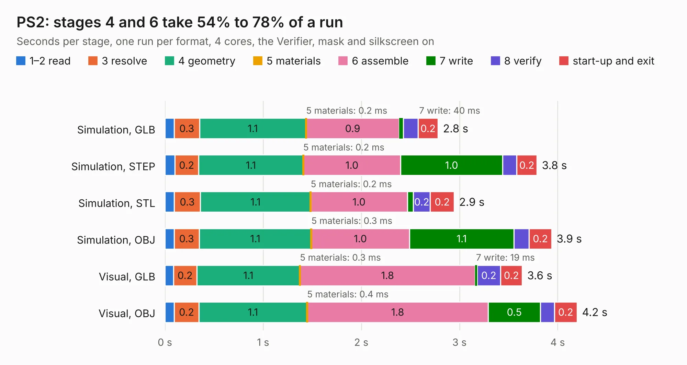

# 977. PS2

Board 977 of the 3,131 of [Corpus Testing](../Corpus-Testing.md), on [Corpus Page 10](../CorpusTestingPages/Corpus-Testing-10.md#977-ps2).

| Mode and format | 1–2 read | 3 resolve | 4 geometry | 5 materials | 6 assemble | 7 write | 8 verify | start-up and exit | Total |
|---|---:|---:|---:|---:|---:|---:|---:|---:|---:|
| Simulation, GLB | 94&nbsp;ms | 0.3 | 1.1 | 0.2&nbsp;ms | 0.9 | 40&nbsp;ms | 0.2 | 0.2 | 2.8 |
| Simulation, STEP | 0.1 | 0.2 | 1.1 | 0.2&nbsp;ms | 1.0 | 1.0 | 0.1 | 0.2 | 3.8 |
| Simulation, STL | 95&nbsp;ms | 0.3 | 1.1 | 0.2&nbsp;ms | 1.0 | 61&nbsp;ms | 0.2 | 0.2 | 2.9 |
| Simulation, OBJ | 93&nbsp;ms | 0.3 | 1.1 | 0.3&nbsp;ms | 1.0 | 1.1 | 0.2 | 0.2 | 3.9 |
| Visual, GLB | 86&nbsp;ms | 0.2 | 1.1 | 0.3&nbsp;ms | 1.8 | 19&nbsp;ms | 0.2 | 0.2 | 3.6 |
| Visual, OBJ | 96&nbsp;ms | 0.2 | 1.1 | 0.4&nbsp;ms | 1.8 | 0.5 | 0.1 | 0.2 | 4.2 |

<table align="center"><tr><td valign="top">

| Board | Repo: [flypie/Ace-2019](https://github.com/flypie/Ace-2019) Board: `PS2.kicad_pcb` |
|---|---|
| Folder | KiCad / PS2 |
| Complexity | 112&nbsp;/&nbsp;1000 (size&nbsp;112, features&nbsp;0) |
| Tested | 9th November 2026 |
| Copper&nbsp;layers | 2 |
| File&nbsp;format | KiCad 6 (20211014) |
| Parts,&nbsp;tracks,&nbsp;vias | 5, 104, 0 |
| Triangles,&nbsp;simulation | 239,970 in 27 parts |
| Verifier | PASS in all six runs |

</td><td valign="top">

<table>
<tr><th>File type</th><th>File size</th><th>Peak memory used</th></tr>
<tr><th colspan="3" align="left">Simulation</th></tr>
<tr><td>GLB</td><td align="right">8.3&nbsp;MB</td><td align="right">230&nbsp;MB</td></tr>
<tr><td>STEP</td><td align="right">37&nbsp;MB</td><td align="right">235&nbsp;MB</td></tr>
<tr><td>STL</td><td align="right">12&nbsp;MB</td><td align="right">220&nbsp;MB</td></tr>
<tr><td>OBJ</td><td align="right">24&nbsp;MB</td><td align="right">223&nbsp;MB</td></tr>
<tr><th colspan="3" align="left">Visual</th></tr>
<tr><td>GLB</td><td align="right">3.9&nbsp;MB</td><td align="right">177&nbsp;MB</td></tr>
<tr><td>OBJ</td><td align="right">11&nbsp;MB</td><td align="right">174&nbsp;MB</td></tr>
</table>

</td></tr></table>

| Previous | Next |
|:---|---:|
| [976. MultiUniBoard](b0976b_Ace-2019_MultiUniBoard.md) | [978. PS2TestCard](b0978b_Ace-2019_PS2TestCard.md) |
