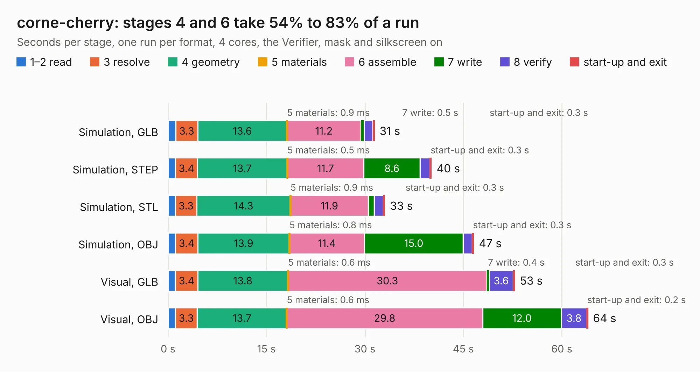

# 978. corne-cherry

Board 978 of the 3,106 of [Corpus Testing](../Corpus-Testing.md), on [Corpus Page 10](../CorpusTestingPages/Corpus-Testing-10.md#978-corne-cherry).

| Mode and format | 1–2 read | 3 resolve | 4 geometry | 5 materials | 6 assemble | 7 write | 8 verify | start-up and exit | Total |
|---|---:|---:|---:|---:|---:|---:|---:|---:|---:|
| Simulation, GLB | 1.2 | 3.3 | 13.6 | 0.9&nbsp;ms | 11.2 | 0.5 | 1.3 | 0.3 | 31.5 |
| Simulation, STEP | 1.1 | 3.4 | 13.7 | 0.5&nbsp;ms | 11.7 | 8.6 | 1.5 | 0.3 | 40.2 |
| Simulation, STL | 1.1 | 3.3 | 14.3 | 0.9&nbsp;ms | 11.9 | 0.9 | 1.4 | 0.3 | 33.1 |
| Simulation, OBJ | 1.1 | 3.4 | 13.9 | 0.8&nbsp;ms | 11.4 | 15.0 | 1.4 | 0.3 | 46.6 |
| Visual, GLB | 1.1 | 3.4 | 13.8 | 0.6&nbsp;ms | 30.3 | 0.4 | 3.6 | 0.3 | 52.9 |
| Visual, OBJ | 1.1 | 3.3 | 13.7 | 0.6&nbsp;ms | 29.8 | 12.0 | 3.8 | 0.2 | 64.0 |

<table align="center"><tr><td valign="top">

| Board | Repo: [foostan/crkbd](https://github.com/foostan/crkbd) Board: `corne-cherry.kicad_pcb` |
|---|---|
| Folder | pcbs / corne-cherry / hotswap |
| Complexity | 377&nbsp;/&nbsp;1000 (size&nbsp;257, features&nbsp;120) |
| KESE&nbsp;features | through vias, slotted holes, custom pads, rounded, trapezoid or chamfered pads, filled zones, copper drawings, curved board outline, stack-up, dielectric εr and tanδ |
| Tested | 9th November 2026 |
| Copper&nbsp;layers | 2 |
| File&nbsp;format | KiCad 7 (20221018) |
| Parts,&nbsp;tracks,&nbsp;vias | 178, 3,027, 452 |
| Triangles,&nbsp;simulation | 2,936,448 in 170 parts |
| Verifier | PASS in all six runs |

</td><td valign="top">

<table>
<tr><th>File type</th><th>File size</th><th>Peak memory used</th></tr>
<tr><th colspan="3" align="left">Simulation</th></tr>
<tr><td>GLB</td><td align="right">103&nbsp;MB</td><td align="right">1.2&nbsp;GB</td></tr>
<tr><td>STEP</td><td align="right">563&nbsp;MB</td><td align="right">1.4&nbsp;GB</td></tr>
<tr><td>STL</td><td align="right">147&nbsp;MB</td><td align="right">1.2&nbsp;GB</td></tr>
<tr><td>OBJ</td><td align="right">317&nbsp;MB</td><td align="right">2.0&nbsp;GB</td></tr>
<tr><th colspan="3" align="left">Visual</th></tr>
<tr><td>GLB</td><td align="right">81&nbsp;MB</td><td align="right">1.5&nbsp;GB</td></tr>
<tr><td>OBJ</td><td align="right">254&nbsp;MB</td><td align="right">1.7&nbsp;GB</td></tr>
</table>

</td></tr></table>

| Previous | Next |
|:---|---:|
| [977. NewBrain StoreBoard](b0977b_NewBrain_NewBrain-StoreBoard.md) | [979. corne-chocolate](b0979b_crkbd_corne-chocolate.md) |
