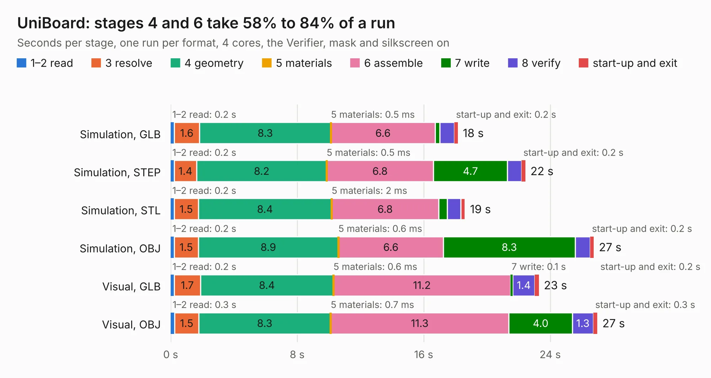

# 979. UniBoard

Board 979 of the 3,129 of [Corpus Testing](../Corpus-Testing.md), on [Corpus Page 10](../CorpusTestingPages/Corpus-Testing-10.md#979-uniboard).

| Mode and format | 1–2 read | 3 resolve | 4 geometry | 5 materials | 6 assemble | 7 write | 8 verify | start-up and exit | Total |
|---|---:|---:|---:|---:|---:|---:|---:|---:|---:|
| Simulation, GLB | 0.2 | 1.6 | 8.3 | 0.5&nbsp;ms | 6.6 | 0.3 | 0.9 | 0.2 | 18.2 |
| Simulation, STEP | 0.2 | 1.4 | 8.2 | 0.5&nbsp;ms | 6.8 | 4.7 | 0.9 | 0.2 | 22.4 |
| Simulation, STL | 0.2 | 1.5 | 8.4 | 2&nbsp;ms | 6.8 | 0.5 | 0.8 | 0.3 | 18.6 |
| Simulation, OBJ | 0.2 | 1.5 | 8.9 | 0.6&nbsp;ms | 6.6 | 8.3 | 1.0 | 0.2 | 26.8 |
| Visual, GLB | 0.2 | 1.7 | 8.4 | 0.6&nbsp;ms | 11.2 | 0.1 | 1.4 | 0.2 | 23.3 |
| Visual, OBJ | 0.3 | 1.5 | 8.3 | 0.7&nbsp;ms | 11.3 | 4.0 | 1.3 | 0.3 | 27.0 |

<table align="center"><tr><td valign="top">

| Board | Repo: [flypie/Ace-2019](https://github.com/flypie/Ace-2019) Board: `UniBoard.kicad_pcb` |
|---|---|
| Folder | KiCad / UniBoard |
| Complexity | 187&nbsp;/&nbsp;1000 (size&nbsp;172, features&nbsp;15) |
| KESE&nbsp;features | through vias |
| Tested | 9th November 2026 |
| Copper&nbsp;layers | 2 |
| File&nbsp;format | KiCad 6 (20211014) |
| Parts,&nbsp;tracks,&nbsp;vias | 20, 1,628, 34 |
| Triangles,&nbsp;simulation | 1,946,730 in 145 parts |
| Verifier | PASS in all six runs |

</td><td valign="top">

<table>
<tr><th>File type</th><th>File size</th><th>Peak memory used</th></tr>
<tr><th colspan="3" align="left">Simulation</th></tr>
<tr><td>GLB</td><td align="right">67&nbsp;MB</td><td align="right">733&nbsp;MB</td></tr>
<tr><td>STEP</td><td align="right">329&nbsp;MB</td><td align="right">815&nbsp;MB</td></tr>
<tr><td>STL</td><td align="right">97&nbsp;MB</td><td align="right">787&nbsp;MB</td></tr>
<tr><td>OBJ</td><td align="right">205&nbsp;MB</td><td align="right">1.3&nbsp;GB</td></tr>
<tr><th colspan="3" align="left">Visual</th></tr>
<tr><td>GLB</td><td align="right">33&nbsp;MB</td><td align="right">825&nbsp;MB</td></tr>
<tr><td>OBJ</td><td align="right">100&nbsp;MB</td><td align="right">748&nbsp;MB</td></tr>
</table>

</td></tr></table>

| Previous | Next |
|:---|---:|
| [978. STM8SUBSYS](b0978b_Ace-2019_STM8SUBSYS.md) | [980. Full Card](b0980b_Ace-2019_Full-Card.md) |
