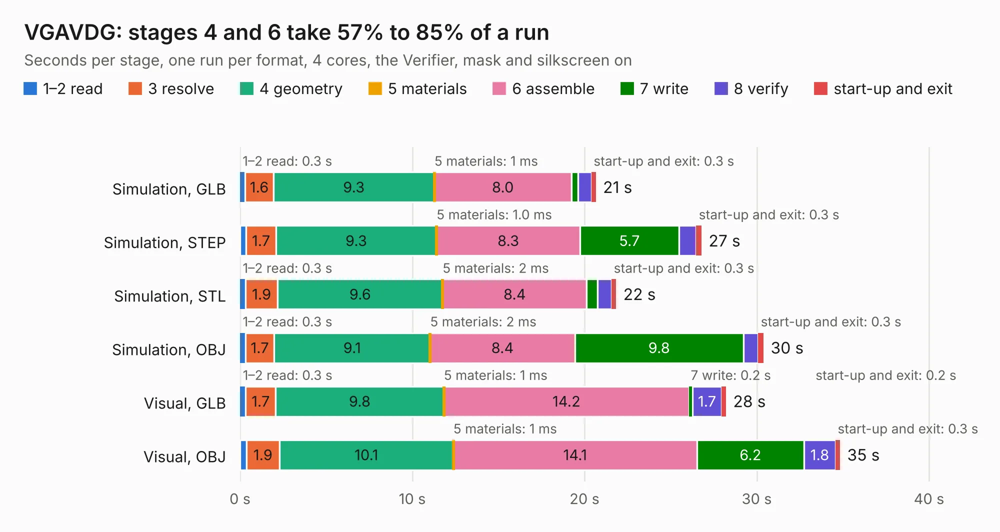

# 981. VGAVDG

Board 981 of the 3,122 of [Corpus Testing](../Corpus-Testing.md), on [Corpus Page 10](../CorpusTestingPages/Corpus-Testing-10.md#981-vgavdg).

| Mode and format | 1–2 read | 3 resolve | 4 geometry | 5 materials | 6 assemble | 7 write | 8 verify | start-up and exit | Total |
|---|---:|---:|---:|---:|---:|---:|---:|---:|---:|
| Simulation, GLB | 0.3 | 1.6 | 9.3 | 1&nbsp;ms | 8.0 | 0.4 | 0.8 | 0.3 | 20.7 |
| Simulation, STEP | 0.4 | 1.7 | 9.3 | 1.0&nbsp;ms | 8.3 | 5.7 | 1.0 | 0.3 | 26.8 |
| Simulation, STL | 0.3 | 1.9 | 9.6 | 2&nbsp;ms | 8.4 | 0.6 | 0.8 | 0.3 | 21.8 |
| Simulation, OBJ | 0.3 | 1.7 | 9.1 | 2&nbsp;ms | 8.4 | 9.8 | 0.9 | 0.3 | 30.4 |
| Visual, GLB | 0.3 | 1.7 | 9.8 | 1&nbsp;ms | 14.2 | 0.2 | 1.7 | 0.2 | 28.2 |
| Visual, OBJ | 0.4 | 1.9 | 10.1 | 1&nbsp;ms | 14.1 | 6.2 | 1.8 | 0.3 | 34.8 |

<table align="center"><tr><td valign="top">

| Board | Repo: [flypie/Ace-2019](https://github.com/flypie/Ace-2019) Board: `VGAVDG.kicad_pcb` |
|---|---|
| Folder | VGA |
| Complexity | 128&nbsp;/&nbsp;1000 (size&nbsp;118, features&nbsp;10) |
| KESE&nbsp;features | rounded, trapezoid or chamfered pads |
| Tested | 9th November 2026 |
| Copper&nbsp;layers | 2 |
| File&nbsp;format | KiCad 6 (20211014) |
| Parts,&nbsp;tracks,&nbsp;vias | 87, 0, 0 |
| Triangles,&nbsp;simulation | 2,092,560 in 266 parts |
| Note | mostly unrouted |
| Verifier | PASS in all six runs |

</td><td valign="top">

<table>
<tr><th>File type</th><th>File size</th><th>Peak memory used</th></tr>
<tr><th colspan="3" align="left">Simulation</th></tr>
<tr><td>GLB</td><td align="right">69&nbsp;MB</td><td align="right">702&nbsp;MB</td></tr>
<tr><td>STEP</td><td align="right">235&nbsp;MB</td><td align="right">890&nbsp;MB</td></tr>
<tr><td>STL</td><td align="right">105&nbsp;MB</td><td align="right">711&nbsp;MB</td></tr>
<tr><td>OBJ</td><td align="right">219&nbsp;MB</td><td align="right">1.4&nbsp;GB</td></tr>
<tr><th colspan="3" align="left">Visual</th></tr>
<tr><td>GLB</td><td align="right">43&nbsp;MB</td><td align="right">985&nbsp;MB</td></tr>
<tr><td>OBJ</td><td align="right">131&nbsp;MB</td><td align="right">957&nbsp;MB</td></tr>
</table>

</td></tr></table>

| Previous | Next |
|:---|---:|
| [980. VGAGAL](b0980b_Ace-2019_VGAGAL.md) | [982. Gigatron](b0982b_Gigatron_Gigatron.md) |
