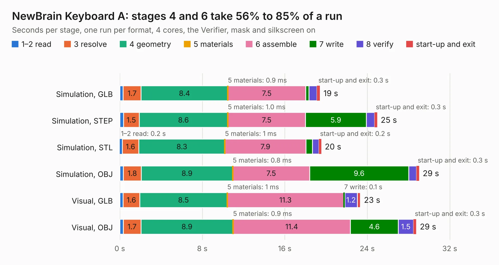

# 981. NewBrain Keyboard A

Board 981 of the 3,118 of [Corpus Testing](../Corpus-Testing.md), on [Corpus Page 10](../CorpusTestingPages/Corpus-Testing-10.md#981-newbrain-keyboard-a).

| Mode and format | 1–2 read | 3 resolve | 4 geometry | 5 materials | 6 assemble | 7 write | 8 verify | start-up and exit | Total |
|---|---:|---:|---:|---:|---:|---:|---:|---:|---:|
| Simulation, GLB | 0.3 | 1.7 | 8.4 | 0.9&nbsp;ms | 7.5 | 0.3 | 0.8 | 0.3 | 19.4 |
| Simulation, STEP | 0.4 | 1.5 | 8.6 | 1.0&nbsp;ms | 7.5 | 5.9 | 0.8 | 0.3 | 25.0 |
| Simulation, STL | 0.2 | 1.6 | 8.3 | 1&nbsp;ms | 7.9 | 0.6 | 0.6 | 0.2 | 19.5 |
| Simulation, OBJ | 0.3 | 1.8 | 8.9 | 0.8&nbsp;ms | 7.5 | 9.6 | 0.8 | 0.3 | 29.0 |
| Visual, GLB | 0.3 | 1.6 | 8.5 | 1&nbsp;ms | 11.3 | 0.1 | 1.2 | 0.3 | 23.3 |
| Visual, OBJ | 0.3 | 1.7 | 8.9 | 0.9&nbsp;ms | 11.4 | 4.6 | 1.5 | 0.3 | 28.8 |

<table align="center"><tr><td valign="top">

| Board | Repo: [flypie/NewBrain](https://github.com/flypie/NewBrain) Board: `NewBrain Keyboard A.kicad_pcb` |
|---|---|
| Folder | NewBrain Keyboard A |
| Complexity | 66&nbsp;/&nbsp;1000 (size&nbsp;66, features&nbsp;0) |
| Tested | 9th November 2026 |
| Copper&nbsp;layers | 2 |
| File&nbsp;format | KiCad 5 (20171130) |
| Parts,&nbsp;tracks,&nbsp;vias | 89, 0, 0 |
| Triangles,&nbsp;simulation | 2,004,382 in 140 parts |
| Note | mostly unrouted |
| Verifier | PASS in all six runs |

</td><td valign="top">

<table>
<tr><th>File type</th><th>File size</th><th>Peak memory used</th></tr>
<tr><th colspan="3" align="left">Simulation</th></tr>
<tr><td>GLB</td><td align="right">63&nbsp;MB</td><td align="right">693&nbsp;MB</td></tr>
<tr><td>STEP</td><td align="right">300&nbsp;MB</td><td align="right">844&nbsp;MB</td></tr>
<tr><td>STL</td><td align="right">100&nbsp;MB</td><td align="right">650&nbsp;MB</td></tr>
<tr><td>OBJ</td><td align="right">210&nbsp;MB</td><td align="right">1.4&nbsp;GB</td></tr>
<tr><th colspan="3" align="left">Visual</th></tr>
<tr><td>GLB</td><td align="right">32&nbsp;MB</td><td align="right">724&nbsp;MB</td></tr>
<tr><td>OBJ</td><td align="right">96&nbsp;MB</td><td align="right">750&nbsp;MB</td></tr>
</table>

</td></tr></table>

| Previous | Next |
|:---|---:|
| [980. Gigatron](b0980b_Gigatron_Gigatron.md) | [982. NewBrain Original](b0982b_NewBrain_NewBrain-Original.md) |
