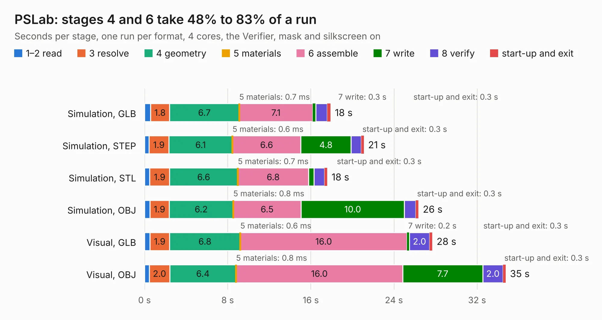

# 982. PSLab

Board 982 of the 3,106 of [Corpus Testing](../Corpus-Testing.md), on [Corpus Page 10](../CorpusTestingPages/Corpus-Testing-10.md#982-pslab).

| Mode and format | 1–2 read | 3 resolve | 4 geometry | 5 materials | 6 assemble | 7 write | 8 verify | start-up and exit | Total |
|---|---:|---:|---:|---:|---:|---:|---:|---:|---:|
| Simulation, GLB | 0.6 | 1.8 | 6.7 | 0.7&nbsp;ms | 7.1 | 0.3 | 1.1 | 0.3 | 17.9 |
| Simulation, STEP | 0.4 | 1.9 | 6.1 | 0.6&nbsp;ms | 6.6 | 4.8 | 1.0 | 0.3 | 21.1 |
| Simulation, STL | 0.5 | 1.9 | 6.6 | 0.7&nbsp;ms | 6.8 | 0.5 | 1.0 | 0.3 | 17.6 |
| Simulation, OBJ | 0.5 | 1.9 | 6.2 | 0.8&nbsp;ms | 6.5 | 10.0 | 1.1 | 0.3 | 26.4 |
| Visual, GLB | 0.5 | 1.9 | 6.8 | 0.6&nbsp;ms | 16.0 | 0.2 | 2.0 | 0.3 | 27.7 |
| Visual, OBJ | 0.5 | 2.0 | 6.4 | 0.8&nbsp;ms | 16.0 | 7.7 | 2.0 | 0.3 | 34.8 |

<table align="center"><tr><td valign="top">

| Board | Repo: [fossasia/pslab-hardware](https://github.com/fossasia/pslab-hardware) Board: `PSLab.kicad_pcb` |
|---|---|
| Folder | archives / PSLab KiCAD v2 |
| Complexity | 294&nbsp;/&nbsp;1000 (size&nbsp;249, features&nbsp;45) |
| KESE&nbsp;features | through vias, slotted holes, filled zones |
| Tested | 9th November 2026 |
| Copper&nbsp;layers | 4 |
| File&nbsp;format | KiCad 4 (4) |
| Parts,&nbsp;tracks,&nbsp;vias | 136, 1,348, 144 |
| Triangles,&nbsp;simulation | 1,868,202 in 156 parts |
| Verifier | PASS in all six runs |

</td><td valign="top">

<table>
<tr><th>File type</th><th>File size</th><th>Peak memory used</th></tr>
<tr><th colspan="3" align="left">Simulation</th></tr>
<tr><td>GLB</td><td align="right">65&nbsp;MB</td><td align="right">765&nbsp;MB</td></tr>
<tr><td>STEP</td><td align="right">306&nbsp;MB</td><td align="right">839&nbsp;MB</td></tr>
<tr><td>STL</td><td align="right">93&nbsp;MB</td><td align="right">790&nbsp;MB</td></tr>
<tr><td>OBJ</td><td align="right">196&nbsp;MB</td><td align="right">1.2&nbsp;GB</td></tr>
<tr><th colspan="3" align="left">Visual</th></tr>
<tr><td>GLB</td><td align="right">47&nbsp;MB</td><td align="right">809&nbsp;MB</td></tr>
<tr><td>OBJ</td><td align="right">143&nbsp;MB</td><td align="right">1.1&nbsp;GB</td></tr>
</table>

</td></tr></table>

| Previous | Next |
|:---|---:|
| [981. PCBs](b0981b_pslab-hardware_PCBs.md) | [983. PSLab](b0983b_pslab-hardware_archives-PSLab-KiCAD-v3_PSLab.md) |
