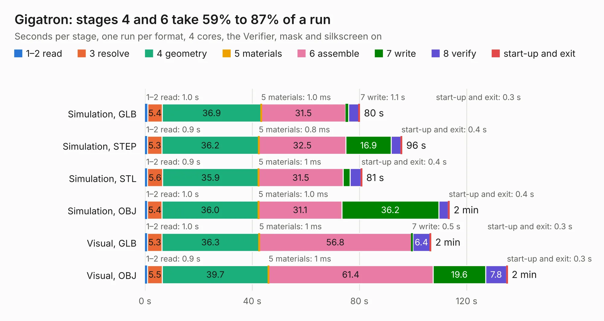

# 984. Gigatron

Board 984 of the 3,132 of [Corpus Testing](../Corpus-Testing.md), on [Corpus Page 10](../CorpusTestingPages/Corpus-Testing-10.md#984-gigatron).

| Mode and format | 1–2 read | 3 resolve | 4 geometry | 5 materials | 6 assemble | 7 write | 8 verify | start-up and exit | Total |
|---|---:|---:|---:|---:|---:|---:|---:|---:|---:|
| Simulation, GLB | 1.0 | 5.4 | 36.9 | 1.0&nbsp;ms | 31.5 | 1.1 | 3.8 | 0.3 | 80.1 |
| Simulation, STEP | 0.9 | 5.3 | 36.2 | 0.8&nbsp;ms | 32.5 | 16.9 | 3.6 | 0.4 | 95.9 |
| Simulation, STL | 0.9 | 5.6 | 35.9 | 1&nbsp;ms | 31.5 | 2.6 | 4.1 | 0.4 | 81.0 |
| Simulation, OBJ | 1.0 | 5.4 | 36.0 | 1.0&nbsp;ms | 31.1 | 36.2 | 3.5 | 0.4 | 113.6 |
| Visual, GLB | 1.0 | 5.3 | 36.3 | 1&nbsp;ms | 56.8 | 0.5 | 6.4 | 0.3 | 106.7 |
| Visual, OBJ | 0.9 | 5.5 | 39.7 | 1&nbsp;ms | 61.4 | 19.6 | 7.8 | 0.3 | 135.2 |

<table align="center"><tr><td valign="top">

| Board | Repo: [flypie/Gigatron](https://github.com/flypie/Gigatron) Board: `Gigatron.kicad_pcb` |
|---|---|
| Folder | Kicad |
| Complexity | 233&nbsp;/&nbsp;1000 (size&nbsp;208, features&nbsp;25) |
| KESE&nbsp;features | through vias, slotted holes |
| Tested | 9th November 2026 |
| Copper&nbsp;layers | 2 |
| File&nbsp;format | KiCad 5 (20171130) |
| Parts,&nbsp;tracks,&nbsp;vias | 146, 4,153, 92 |
| Triangles,&nbsp;simulation | 5,836,684 in 223 parts |
| Verifier | PASS in all six runs |

</td><td valign="top">

<table>
<tr><th>File type</th><th>File size</th><th>Peak memory used</th></tr>
<tr><th colspan="3" align="left">Simulation</th></tr>
<tr><td>GLB</td><td align="right">202&nbsp;MB</td><td align="right">1.8&nbsp;GB</td></tr>
<tr><td>STEP</td><td align="right">1.0&nbsp;GB</td><td align="right">2.1&nbsp;GB</td></tr>
<tr><td>STL</td><td align="right">292&nbsp;MB</td><td align="right">1.8&nbsp;GB</td></tr>
<tr><td>OBJ</td><td align="right">630&nbsp;MB</td><td align="right">3.8&nbsp;GB</td></tr>
<tr><th colspan="3" align="left">Visual</th></tr>
<tr><td>GLB</td><td align="right">108&nbsp;MB</td><td align="right">1.9&nbsp;GB</td></tr>
<tr><td>OBJ</td><td align="right">338&nbsp;MB</td><td align="right">2.2&nbsp;GB</td></tr>
</table>

</td></tr></table>

| Previous | Next |
|:---|---:|
| [983. VGAVDG](b0983b_Ace-2019_VGAVDG.md) | [985. NewBrain Keyboard A](b0985b_NewBrain_NewBrain-Keyboard-A.md) |
