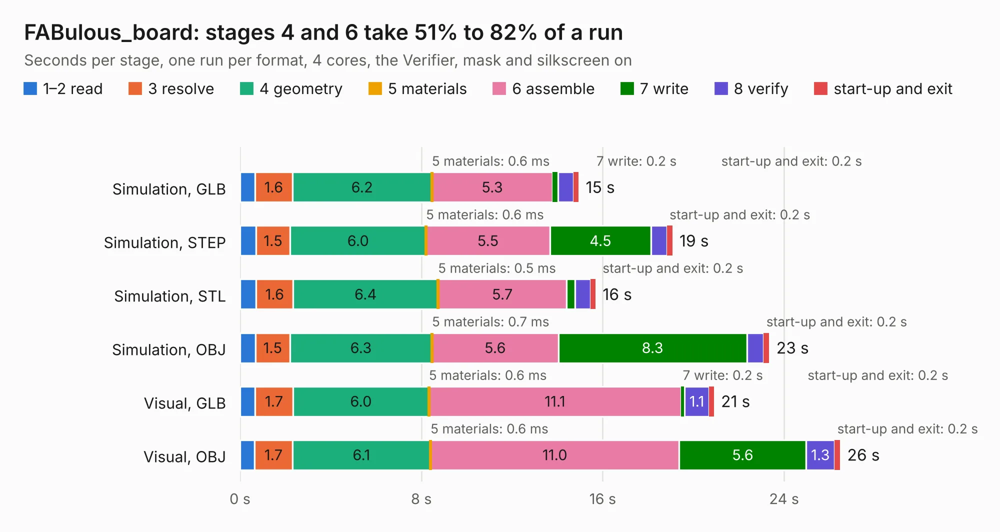

# 986. FABulous_board

Board 986 of the 3,106 of [Corpus Testing](../Corpus-Testing.md), on [Corpus Page 10](../CorpusTestingPages/Corpus-Testing-10.md#986-fabulous_board).

| Mode and format | 1–2 read | 3 resolve | 4 geometry | 5 materials | 6 assemble | 7 write | 8 verify | start-up and exit | Total |
|---|---:|---:|---:|---:|---:|---:|---:|---:|---:|
| Simulation, GLB | 0.7 | 1.6 | 6.2 | 0.6&nbsp;ms | 5.3 | 0.2 | 0.7 | 0.2 | 14.9 |
| Simulation, STEP | 0.7 | 1.5 | 6.0 | 0.6&nbsp;ms | 5.5 | 4.5 | 0.7 | 0.2 | 19.1 |
| Simulation, STL | 0.7 | 1.6 | 6.4 | 0.5&nbsp;ms | 5.7 | 0.4 | 0.7 | 0.2 | 15.7 |
| Simulation, OBJ | 0.7 | 1.5 | 6.3 | 0.7&nbsp;ms | 5.6 | 8.3 | 0.7 | 0.2 | 23.3 |
| Visual, GLB | 0.7 | 1.7 | 6.0 | 0.6&nbsp;ms | 11.1 | 0.2 | 1.1 | 0.2 | 20.9 |
| Visual, OBJ | 0.6 | 1.7 | 6.1 | 0.6&nbsp;ms | 11.0 | 5.6 | 1.3 | 0.2 | 26.5 |

<table align="center"><tr><td valign="top">

| Board | Repo: [fpga-research/fabulous_board](https://github.com/fpga-research/fabulous_board) Board: `FABulous_board.kicad_pcb` |
|---|---|
| Folder | hardware / kicad_files / project |
| Complexity | 332&nbsp;/&nbsp;1000 (size&nbsp;237, features&nbsp;95) |
| KESE&nbsp;features | through vias, slotted holes, rounded, trapezoid or chamfered pads, filled zones, curved board outline, stack-up, dielectric εr and tanδ |
| Tested | 9th November 2026 |
| Copper&nbsp;layers | 4 |
| File&nbsp;format | KiCad 8 (20240108) |
| Parts,&nbsp;tracks,&nbsp;vias | 75, 878, 130 |
| Triangles,&nbsp;simulation | 1,583,870 in 128 parts |
| Verifier | PASS in all six runs |

</td><td valign="top">

<table>
<tr><th>File type</th><th>File size</th><th>Peak memory used</th></tr>
<tr><th colspan="3" align="left">Simulation</th></tr>
<tr><td>GLB</td><td align="right">55&nbsp;MB</td><td align="right">620&nbsp;MB</td></tr>
<tr><td>STEP</td><td align="right">239&nbsp;MB</td><td align="right">738&nbsp;MB</td></tr>
<tr><td>STL</td><td align="right">79&nbsp;MB</td><td align="right">613&nbsp;MB</td></tr>
<tr><td>OBJ</td><td align="right">166&nbsp;MB</td><td align="right">1.1&nbsp;GB</td></tr>
<tr><th colspan="3" align="left">Visual</th></tr>
<tr><td>GLB</td><td align="right">36&nbsp;MB</td><td align="right">836&nbsp;MB</td></tr>
<tr><td>OBJ</td><td align="right">108&nbsp;MB</td><td align="right">824&nbsp;MB</td></tr>
</table>

</td></tr></table>

| Previous | Next |
|:---|---:|
| [985. PSLab](b0985b_pslab-hardware_schematics_PSLab.md) | [987. DroneController](b0987b_DroneController_DroneController.md) |
