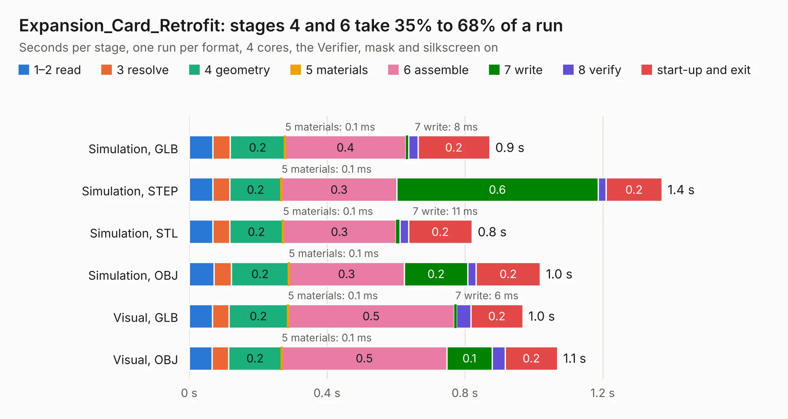

# 991. Expansion_Card_Retrofit

Board 991 of the 3,110 of [Corpus Testing](../Corpus-Testing.md), on [Corpus Page 10](../CorpusTestingPages/Corpus-Testing-10.md#991-expansion_card_retrofit).

| Mode and format | 1–2 read | 3 resolve | 4 geometry | 5 materials | 6 assemble | 7 write | 8 verify | start-up and exit | Total |
|---|---:|---:|---:|---:|---:|---:|---:|---:|---:|
| Simulation, GLB | 68&nbsp;ms | 51&nbsp;ms | 0.2 | 0.1&nbsp;ms | 0.4 | 8&nbsp;ms | 27&nbsp;ms | 0.2 | 0.9 |
| Simulation, STEP | 69&nbsp;ms | 48&nbsp;ms | 0.2 | 0.1&nbsp;ms | 0.3 | 0.6 | 23&nbsp;ms | 0.2 | 1.4 |
| Simulation, STL | 69&nbsp;ms | 50&nbsp;ms | 0.2 | 0.1&nbsp;ms | 0.3 | 11&nbsp;ms | 25&nbsp;ms | 0.2 | 0.8 |
| Simulation, OBJ | 73&nbsp;ms | 50&nbsp;ms | 0.2 | 0.1&nbsp;ms | 0.3 | 0.2 | 24&nbsp;ms | 0.2 | 1.0 |
| Visual, GLB | 67&nbsp;ms | 48&nbsp;ms | 0.2 | 0.1&nbsp;ms | 0.5 | 6&nbsp;ms | 43&nbsp;ms | 0.2 | 1.0 |
| Visual, OBJ | 66&nbsp;ms | 48&nbsp;ms | 0.2 | 0.1&nbsp;ms | 0.5 | 0.1 | 38&nbsp;ms | 0.2 | 1.1 |

<table align="center"><tr><td valign="top">

| Board | Repo: [FrameworkComputer/ExpansionCards](https://github.com/FrameworkComputer/ExpansionCards) Board: `Expansion_Card_Retrofit.kicad_pcb` |
|---|---|
| Folder | Electrical / KiCad_templates / Expansion_Card_Retrofit |
| Complexity | 124&nbsp;/&nbsp;1000 (size&nbsp;89, features&nbsp;35) |
| KESE&nbsp;features | through vias, rounded, trapezoid or chamfered pads, curved board outline |
| Tested | 9th November 2026 |
| Copper&nbsp;layers | 2 |
| File&nbsp;format | KiCad 5 (20171130) |
| Parts,&nbsp;tracks,&nbsp;vias | 5, 0, 8 |
| Triangles,&nbsp;simulation | 47,004 in 16 parts |
| Verifier | PASS in all six runs |

</td><td valign="top">

<table>
<tr><th>File type</th><th>File size</th><th>Peak memory used</th></tr>
<tr><th colspan="3" align="left">Simulation</th></tr>
<tr><td>GLB</td><td align="right">1.7&nbsp;MB</td><td align="right">67&nbsp;MB</td></tr>
<tr><td>STEP</td><td align="right">6.4&nbsp;MB</td><td align="right">167&nbsp;MB</td></tr>
<tr><td>STL</td><td align="right">2.4&nbsp;MB</td><td align="right">68&nbsp;MB</td></tr>
<tr><td>OBJ</td><td align="right">4.6&nbsp;MB</td><td align="right">76&nbsp;MB</td></tr>
<tr><th colspan="3" align="left">Visual</th></tr>
<tr><td>GLB</td><td align="right">1.2&nbsp;MB</td><td align="right">104&nbsp;MB</td></tr>
<tr><td>OBJ</td><td align="right">3.4&nbsp;MB</td><td align="right">106&nbsp;MB</td></tr>
</table>

</td></tr></table>

| Previous | Next |
|:---|---:|
| [990. Expansion_Card](b0990b_ExpansionCards_Expansion-Card.md) | [992. Microcontroller](b0992b_ExpansionCards_Microcontroller.md) |
