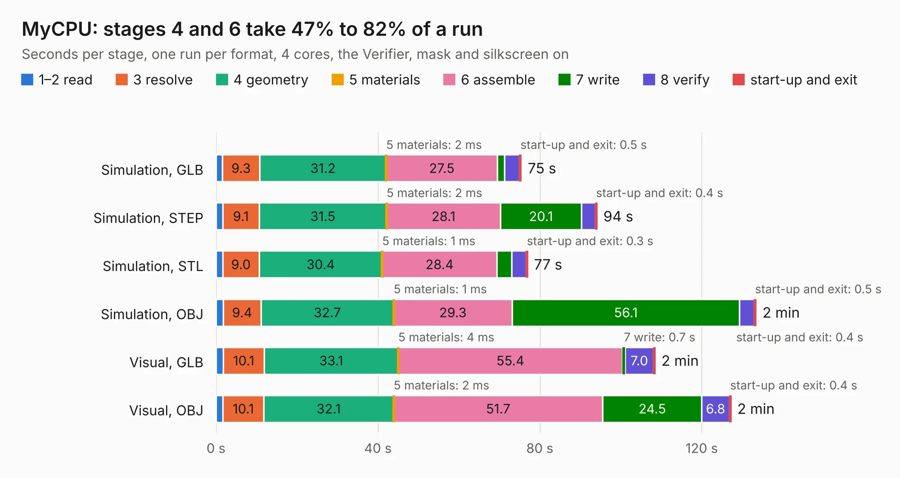

# 991. MyCPU

Board 991 of the 3,132 of [Corpus Testing](../Corpus-Testing.md), on [Corpus Page 10](../CorpusTestingPages/Corpus-Testing-10.md#991-mycpu).

| Mode and format | 1–2 read | 3 resolve | 4 geometry | 5 materials | 6 assemble | 7 write | 8 verify | start-up and exit | Total |
|---|---:|---:|---:|---:|---:|---:|---:|---:|---:|
| Simulation, GLB | 1.5 | 9.3 | 31.2 | 2&nbsp;ms | 27.5 | 1.7 | 3.7 | 0.5 | 75.4 |
| Simulation, STEP | 1.6 | 9.1 | 31.5 | 2&nbsp;ms | 28.1 | 20.1 | 3.4 | 0.4 | 94.1 |
| Simulation, STL | 1.6 | 9.0 | 30.4 | 1&nbsp;ms | 28.4 | 3.6 | 3.6 | 0.3 | 77.0 |
| Simulation, OBJ | 1.8 | 9.4 | 32.7 | 1&nbsp;ms | 29.3 | 56.1 | 3.6 | 0.5 | 133.4 |
| Visual, GLB | 1.8 | 10.1 | 33.1 | 4&nbsp;ms | 55.4 | 0.7 | 7.0 | 0.4 | 108.4 |
| Visual, OBJ | 1.7 | 10.1 | 32.1 | 2&nbsp;ms | 51.7 | 24.5 | 6.8 | 0.4 | 127.2 |

<table align="center"><tr><td valign="top">

| Board | Repo: [fortinsylvain/MyCpu](https://github.com/fortinsylvain/MyCpu) Board: `MyCPU.kicad_pcb` |
|---|---|
| Folder | Kicad |
| Complexity | 317&nbsp;/&nbsp;1000 (size&nbsp;227, features&nbsp;90) |
| KESE&nbsp;features | through vias, rounded, trapezoid or chamfered pads, filled zones, TrueType text, stack-up, dielectric εr and tanδ |
| Tested | 9th November 2026 |
| Copper&nbsp;layers | 4 |
| File&nbsp;format | KiCad 9 (20241229) |
| Parts,&nbsp;tracks,&nbsp;vias | 161, 2,736, 666 |
| Triangles,&nbsp;simulation | 9,058,616 in 251 parts |
| Verifier | PASS in all six runs |

</td><td valign="top">

<table>
<tr><th>File type</th><th>File size</th><th>Peak memory used</th></tr>
<tr><th colspan="3" align="left">Simulation</th></tr>
<tr><td>GLB</td><td align="right">306&nbsp;MB</td><td align="right">2.0&nbsp;GB</td></tr>
<tr><td>STEP</td><td align="right">1.1&nbsp;GB</td><td align="right">2.6&nbsp;GB</td></tr>
<tr><td>STL</td><td align="right">453&nbsp;MB</td><td align="right">2.0&nbsp;GB</td></tr>
<tr><td>OBJ</td><td align="right">965&nbsp;MB</td><td align="right">5.6&nbsp;GB</td></tr>
<tr><th colspan="3" align="left">Visual</th></tr>
<tr><td>GLB</td><td align="right">138&nbsp;MB</td><td align="right">2.4&nbsp;GB</td></tr>
<tr><td>OBJ</td><td align="right">444&nbsp;MB</td><td align="right">2.9&nbsp;GB</td></tr>
</table>

</td></tr></table>

| Previous | Next |
|:---|---:|
| [990. corne-chocolate](b0990b_crkbd_corne-chocolate.md) | [992. PCBs](b0992b_pslab-hardware_PCBs.md) |
