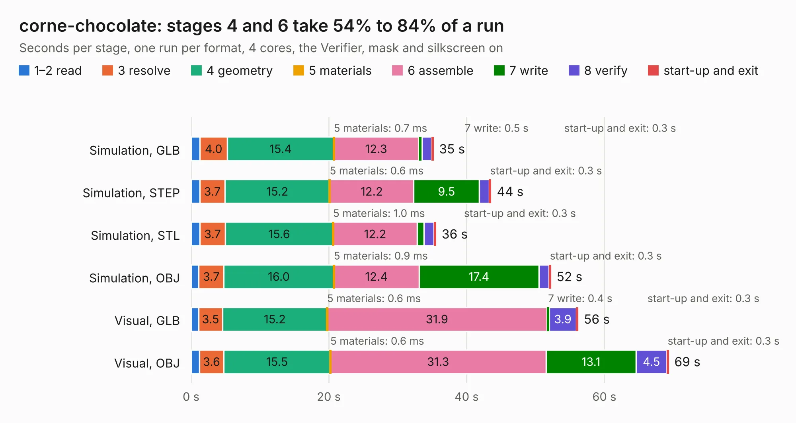

# 991 corne-chocolate

Board 991 of the 3,138 of [Corpus Testing](../Corpus-Testing.md), on [Corpus Page 10](../CorpusTestingPages/Corpus-Testing-10.md#991-corne-chocolate).

| Mode and format | 1–2 read | 3 resolve | 4 geometry | 5 materials | 6 assemble | 7 write | 8 verify | start-up and exit | Total |
|---|---:|---:|---:|---:|---:|---:|---:|---:|---:|
| Simulation, GLB | 1.3 | 4.0 | 15.4 | 0.7&nbsp;ms | 12.3 | 0.5 | 1.4 | 0.3 | 35.2 |
| Simulation, STEP | 1.3 | 3.7 | 15.2 | 0.6&nbsp;ms | 12.2 | 9.5 | 1.4 | 0.3 | 43.6 |
| Simulation, STL | 1.3 | 3.7 | 15.6 | 1.0&nbsp;ms | 12.2 | 1.0 | 1.4 | 0.3 | 35.6 |
| Simulation, OBJ | 1.1 | 3.7 | 16.0 | 0.9&nbsp;ms | 12.4 | 17.4 | 1.5 | 0.3 | 52.2 |
| Visual, GLB | 1.1 | 3.5 | 15.2 | 0.6&nbsp;ms | 31.9 | 0.4 | 3.9 | 0.3 | 56.2 |
| Visual, OBJ | 1.2 | 3.6 | 15.5 | 0.6&nbsp;ms | 31.3 | 13.1 | 4.5 | 0.3 | 69.3 |

<table align="center"><tr><td valign="top">

| Board | Repo: [foostan/crkbd](https://github.com/foostan/crkbd) Board: `corne-chocolate.kicad_pcb` |
|---|---|
| Folder | pcbs / corne-chocolate / hotswap |
| Complexity | 377&nbsp;/&nbsp;1000 (size&nbsp;257, features&nbsp;120) |
| KESE&nbsp;features | through vias, slotted holes, custom pads, rounded, trapezoid or chamfered pads, filled zones, copper drawings, curved board outline, stack-up, dielectric εr and tanδ |
| Tested | 9th November 2026 |
| Copper&nbsp;layers | 2 |
| File&nbsp;format | KiCad 7 (20221018) |
| Parts,&nbsp;tracks,&nbsp;vias | 178, 3,255, 429 |
| Triangles,&nbsp;simulation | 2,994,126 in 170 parts |
| Verifier | PASS in all six runs |

</td><td valign="top">

<table>
<tr><th>File type</th><th>File size</th><th>Peak memory used</th></tr>
<tr><th colspan="3" align="left">Simulation</th></tr>
<tr><td>GLB</td><td align="right">105&nbsp;MB</td><td align="right">1.3&nbsp;GB</td></tr>
<tr><td>STEP</td><td align="right">577&nbsp;MB</td><td align="right">1.4&nbsp;GB</td></tr>
<tr><td>STL</td><td align="right">150&nbsp;MB</td><td align="right">1.3&nbsp;GB</td></tr>
<tr><td>OBJ</td><td align="right">323&nbsp;MB</td><td align="right">2.0&nbsp;GB</td></tr>
<tr><th colspan="3" align="left">Visual</th></tr>
<tr><td>GLB</td><td align="right">83&nbsp;MB</td><td align="right">1.4&nbsp;GB</td></tr>
<tr><td>OBJ</td><td align="right">260&nbsp;MB</td><td align="right">1.8&nbsp;GB</td></tr>
</table>

</td></tr></table>

| Previous | Next |
|:---|---:|
| [990 corne-cherry](b0990b_crkbd_corne-cherry.md) | [992 MyCPU](b0992b_MyCpu_MyCPU.md) |
