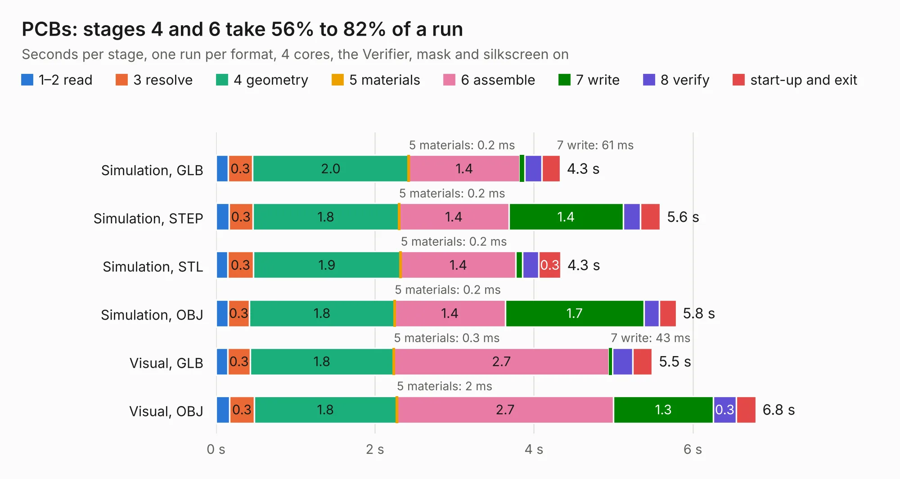

# 991. PCBs

Board 991 of the 3,127 of [Corpus Testing](../Corpus-Testing.md), on [Corpus Page 10](../CorpusTestingPages/Corpus-Testing-10.md#991-pcbs).

| Mode and format | 1–2 read | 3 resolve | 4 geometry | 5 materials | 6 assemble | 7 write | 8 verify | start-up and exit | Total |
|---|---:|---:|---:|---:|---:|---:|---:|---:|---:|
| Simulation, GLB | 0.2 | 0.3 | 2.0 | 0.2&nbsp;ms | 1.4 | 61&nbsp;ms | 0.2 | 0.2 | 4.3 |
| Simulation, STEP | 0.2 | 0.3 | 1.8 | 0.2&nbsp;ms | 1.4 | 1.4 | 0.2 | 0.3 | 5.6 |
| Simulation, STL | 0.1 | 0.3 | 1.9 | 0.2&nbsp;ms | 1.4 | 82&nbsp;ms | 0.2 | 0.3 | 4.3 |
| Simulation, OBJ | 0.2 | 0.3 | 1.8 | 0.2&nbsp;ms | 1.4 | 1.7 | 0.2 | 0.2 | 5.8 |
| Visual, GLB | 0.1 | 0.3 | 1.8 | 0.3&nbsp;ms | 2.7 | 43&nbsp;ms | 0.3 | 0.2 | 5.5 |
| Visual, OBJ | 0.2 | 0.3 | 1.8 | 2&nbsp;ms | 2.7 | 1.3 | 0.3 | 0.2 | 6.8 |

<table align="center"><tr><td valign="top">

| Board | Repo: [fossasia/pslab-hardware](https://github.com/fossasia/pslab-hardware) Board: `PCBs.kicad_pcb` |
|---|---|
| Folder | archives / Breakout_Boards |
| Complexity | 220&nbsp;/&nbsp;1000 (size&nbsp;185, features&nbsp;35) |
| KESE&nbsp;features | through vias, filled zones |
| Tested | 9th November 2026 |
| Copper&nbsp;layers | 2 |
| File&nbsp;format | KiCad 4 (4) |
| Parts,&nbsp;tracks,&nbsp;vias | 28, 249, 7 |
| Triangles,&nbsp;simulation | 293,214 in 34 parts |
| Verifier | PASS in all six runs |

</td><td valign="top">

<table>
<tr><th>File type</th><th>File size</th><th>Peak memory used</th></tr>
<tr><th colspan="3" align="left">Simulation</th></tr>
<tr><td>GLB</td><td align="right">10&nbsp;MB</td><td align="right">238&nbsp;MB</td></tr>
<tr><td>STEP</td><td align="right">54&nbsp;MB</td><td align="right">273&nbsp;MB</td></tr>
<tr><td>STL</td><td align="right">15&nbsp;MB</td><td align="right">241&nbsp;MB</td></tr>
<tr><td>OBJ</td><td align="right">30&nbsp;MB</td><td align="right">260&nbsp;MB</td></tr>
<tr><th colspan="3" align="left">Visual</th></tr>
<tr><td>GLB</td><td align="right">7.6&nbsp;MB</td><td align="right">253&nbsp;MB</td></tr>
<tr><td>OBJ</td><td align="right">22&nbsp;MB</td><td align="right">249&nbsp;MB</td></tr>
</table>

</td></tr></table>

| Previous | Next |
|:---|---:|
| [990. MyCPU](b0990b_MyCpu_MyCPU.md) | [992. PSLab](b0992b_pslab-hardware_archives-PSLab-KiCAD-v2_PSLab.md) |
