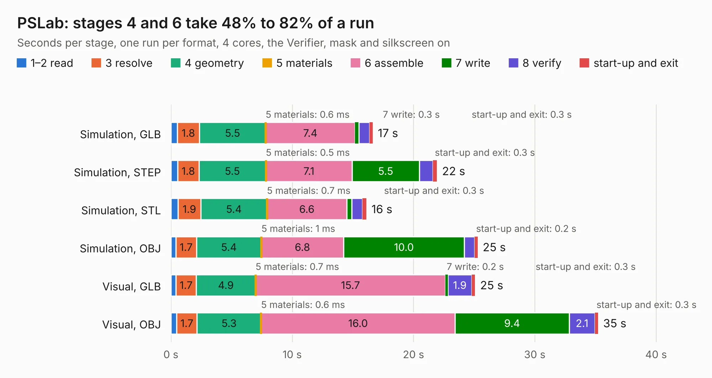

# 992. PSLab

Board 992 of the 3,120 of [Corpus Testing](../Corpus-Testing.md), on [Corpus Page 10](../CorpusTestingPages/Corpus-Testing-10.md#992-pslab).

| Mode and format | 1–2 read | 3 resolve | 4 geometry | 5 materials | 6 assemble | 7 write | 8 verify | start-up and exit | Total |
|---|---:|---:|---:|---:|---:|---:|---:|---:|---:|
| Simulation, GLB | 0.5 | 1.8 | 5.5 | 0.6&nbsp;ms | 7.4 | 0.3 | 0.9 | 0.3 | 16.6 |
| Simulation, STEP | 0.6 | 1.8 | 5.5 | 0.5&nbsp;ms | 7.1 | 5.5 | 1.1 | 0.3 | 21.9 |
| Simulation, STL | 0.6 | 1.9 | 5.4 | 0.7&nbsp;ms | 6.6 | 0.4 | 0.9 | 0.3 | 16.1 |
| Simulation, OBJ | 0.4 | 1.7 | 5.4 | 1&nbsp;ms | 6.8 | 10.0 | 0.8 | 0.2 | 25.3 |
| Visual, GLB | 0.4 | 1.7 | 4.9 | 0.7&nbsp;ms | 15.7 | 0.2 | 1.9 | 0.3 | 25.1 |
| Visual, OBJ | 0.5 | 1.7 | 5.3 | 0.6&nbsp;ms | 16.0 | 9.4 | 2.1 | 0.3 | 35.2 |

<table align="center"><tr><td valign="top">

| Board | Repo: [fossasia/pslab-hardware](https://github.com/fossasia/pslab-hardware) Board: `PSLab.kicad_pcb` |
|---|---|
| Folder | archives / PSLab KiCAD v3 |
| Complexity | 297&nbsp;/&nbsp;1000 (size&nbsp;252, features&nbsp;45) |
| KESE&nbsp;features | through vias, slotted holes, filled zones |
| Tested | 9th November 2026 |
| Copper&nbsp;layers | 4 |
| File&nbsp;format | KiCad 4 (4) |
| Parts,&nbsp;tracks,&nbsp;vias | 134, 1,653, 174 |
| Triangles,&nbsp;simulation | 1,676,062 in 128 parts |
| Verifier | PASS in all six runs |

</td><td valign="top">

<table>
<tr><th>File type</th><th>File size</th><th>Peak memory used</th></tr>
<tr><th colspan="3" align="left">Simulation</th></tr>
<tr><td>GLB</td><td align="right">58&nbsp;MB</td><td align="right">605&nbsp;MB</td></tr>
<tr><td>STEP</td><td align="right">256&nbsp;MB</td><td align="right">759&nbsp;MB</td></tr>
<tr><td>STL</td><td align="right">84&nbsp;MB</td><td align="right">581&nbsp;MB</td></tr>
<tr><td>OBJ</td><td align="right">174&nbsp;MB</td><td align="right">1.1&nbsp;GB</td></tr>
<tr><th colspan="3" align="left">Visual</th></tr>
<tr><td>GLB</td><td align="right">44&nbsp;MB</td><td align="right">804&nbsp;MB</td></tr>
<tr><td>OBJ</td><td align="right">134&nbsp;MB</td><td align="right">959&nbsp;MB</td></tr>
</table>

</td></tr></table>

| Previous | Next |
|:---|---:|
| [991. PSLab](b0991b_pslab-hardware_archives-PSLab-KiCAD-v2_PSLab.md) | [993. PSLab](b0993b_pslab-hardware_archives-PSLab-KiCAD_PSLab.md) |
