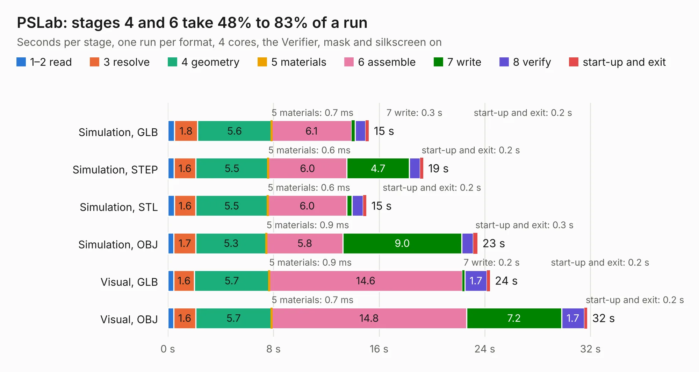

# 994. PSLab

Board 994 of the 3,130 of [Corpus Testing](../Corpus-Testing.md), on [Corpus Page 10](../CorpusTestingPages/Corpus-Testing-10.md#994-pslab).

| Mode and format | 1–2 read | 3 resolve | 4 geometry | 5 materials | 6 assemble | 7 write | 8 verify | start-up and exit | Total |
|---|---:|---:|---:|---:|---:|---:|---:|---:|---:|
| Simulation, GLB | 0.5 | 1.8 | 5.6 | 0.7&nbsp;ms | 6.1 | 0.3 | 0.8 | 0.2 | 15.2 |
| Simulation, STEP | 0.5 | 1.6 | 5.5 | 0.6&nbsp;ms | 6.0 | 4.7 | 0.8 | 0.2 | 19.3 |
| Simulation, STL | 0.5 | 1.6 | 5.5 | 0.6&nbsp;ms | 6.0 | 0.4 | 0.9 | 0.2 | 15.0 |
| Simulation, OBJ | 0.5 | 1.7 | 5.3 | 0.9&nbsp;ms | 5.8 | 9.0 | 0.9 | 0.3 | 23.4 |
| Visual, GLB | 0.5 | 1.6 | 5.7 | 0.9&nbsp;ms | 14.6 | 0.2 | 1.7 | 0.2 | 24.4 |
| Visual, OBJ | 0.5 | 1.6 | 5.7 | 0.7&nbsp;ms | 14.8 | 7.2 | 1.7 | 0.2 | 31.8 |

<table align="center"><tr><td valign="top">

| Board | Repo: [fossasia/pslab-hardware](https://github.com/fossasia/pslab-hardware) Board: `PSLab.kicad_pcb` |
|---|---|
| Folder | archives / PSLab KiCAD |
| Complexity | 293&nbsp;/&nbsp;1000 (size&nbsp;248, features&nbsp;45) |
| KESE&nbsp;features | through vias, slotted holes, filled zones |
| Tested | 9th November 2026 |
| Copper&nbsp;layers | 4 |
| File&nbsp;format | KiCad 4 (4) |
| Parts,&nbsp;tracks,&nbsp;vias | 139, 1,212, 126 |
| Triangles,&nbsp;simulation | 1,689,648 in 152 parts |
| Verifier | PASS in all six runs |

</td><td valign="top">

<table>
<tr><th>File type</th><th>File size</th><th>Peak memory used</th></tr>
<tr><th colspan="3" align="left">Simulation</th></tr>
<tr><td>GLB</td><td align="right">59&nbsp;MB</td><td align="right">718&nbsp;MB</td></tr>
<tr><td>STEP</td><td align="right">279&nbsp;MB</td><td align="right">768&nbsp;MB</td></tr>
<tr><td>STL</td><td align="right">84&nbsp;MB</td><td align="right">734&nbsp;MB</td></tr>
<tr><td>OBJ</td><td align="right">177&nbsp;MB</td><td align="right">1.1&nbsp;GB</td></tr>
<tr><th colspan="3" align="left">Visual</th></tr>
<tr><td>GLB</td><td align="right">43&nbsp;MB</td><td align="right">803&nbsp;MB</td></tr>
<tr><td>OBJ</td><td align="right">132&nbsp;MB</td><td align="right">929&nbsp;MB</td></tr>
</table>

</td></tr></table>

| Previous | Next |
|:---|---:|
| [993. PSLab](b0993b_pslab-hardware_archives-PSLab-KiCAD-v3_PSLab.md) | [995. PSLab](b0995b_pslab-hardware_schematics_PSLab.md) |
