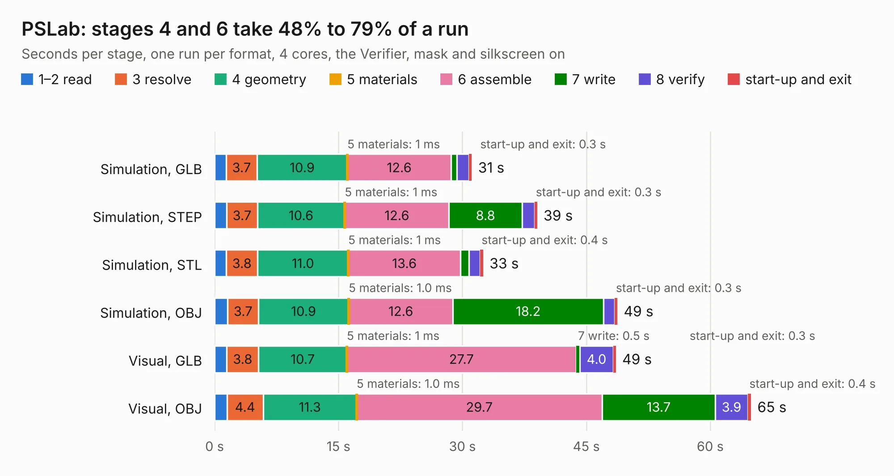

# 995. PSLab

Board 995 of the 3,123 of [Corpus Testing](../Corpus-Testing.md), on [Corpus Page 10](../CorpusTestingPages/Corpus-Testing-10.md#995-pslab).

| Mode and format | 1–2 read | 3 resolve | 4 geometry | 5 materials | 6 assemble | 7 write | 8 verify | start-up and exit | Total |
|---|---:|---:|---:|---:|---:|---:|---:|---:|---:|
| Simulation, GLB | 1.4 | 3.7 | 10.9 | 1&nbsp;ms | 12.6 | 0.7 | 1.5 | 0.3 | 31.1 |
| Simulation, STEP | 1.5 | 3.7 | 10.6 | 1&nbsp;ms | 12.6 | 8.8 | 1.5 | 0.3 | 39.0 |
| Simulation, STL | 1.4 | 3.8 | 11.0 | 1&nbsp;ms | 13.6 | 1.0 | 1.4 | 0.4 | 32.5 |
| Simulation, OBJ | 1.6 | 3.7 | 10.9 | 1.0&nbsp;ms | 12.6 | 18.2 | 1.3 | 0.3 | 48.8 |
| Visual, GLB | 1.5 | 3.8 | 10.7 | 1&nbsp;ms | 27.7 | 0.5 | 4.0 | 0.3 | 48.6 |
| Visual, OBJ | 1.5 | 4.4 | 11.3 | 1.0&nbsp;ms | 29.7 | 13.7 | 3.9 | 0.4 | 64.9 |

<table align="center"><tr><td valign="top">

| Board | Repo: [fossasia/pslab-hardware](https://github.com/fossasia/pslab-hardware) Board: `PSLab.kicad_pcb` |
|---|---|
| Folder | schematics |
| Complexity | 361&nbsp;/&nbsp;1000 (size&nbsp;261, features&nbsp;100) |
| KESE&nbsp;features | through vias, custom pads, rounded, trapezoid or chamfered pads, filled zones, curved board outline, stack-up, dielectric εr and tanδ |
| Tested | 9th November 2026 |
| Copper&nbsp;layers | 4 |
| File&nbsp;format | KiCad 7 (20221018) |
| Parts,&nbsp;tracks,&nbsp;vias | 175, 1,922, 365 |
| Triangles,&nbsp;simulation | 3,005,790 in 187 parts |
| Verifier | PASS in all six runs |

</td><td valign="top">

<table>
<tr><th>File type</th><th>File size</th><th>Peak memory used</th></tr>
<tr><th colspan="3" align="left">Simulation</th></tr>
<tr><td>GLB</td><td align="right">102&nbsp;MB</td><td align="right">929&nbsp;MB</td></tr>
<tr><td>STEP</td><td align="right">454&nbsp;MB</td><td align="right">1.2&nbsp;GB</td></tr>
<tr><td>STL</td><td align="right">150&nbsp;MB</td><td align="right">944&nbsp;MB</td></tr>
<tr><td>OBJ</td><td align="right">318&nbsp;MB</td><td align="right">1.9&nbsp;GB</td></tr>
<tr><th colspan="3" align="left">Visual</th></tr>
<tr><td>GLB</td><td align="right">75&nbsp;MB</td><td align="right">1.3&nbsp;GB</td></tr>
<tr><td>OBJ</td><td align="right">234&nbsp;MB</td><td align="right">1.6&nbsp;GB</td></tr>
</table>

</td></tr></table>

| Previous | Next |
|:---|---:|
| [994. PSLab](b0994b_pslab-hardware_archives-PSLab-KiCAD_PSLab.md) | [996. FABulous_board](b0996b_fabulous-board_FABulous-board.md) |
