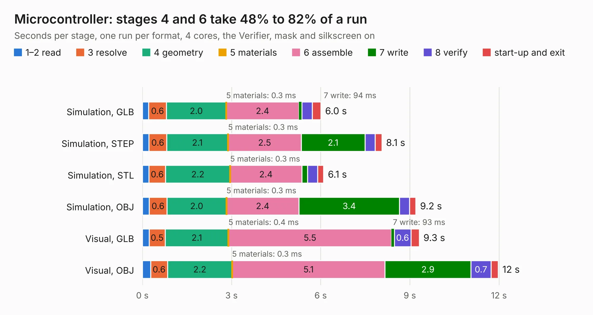

# 996. Microcontroller

Board 996 of the 3,116 of [Corpus Testing](../Corpus-Testing.md), on [Corpus Page 10](../CorpusTestingPages/Corpus-Testing-10.md#996-microcontroller).

| Mode and format | 1–2 read | 3 resolve | 4 geometry | 5 materials | 6 assemble | 7 write | 8 verify | start-up and exit | Total |
|---|---:|---:|---:|---:|---:|---:|---:|---:|---:|
| Simulation, GLB | 0.2 | 0.6 | 2.0 | 0.3&nbsp;ms | 2.4 | 94&nbsp;ms | 0.3 | 0.3 | 6.0 |
| Simulation, STEP | 0.2 | 0.6 | 2.1 | 0.3&nbsp;ms | 2.5 | 2.1 | 0.3 | 0.2 | 8.1 |
| Simulation, STL | 0.2 | 0.6 | 2.2 | 0.3&nbsp;ms | 2.4 | 0.2 | 0.3 | 0.2 | 6.1 |
| Simulation, OBJ | 0.2 | 0.6 | 2.0 | 0.3&nbsp;ms | 2.4 | 3.4 | 0.3 | 0.2 | 9.2 |
| Visual, GLB | 0.2 | 0.5 | 2.1 | 0.4&nbsp;ms | 5.5 | 93&nbsp;ms | 0.6 | 0.3 | 9.3 |
| Visual, OBJ | 0.3 | 0.6 | 2.2 | 0.3&nbsp;ms | 5.1 | 2.9 | 0.7 | 0.2 | 12.0 |

<table align="center"><tr><td valign="top">

| Board | Repo: [FrameworkComputer/ExpansionCards](https://github.com/FrameworkComputer/ExpansionCards) Board: `Microcontroller.kicad_pcb` |
|---|---|
| Folder | Electrical / Microcontroller |
| Complexity | 258&nbsp;/&nbsp;1000 (size&nbsp;203, features&nbsp;55) |
| KESE&nbsp;features | through vias, rounded, trapezoid or chamfered pads, filled zones, curved board outline |
| Tested | 9th November 2026 |
| Copper&nbsp;layers | 2 |
| File&nbsp;format | KiCad 5 (20171130) |
| Parts,&nbsp;tracks,&nbsp;vias | 26, 539, 110 |
| Triangles,&nbsp;simulation | 566,184 in 50 parts |
| Verifier | PASS in all six runs |

</td><td valign="top">

<table>
<tr><th>File type</th><th>File size</th><th>Peak memory used</th></tr>
<tr><th colspan="3" align="left">Simulation</th></tr>
<tr><td>GLB</td><td align="right">19&nbsp;MB</td><td align="right">320&nbsp;MB</td></tr>
<tr><td>STEP</td><td align="right">90&nbsp;MB</td><td align="right">393&nbsp;MB</td></tr>
<tr><td>STL</td><td align="right">28&nbsp;MB</td><td align="right">324&nbsp;MB</td></tr>
<tr><td>OBJ</td><td align="right">57&nbsp;MB</td><td align="right">419&nbsp;MB</td></tr>
<tr><th colspan="3" align="left">Visual</th></tr>
<tr><td>GLB</td><td align="right">17&nbsp;MB</td><td align="right">466&nbsp;MB</td></tr>
<tr><td>OBJ</td><td align="right">51&nbsp;MB</td><td align="right">412&nbsp;MB</td></tr>
</table>

</td></tr></table>

| Previous | Next |
|:---|---:|
| [995. Expansion_Card_Retrofit](b0995b_ExpansionCards_Expansion-Card-Retrofit.md) | [997. hram_regs_patch](b0997b_NE-Delta-Schematics_hram-regs-patch.md) |
