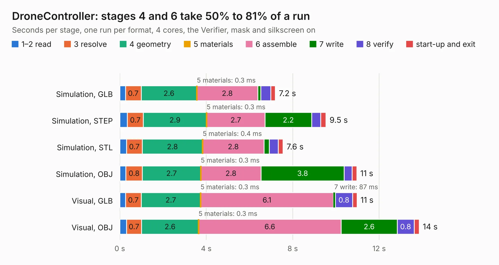

# 997. DroneController

Board 997 of the 3,128 of [Corpus Testing](../Corpus-Testing.md), on [Corpus Page 10](../CorpusTestingPages/Corpus-Testing-10.md#997-dronecontroller).

| Mode and format | 1–2 read | 3 resolve | 4 geometry | 5 materials | 6 assemble | 7 write | 8 verify | start-up and exit | Total |
|---|---:|---:|---:|---:|---:|---:|---:|---:|---:|
| Simulation, GLB | 0.3 | 0.7 | 2.6 | 0.3&nbsp;ms | 2.8 | 0.1 | 0.5 | 0.2 | 7.2 |
| Simulation, STEP | 0.3 | 0.7 | 2.9 | 0.3&nbsp;ms | 2.7 | 2.2 | 0.4 | 0.2 | 9.5 |
| Simulation, STL | 0.3 | 0.7 | 2.8 | 0.4&nbsp;ms | 2.8 | 0.2 | 0.4 | 0.2 | 7.6 |
| Simulation, OBJ | 0.3 | 0.8 | 2.7 | 0.3&nbsp;ms | 2.8 | 3.8 | 0.4 | 0.2 | 11.0 |
| Visual, GLB | 0.3 | 0.7 | 2.7 | 0.3&nbsp;ms | 6.1 | 87&nbsp;ms | 0.8 | 0.2 | 11.0 |
| Visual, OBJ | 0.3 | 0.7 | 2.6 | 0.3&nbsp;ms | 6.6 | 2.6 | 0.8 | 0.2 | 13.9 |

<table align="center"><tr><td valign="top">

| Board | Repo: [FPV-Drone-STM32F411/DroneController](https://github.com/FPV-Drone-STM32F411/DroneController) Board: `DroneController.kicad_pcb` |
|---|---|
| Folder | KiCad |
| Complexity | 338&nbsp;/&nbsp;1000 (size&nbsp;228, features&nbsp;110) |
| KESE&nbsp;features | through vias, slotted holes, rounded, trapezoid or chamfered pads, filled zones, curved board outline, knockout text, stack-up, dielectric εr and tanδ |
| Tested | 9th November 2026 |
| Copper&nbsp;layers | 4 |
| File&nbsp;format | KiCad 9 (20241229) |
| Parts,&nbsp;tracks,&nbsp;vias | 59, 450, 126 |
| Triangles,&nbsp;simulation | 859,154 in 89 parts |
| Verifier | PASS in all six runs |

</td><td valign="top">

<table>
<tr><th>File type</th><th>File size</th><th>Peak memory used</th></tr>
<tr><th colspan="3" align="left">Simulation</th></tr>
<tr><td>GLB</td><td align="right">30&nbsp;MB</td><td align="right">397&nbsp;MB</td></tr>
<tr><td>STEP</td><td align="right">115&nbsp;MB</td><td align="right">472&nbsp;MB</td></tr>
<tr><td>STL</td><td align="right">43&nbsp;MB</td><td align="right">375&nbsp;MB</td></tr>
<tr><td>OBJ</td><td align="right">88&nbsp;MB</td><td align="right">633&nbsp;MB</td></tr>
<tr><th colspan="3" align="left">Visual</th></tr>
<tr><td>GLB</td><td align="right">18&nbsp;MB</td><td align="right">470&nbsp;MB</td></tr>
<tr><td>OBJ</td><td align="right">54&nbsp;MB</td><td align="right">490&nbsp;MB</td></tr>
</table>

</td></tr></table>

| Previous | Next |
|:---|---:|
| [996. FABulous_board](b0996b_fabulous-board_FABulous-board.md) | [998. ESC_Board](b0998b_DroneController_ESC-Board.md) |
