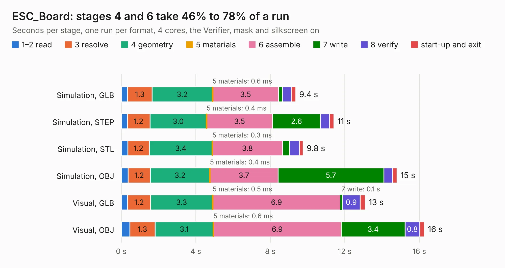

# 998. ESC_Board

Board 998 of the 3,127 of [Corpus Testing](../Corpus-Testing.md), on [Corpus Page 10](../CorpusTestingPages/Corpus-Testing-10.md#998-esc_board).

| Mode and format | 1–2 read | 3 resolve | 4 geometry | 5 materials | 6 assemble | 7 write | 8 verify | start-up and exit | Total |
|---|---:|---:|---:|---:|---:|---:|---:|---:|---:|
| Simulation, GLB | 0.3 | 1.3 | 3.2 | 0.6&nbsp;ms | 3.5 | 0.2 | 0.5 | 0.2 | 9.4 |
| Simulation, STEP | 0.3 | 1.2 | 3.0 | 0.4&nbsp;ms | 3.5 | 2.6 | 0.5 | 0.2 | 11.4 |
| Simulation, STL | 0.3 | 1.2 | 3.4 | 0.3&nbsp;ms | 3.8 | 0.4 | 0.5 | 0.2 | 9.8 |
| Simulation, OBJ | 0.4 | 1.2 | 3.2 | 0.4&nbsp;ms | 3.7 | 5.7 | 0.5 | 0.2 | 14.8 |
| Visual, GLB | 0.3 | 1.2 | 3.3 | 0.5&nbsp;ms | 6.9 | 0.1 | 0.9 | 0.3 | 13.1 |
| Visual, OBJ | 0.5 | 1.3 | 3.1 | 0.6&nbsp;ms | 6.9 | 3.4 | 0.8 | 0.2 | 16.3 |

<table align="center"><tr><td valign="top">

| Board | Repo: [FPV-Drone-STM32F411/DroneController](https://github.com/FPV-Drone-STM32F411/DroneController) Board: `ESC_Board.kicad_pcb` |
|---|---|
| Folder | KiCad / ESC_Board |
| Complexity | 366&nbsp;/&nbsp;1000 (size&nbsp;236, features&nbsp;130) |
| KESE&nbsp;features | through vias, custom pads, rounded, trapezoid or chamfered pads, filled zones, copper text, knockout text, TrueType text, stack-up, dielectric εr and tanδ |
| Tested | 9th November 2026 |
| Copper&nbsp;layers | 4 |
| File&nbsp;format | KiCad 9 (20241229) |
| Parts,&nbsp;tracks,&nbsp;vias | 70, 368, 296 |
| Triangles,&nbsp;simulation | 1,260,224 in 79 parts |
| Verifier | PASS in all six runs |

</td><td valign="top">

<table>
<tr><th>File type</th><th>File size</th><th>Peak memory used</th></tr>
<tr><th colspan="3" align="left">Simulation</th></tr>
<tr><td>GLB</td><td align="right">43&nbsp;MB</td><td align="right">576&nbsp;MB</td></tr>
<tr><td>STEP</td><td align="right">136&nbsp;MB</td><td align="right">627&nbsp;MB</td></tr>
<tr><td>STL</td><td align="right">63&nbsp;MB</td><td align="right">578&nbsp;MB</td></tr>
<tr><td>OBJ</td><td align="right">128&nbsp;MB</td><td align="right">852&nbsp;MB</td></tr>
<tr><th colspan="3" align="left">Visual</th></tr>
<tr><td>GLB</td><td align="right">24&nbsp;MB</td><td align="right">611&nbsp;MB</td></tr>
<tr><td>OBJ</td><td align="right">74&nbsp;MB</td><td align="right">591&nbsp;MB</td></tr>
</table>

</td></tr></table>

| Previous | Next |
|:---|---:|
| [997. DroneController](b0997b_DroneController_DroneController.md) | [999. Expansion_Card](b0999b_ExpansionCards_Expansion-Card.md) |
