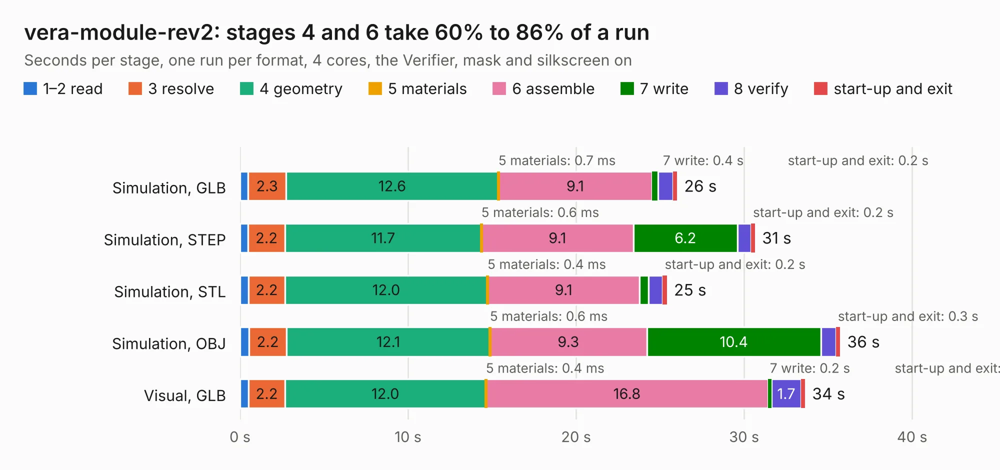

# 999. vera-module-rev2

Board 999 of the 3,112 of [Corpus Testing](../Corpus-Testing.md), on [Corpus Page 10](../CorpusTestingPages/Corpus-Testing-10.md#999-vera-module-rev2).

| Mode and format | 1–2 read | 3 resolve | 4 geometry | 5 materials | 6 assemble | 7 write | 8 verify | start-up and exit | Total |
|---|---:|---:|---:|---:|---:|---:|---:|---:|---:|
| Simulation, GLB | 0.5 | 2.3 | 12.6 | 0.7&nbsp;ms | 9.1 | 0.4 | 0.9 | 0.2 | 26.0 |
| Simulation, STEP | 0.5 | 2.2 | 11.7 | 0.6&nbsp;ms | 9.1 | 6.2 | 0.8 | 0.2 | 30.6 |
| Simulation, STL | 0.5 | 2.2 | 12.0 | 0.4&nbsp;ms | 9.1 | 0.5 | 0.8 | 0.2 | 25.4 |
| Simulation, OBJ | 0.5 | 2.2 | 12.1 | 0.6&nbsp;ms | 9.3 | 10.4 | 0.9 | 0.3 | 35.7 |
| Visual, GLB | 0.5 | 2.2 | 12.0 | 0.4&nbsp;ms | 16.8 | 0.2 | 1.7 | 0.2 | 33.6 |
| Visual, OBJ | 0.4 | 1.9 | 10.4 | 0.3&nbsp;ms | 17.3 | 5.7 | 2.0 | 0.3 | 38.0 |

<table align="center"><tr><td valign="top">

| Board | Repo: [fvdhoef/vera-module](https://github.com/fvdhoef/vera-module) Board: `vera-module-rev2.kicad_pcb` |
|---|---|
| Folder | pcb / rev2 |
| Complexity | 287&nbsp;/&nbsp;1000 (size&nbsp;232, features&nbsp;55) |
| KESE&nbsp;features | through vias, rounded, trapezoid or chamfered pads, filled zones, curved board outline |
| Tested | 9th November 2026 |
| Copper&nbsp;layers | 2 |
| File&nbsp;format | KiCad 5 (20171130) |
| Parts,&nbsp;tracks,&nbsp;vias | 111, 1,215, 256 |
| Triangles,&nbsp;simulation | 1,904,622 in 145 parts |
| Verifier | PASS in all six runs |

</td><td valign="top">

<table>
<tr><th>File type</th><th>File size</th><th>Peak memory used</th></tr>
<tr><th colspan="3" align="left">Simulation</th></tr>
<tr><td>GLB</td><td align="right">67&nbsp;MB</td><td align="right">786&nbsp;MB</td></tr>
<tr><td>STEP</td><td align="right">341&nbsp;MB</td><td align="right">912&nbsp;MB</td></tr>
<tr><td>STL</td><td align="right">95&nbsp;MB</td><td align="right">758&nbsp;MB</td></tr>
<tr><td>OBJ</td><td align="right">201&nbsp;MB</td><td align="right">1.3&nbsp;GB</td></tr>
<tr><th colspan="3" align="left">Visual</th></tr>
<tr><td>GLB</td><td align="right">49&nbsp;MB</td><td align="right">953&nbsp;MB</td></tr>
<tr><td>OBJ</td><td align="right">150&nbsp;MB</td><td align="right">1.1&nbsp;GB</td></tr>
</table>

</td></tr></table>

| Previous | Next |
|:---|---:|
| [998. LX783](b0998b_NE-Delta-Schematics_LX783.md) | [1000. vera-module-rev3](b1000b_vera-module_vera-module-rev3.md) |
