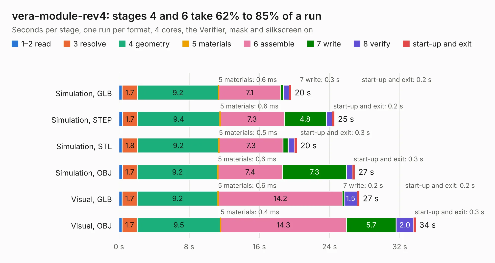

# 999. vera-module-rev4

Board 999 of the 3,107 of [Corpus Testing](../Corpus-Testing.md), on [Corpus Page 10](../CorpusTestingPages/Corpus-Testing-10.md#999-vera-module-rev4).

| Mode and format | 1–2 read | 3 resolve | 4 geometry | 5 materials | 6 assemble | 7 write | 8 verify | start-up and exit | Total |
|---|---:|---:|---:|---:|---:|---:|---:|---:|---:|
| Simulation, GLB | 0.4 | 1.7 | 9.2 | 0.6&nbsp;ms | 7.1 | 0.3 | 0.7 | 0.2 | 19.6 |
| Simulation, STEP | 0.4 | 1.7 | 9.4 | 0.6&nbsp;ms | 7.3 | 4.8 | 0.7 | 0.2 | 24.6 |
| Simulation, STL | 0.4 | 1.8 | 9.2 | 0.5&nbsp;ms | 7.3 | 0.6 | 0.7 | 0.3 | 20.3 |
| Simulation, OBJ | 0.4 | 1.7 | 9.2 | 0.6&nbsp;ms | 7.4 | 7.3 | 0.7 | 0.3 | 26.9 |
| Visual, GLB | 0.4 | 1.7 | 9.2 | 0.6&nbsp;ms | 14.2 | 0.2 | 1.5 | 0.2 | 27.4 |
| Visual, OBJ | 0.4 | 1.7 | 9.5 | 0.4&nbsp;ms | 14.3 | 5.7 | 2.0 | 0.3 | 33.8 |

<table align="center"><tr><td valign="top">

| Board | Repo: [fvdhoef/vera-module](https://github.com/fvdhoef/vera-module) Board: `vera-module-rev4.kicad_pcb` |
|---|---|
| Folder | pcb / rev4 |
| Complexity | 285&nbsp;/&nbsp;1000 (size&nbsp;230, features&nbsp;55) |
| KESE&nbsp;features | through vias, rounded, trapezoid or chamfered pads, filled zones, curved board outline |
| Tested | 9th November 2026 |
| Copper&nbsp;layers | 2 |
| File&nbsp;format | KiCad 5 (20171130) |
| Parts,&nbsp;tracks,&nbsp;vias | 99, 1,157, 255 |
| Triangles,&nbsp;simulation | 1,770,960 in 145 parts |
| Verifier | PASS in all six runs |

</td><td valign="top">

<table>
<tr><th>File type</th><th>File size</th><th>Peak memory used</th></tr>
<tr><th colspan="3" align="left">Simulation</th></tr>
<tr><td>GLB</td><td align="right">62&nbsp;MB</td><td align="right">722&nbsp;MB</td></tr>
<tr><td>STEP</td><td align="right">317&nbsp;MB</td><td align="right">817&nbsp;MB</td></tr>
<tr><td>STL</td><td align="right">89&nbsp;MB</td><td align="right">746&nbsp;MB</td></tr>
<tr><td>OBJ</td><td align="right">187&nbsp;MB</td><td align="right">1.2&nbsp;GB</td></tr>
<tr><th colspan="3" align="left">Visual</th></tr>
<tr><td>GLB</td><td align="right">46&nbsp;MB</td><td align="right">840&nbsp;MB</td></tr>
<tr><td>OBJ</td><td align="right">140&nbsp;MB</td><td align="right">1.0&nbsp;GB</td></tr>
</table>

</td></tr></table>

| Previous | Next |
|:---|---:|
| [998. vera-module-rev3](b0998b_vera-module_vera-module-rev3.md) | [1000. GR8RAM](b1000b_GR8RAM_GR8RAM.md) |
