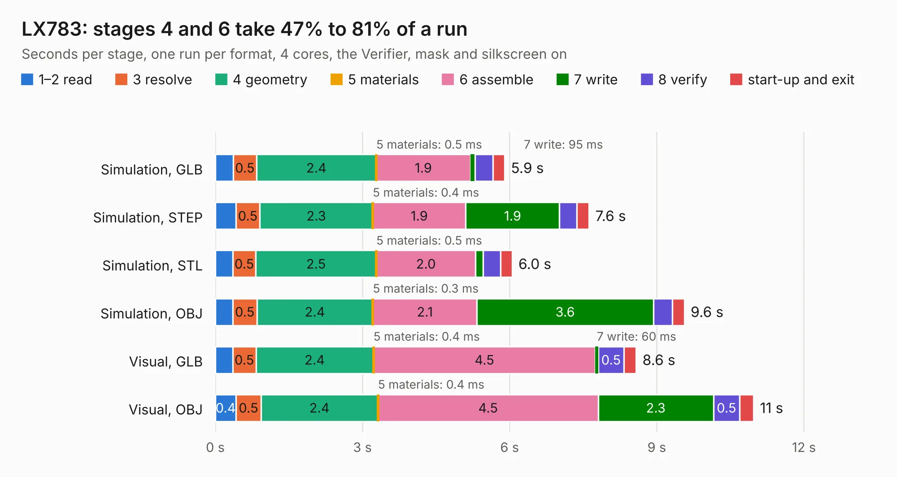

# 1001. LX783

Board 1,001 of the 3,116 of [Corpus Testing](../Corpus-Testing.md), on [Corpus Page 10](../CorpusTestingPages/Corpus-Testing-10.md#1001-lx783).

| Mode and format | 1–2 read | 3 resolve | 4 geometry | 5 materials | 6 assemble | 7 write | 8 verify | start-up and exit | Total |
|---|---:|---:|---:|---:|---:|---:|---:|---:|---:|
| Simulation, GLB | 0.4 | 0.5 | 2.4 | 0.5&nbsp;ms | 1.9 | 95&nbsp;ms | 0.4 | 0.2 | 5.9 |
| Simulation, STEP | 0.4 | 0.5 | 2.3 | 0.4&nbsp;ms | 1.9 | 1.9 | 0.4 | 0.2 | 7.6 |
| Simulation, STL | 0.4 | 0.5 | 2.5 | 0.5&nbsp;ms | 2.0 | 0.2 | 0.4 | 0.2 | 6.0 |
| Simulation, OBJ | 0.4 | 0.5 | 2.4 | 0.3&nbsp;ms | 2.1 | 3.6 | 0.4 | 0.2 | 9.6 |
| Visual, GLB | 0.4 | 0.5 | 2.4 | 0.4&nbsp;ms | 4.5 | 60&nbsp;ms | 0.5 | 0.3 | 8.6 |
| Visual, OBJ | 0.4 | 0.5 | 2.4 | 0.4&nbsp;ms | 4.5 | 2.3 | 0.5 | 0.3 | 11.0 |

<table align="center"><tr><td valign="top">

| Board | Repo: [frubem/NE_Delta_Schematics](https://github.com/frubem/NE_Delta_Schematics) Board: `LX783.kicad_pcb` |
|---|---|
| Folder | LX783_RGB_Video |
| Complexity | 237&nbsp;/&nbsp;1000 (size&nbsp;147, features&nbsp;90) |
| KESE&nbsp;features | through vias, rounded, trapezoid or chamfered pads, drill offsets, arc tracks, filled zones, copper text, curved board outline |
| Tested | 9th November 2026 |
| Copper&nbsp;layers | 2 |
| File&nbsp;format | KiCad 9 (20241229) |
| Parts,&nbsp;tracks,&nbsp;vias | 27, 301, 3 |
| Triangles,&nbsp;simulation | 566,684 in 47 parts |
| Verifier | PASS in all six runs |

</td><td valign="top">

<table>
<tr><th>File type</th><th>File size</th><th>Peak memory used</th></tr>
<tr><th colspan="3" align="left">Simulation</th></tr>
<tr><td>GLB</td><td align="right">19&nbsp;MB</td><td align="right">320&nbsp;MB</td></tr>
<tr><td>STEP</td><td align="right">82&nbsp;MB</td><td align="right">363&nbsp;MB</td></tr>
<tr><td>STL</td><td align="right">28&nbsp;MB</td><td align="right">327&nbsp;MB</td></tr>
<tr><td>OBJ</td><td align="right">56&nbsp;MB</td><td align="right">421&nbsp;MB</td></tr>
<tr><th colspan="3" align="left">Visual</th></tr>
<tr><td>GLB</td><td align="right">12&nbsp;MB</td><td align="right">402&nbsp;MB</td></tr>
<tr><td>OBJ</td><td align="right">36&nbsp;MB</td><td align="right">387&nbsp;MB</td></tr>
</table>

</td></tr></table>

| Previous | Next |
|:---|---:|
| [1000. LX782](b1000b_NE-Delta-Schematics_LX782.md) | [1002. vera-module-rev2](b1002b_vera-module_vera-module-rev2.md) |
