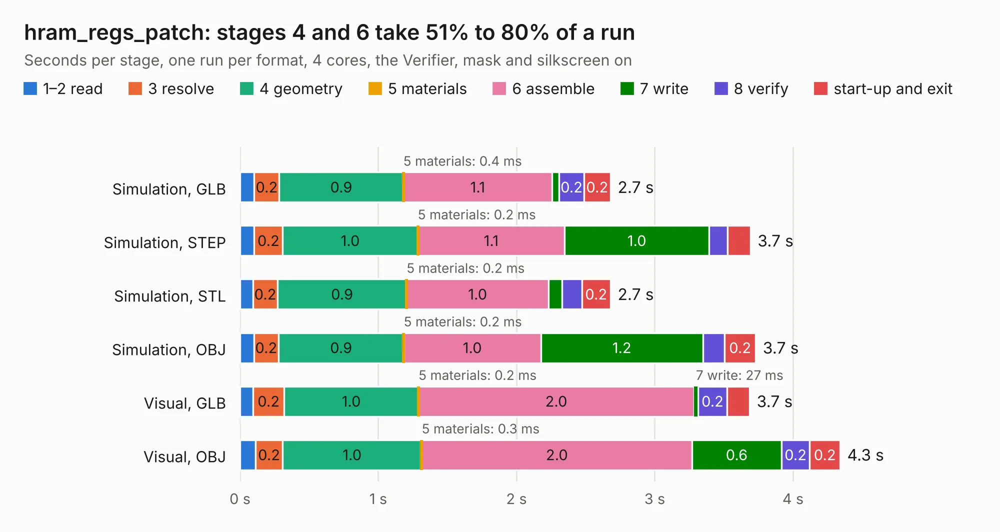

# 1001. hram_regs_patch

Board 1,001 of the 3,120 of [Corpus Testing](../Corpus-Testing.md), on [Corpus Page 10](../CorpusTestingPages/Corpus-Testing-10.md#1001-hram_regs_patch).

| Mode and format | 1–2 read | 3 resolve | 4 geometry | 5 materials | 6 assemble | 7 write | 8 verify | start-up and exit | Total |
|---|---:|---:|---:|---:|---:|---:|---:|---:|---:|
| Simulation, GLB | 0.1 | 0.2 | 0.9 | 0.4&nbsp;ms | 1.1 | 53&nbsp;ms | 0.2 | 0.2 | 2.7 |
| Simulation, STEP | 0.1 | 0.2 | 1.0 | 0.2&nbsp;ms | 1.1 | 1.0 | 0.1 | 0.2 | 3.7 |
| Simulation, STL | 94&nbsp;ms | 0.2 | 0.9 | 0.2&nbsp;ms | 1.0 | 99&nbsp;ms | 0.1 | 0.2 | 2.7 |
| Simulation, OBJ | 0.1 | 0.2 | 0.9 | 0.2&nbsp;ms | 1.0 | 1.2 | 0.2 | 0.2 | 3.7 |
| Visual, GLB | 95&nbsp;ms | 0.2 | 1.0 | 0.2&nbsp;ms | 2.0 | 27&nbsp;ms | 0.2 | 0.2 | 3.7 |
| Visual, OBJ | 0.1 | 0.2 | 1.0 | 0.3&nbsp;ms | 2.0 | 0.6 | 0.2 | 0.2 | 4.3 |

<table align="center"><tr><td valign="top">

| Board | Repo: [frubem/NE_Delta_Schematics](https://github.com/frubem/NE_Delta_Schematics) Board: `hram_regs_patch.kicad_pcb` |
|---|---|
| Folder | hram_regs_patch |
| Complexity | 146&nbsp;/&nbsp;1000 (size&nbsp;101, features&nbsp;45) |
| KESE&nbsp;features | rounded, trapezoid or chamfered pads, arc tracks, filled zones |
| Tested | 9th November 2026 |
| Copper&nbsp;layers | 2 |
| File&nbsp;format | KiCad 9 (20241229) |
| Parts,&nbsp;tracks,&nbsp;vias | 5, 51, 0 |
| Triangles,&nbsp;simulation | 303,608 in 45 parts |
| Verifier | PASS in all six runs |

</td><td valign="top">

<table>
<tr><th>File type</th><th>File size</th><th>Peak memory used</th></tr>
<tr><th colspan="3" align="left">Simulation</th></tr>
<tr><td>GLB</td><td align="right">9.8&nbsp;MB</td><td align="right">232&nbsp;MB</td></tr>
<tr><td>STEP</td><td align="right">38&nbsp;MB</td><td align="right">261&nbsp;MB</td></tr>
<tr><td>STL</td><td align="right">15&nbsp;MB</td><td align="right">228&nbsp;MB</td></tr>
<tr><td>OBJ</td><td align="right">30&nbsp;MB</td><td align="right">246&nbsp;MB</td></tr>
<tr><th colspan="3" align="left">Visual</th></tr>
<tr><td>GLB</td><td align="right">5.5&nbsp;MB</td><td align="right">244&nbsp;MB</td></tr>
<tr><td>OBJ</td><td align="right">16&nbsp;MB</td><td align="right">245&nbsp;MB</td></tr>
</table>

</td></tr></table>

| Previous | Next |
|:---|---:|
| [1000. Microcontroller](b1000b_ExpansionCards_Microcontroller.md) | [1002. NE_Delta](b1002b_NE-Delta-Schematics_LX780-Delta-fixed_NE-Delta.md) |
