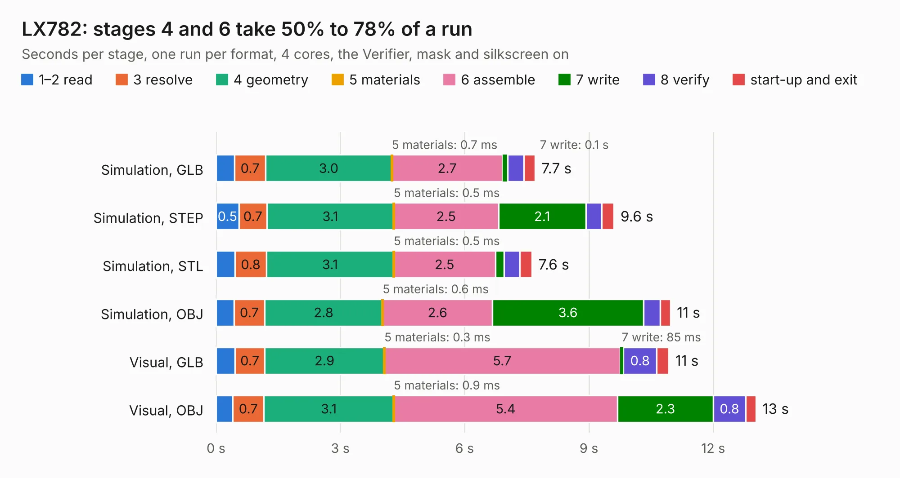

# 1003. LX782

Board 1,003 of the 3,119 of [Corpus Testing](../Corpus-Testing.md), on [Corpus Page 10](../CorpusTestingPages/Corpus-Testing-10.md#1003-lx782).

| Mode and format | 1–2 read | 3 resolve | 4 geometry | 5 materials | 6 assemble | 7 write | 8 verify | start-up and exit | Total |
|---|---:|---:|---:|---:|---:|---:|---:|---:|---:|
| Simulation, GLB | 0.4 | 0.7 | 3.0 | 0.7&nbsp;ms | 2.7 | 0.1 | 0.4 | 0.3 | 7.7 |
| Simulation, STEP | 0.5 | 0.7 | 3.1 | 0.5&nbsp;ms | 2.5 | 2.1 | 0.4 | 0.3 | 9.6 |
| Simulation, STL | 0.5 | 0.8 | 3.1 | 0.5&nbsp;ms | 2.5 | 0.2 | 0.4 | 0.3 | 7.6 |
| Simulation, OBJ | 0.4 | 0.7 | 2.8 | 0.6&nbsp;ms | 2.6 | 3.6 | 0.4 | 0.2 | 11.0 |
| Visual, GLB | 0.5 | 0.7 | 2.9 | 0.3&nbsp;ms | 5.7 | 85&nbsp;ms | 0.8 | 0.3 | 10.9 |
| Visual, OBJ | 0.4 | 0.7 | 3.1 | 0.9&nbsp;ms | 5.4 | 2.3 | 0.8 | 0.3 | 13.0 |

<table align="center"><tr><td valign="top">

| Board | Repo: [frubem/NE_Delta_Schematics](https://github.com/frubem/NE_Delta_Schematics) Board: `LX782.kicad_pcb` |
|---|---|
| Folder | LX782_Monochrome_Video |
| Complexity | 255&nbsp;/&nbsp;1000 (size&nbsp;155, features&nbsp;100) |
| KESE&nbsp;features | through vias, slotted holes, rounded, trapezoid or chamfered pads, drill offsets, arc tracks, filled zones, copper text, curved board outline |
| Tested | 9th November 2026 |
| Copper&nbsp;layers | 2 |
| File&nbsp;format | KiCad 9 (20241229) |
| Parts,&nbsp;tracks,&nbsp;vias | 47, 347, 1 |
| Triangles,&nbsp;simulation | 753,366 in 47 parts |
| Verifier | PASS in all six runs |

</td><td valign="top">

<table>
<tr><th>File type</th><th>File size</th><th>Peak memory used</th></tr>
<tr><th colspan="3" align="left">Simulation</th></tr>
<tr><td>GLB</td><td align="right">26&nbsp;MB</td><td align="right">401&nbsp;MB</td></tr>
<tr><td>STEP</td><td align="right">111&nbsp;MB</td><td align="right">444&nbsp;MB</td></tr>
<tr><td>STL</td><td align="right">38&nbsp;MB</td><td align="right">384&nbsp;MB</td></tr>
<tr><td>OBJ</td><td align="right">76&nbsp;MB</td><td align="right">548&nbsp;MB</td></tr>
<tr><th colspan="3" align="left">Visual</th></tr>
<tr><td>GLB</td><td align="right">16&nbsp;MB</td><td align="right">475&nbsp;MB</td></tr>
<tr><td>OBJ</td><td align="right">47&nbsp;MB</td><td align="right">452&nbsp;MB</td></tr>
</table>

</td></tr></table>

| Previous | Next |
|:---|---:|
| [1002. NE_Delta](b1002b_NE-Delta-Schematics_LX780-Delta-original_NE-Delta.md) | [1004. LX783](b1004b_NE-Delta-Schematics_LX783.md) |
