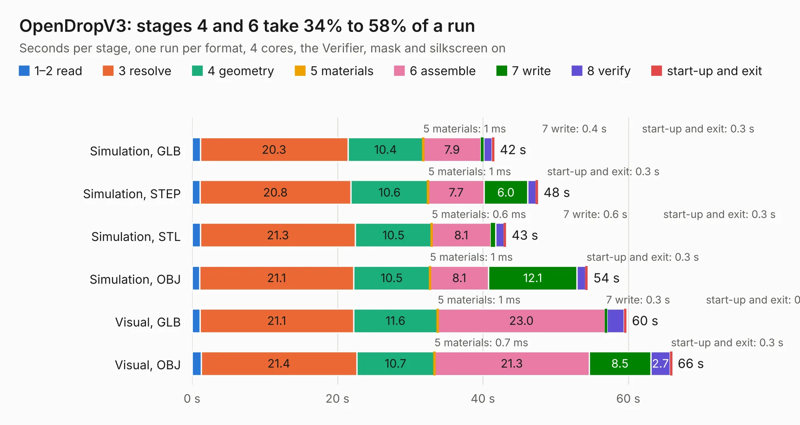

# 1003. OpenDropV3

Board 1,003 of the 3,100 of [Corpus Testing](../Corpus-Testing.md), on [Corpus Page 10](../CorpusTestingPages/Corpus-Testing-10.md#1003-opendropv3).

| Mode and format | 1–2 read | 3 resolve | 4 geometry | 5 materials | 6 assemble | 7 write | 8 verify | start-up and exit | Total |
|---|---:|---:|---:|---:|---:|---:|---:|---:|---:|
| Simulation, GLB | 1.1 | 20.3 | 10.4 | 1&nbsp;ms | 7.9 | 0.4 | 1.2 | 0.3 | 41.5 |
| Simulation, STEP | 1.1 | 20.8 | 10.6 | 1&nbsp;ms | 7.7 | 6.0 | 1.1 | 0.3 | 47.6 |
| Simulation, STL | 1.2 | 21.3 | 10.5 | 0.6&nbsp;ms | 8.1 | 0.6 | 1.2 | 0.3 | 43.2 |
| Simulation, OBJ | 1.1 | 21.1 | 10.5 | 1&nbsp;ms | 8.1 | 12.1 | 1.2 | 0.3 | 54.4 |
| Visual, GLB | 1.1 | 21.1 | 11.6 | 1&nbsp;ms | 23.0 | 0.3 | 2.4 | 0.3 | 59.7 |
| Visual, OBJ | 1.2 | 21.4 | 10.7 | 0.7&nbsp;ms | 21.3 | 8.5 | 2.7 | 0.3 | 66.0 |

<table align="center"><tr><td valign="top">

| Board | Repo: [GaudiLabs/OpenDrop](https://github.com/GaudiLabs/OpenDrop) Board: `OpenDropV3.kicad_pcb` |
|---|---|
| Folder | OpenDropV3 / Electronics / KiCad_Files |
| Complexity | 314&nbsp;/&nbsp;1000 (size&nbsp;259, features&nbsp;55) |
| KESE&nbsp;features | through vias, slotted holes, filled zones, curved board outline |
| Tested | 9th November 2026 |
| Copper&nbsp;layers | 2 |
| File&nbsp;format | KiCad 4 (4) |
| Parts,&nbsp;tracks,&nbsp;vias | 260, 2,641, 168 |
| Triangles,&nbsp;simulation | 2,229,422 in 287 parts |
| Verifier | PASS in all six runs |

</td><td valign="top">

<table>
<tr><th>File type</th><th>File size</th><th>Peak memory used</th></tr>
<tr><th colspan="3" align="left">Simulation</th></tr>
<tr><td>GLB</td><td align="right">80&nbsp;MB</td><td align="right">856&nbsp;MB</td></tr>
<tr><td>STEP</td><td align="right">434&nbsp;MB</td><td align="right">942&nbsp;MB</td></tr>
<tr><td>STL</td><td align="right">111&nbsp;MB</td><td align="right">809&nbsp;MB</td></tr>
<tr><td>OBJ</td><td align="right">242&nbsp;MB</td><td align="right">1.5&nbsp;GB</td></tr>
<tr><th colspan="3" align="left">Visual</th></tr>
<tr><td>GLB</td><td align="right">52&nbsp;MB</td><td align="right">988&nbsp;MB</td></tr>
<tr><td>OBJ</td><td align="right">160&nbsp;MB</td><td align="right">1.2&nbsp;GB</td></tr>
</table>

</td></tr></table>

| Previous | Next |
|:---|---:|
| [1002. PCBFrame](b1002b_OpenDrop_PCBFrame.md) | [1004. DIMMCartridgeConect](b1004b_OpenDrop_DIMMCartridgeConect.md) |
