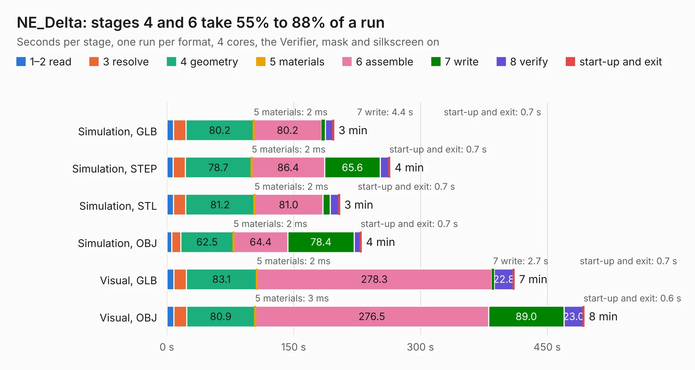

# 1004. NE_Delta

Board 1,004 of the 3,130 of [Corpus Testing](../Corpus-Testing.md), on [Corpus Page 10](../CorpusTestingPages/Corpus-Testing-10.md#1004-ne_delta).

| Mode and format | 1–2 read | 3 resolve | 4 geometry | 5 materials | 6 assemble | 7 write | 8 verify | start-up and exit | Total |
|---|---:|---:|---:|---:|---:|---:|---:|---:|---:|
| Simulation, GLB | 7.8 | 14.8 | 80.2 | 2&nbsp;ms | 80.2 | 4.4 | 9.1 | 0.7 | 197.3 |
| Simulation, STEP | 7.5 | 14.2 | 78.7 | 2&nbsp;ms | 86.4 | 65.6 | 10.6 | 0.7 | 263.6 |
| Simulation, STL | 8.0 | 14.4 | 81.2 | 2&nbsp;ms | 81.0 | 8.8 | 10.0 | 0.7 | 204.1 |
| Simulation, OBJ | 5.6 | 10.7 | 62.5 | 2&nbsp;ms | 64.4 | 78.4 | 7.4 | 0.7 | 229.7 |
| Visual, GLB | 8.3 | 14.9 | 83.1 | 2&nbsp;ms | 278.3 | 2.7 | 22.8 | 0.7 | 410.8 |
| Visual, OBJ | 8.3 | 15.1 | 80.9 | 3&nbsp;ms | 276.5 | 89.0 | 23.0 | 0.6 | 493.4 |

<table align="center"><tr><td valign="top">

| Board | Repo: [frubem/NE_Delta_Schematics](https://github.com/frubem/NE_Delta_Schematics) Board: `NE_Delta.kicad_pcb` |
|---|---|
| Folder | LX780_Delta-original |
| Complexity | 422&nbsp;/&nbsp;1000 (size&nbsp;252, features&nbsp;170) |
| KESE&nbsp;features | through vias, slotted holes, custom pads, rounded, trapezoid or chamfered pads, drill offsets, arc tracks, filled zones, copper drawings, copper text, curved board outline, TrueType text, stack-up, dielectric εr and tanδ |
| Tested | 9th November 2026 to 10th November 2026 |
| Copper&nbsp;layers | 2 |
| File&nbsp;format | KiCad 9 (20241229) |
| Parts,&nbsp;tracks,&nbsp;vias | 185, 51,566, 969 |
| Triangles,&nbsp;simulation | 16,535,996 in 415 parts |
| Verifier | PASS in all six runs |
| Run&nbsp;again | Simulation, OBJ: failed in the corpus run, run again with the memory cap raised from 11 GB to 14.5 GB, and passed |

</td><td valign="top">

<table>
<tr><th>File type</th><th>File size</th><th>Peak memory used</th></tr>
<tr><th colspan="3" align="left">Simulation</th></tr>
<tr><td>GLB</td><td align="right">562&nbsp;MB</td><td align="right">5.2&nbsp;GB</td></tr>
<tr><td>STEP</td><td align="right">3.3&nbsp;GB</td><td align="right">6.1&nbsp;GB</td></tr>
<tr><td>STL</td><td align="right">827&nbsp;MB</td><td align="right">5.0&nbsp;GB</td></tr>
<tr><td>OBJ</td><td align="right">1.8&nbsp;GB</td><td align="right">14&nbsp;GB</td></tr>
<tr><th colspan="3" align="left">Visual</th></tr>
<tr><td>GLB</td><td align="right">387&nbsp;MB</td><td align="right">6.0&nbsp;GB</td></tr>
<tr><td>OBJ</td><td align="right">1.3&nbsp;GB</td><td align="right">10&nbsp;GB</td></tr>
</table>

</td></tr></table>

| Previous | Next |
|:---|---:|
| [1003. NE_Delta](b1003b_NE-Delta-Schematics_LX780-Delta-fixed_NE-Delta.md) | [1005. LX782](b1005b_NE-Delta-Schematics_LX782.md) |
