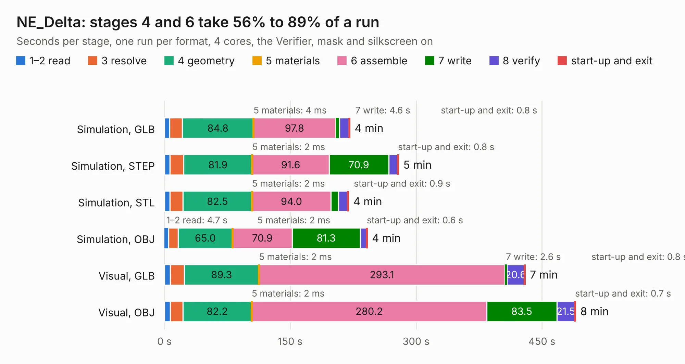

# 1005 NE_Delta

Board 1,005 of the 3,138 of [Corpus Testing](../Corpus-Testing.md), on [Corpus Page 10](../CorpusTestingPages/Corpus-Testing-10.md#1005-ne_delta).

| Mode and format | 1–2 read | 3 resolve | 4 geometry | 5 materials | 6 assemble | 7 write | 8 verify | start-up and exit | Total |
|---|---:|---:|---:|---:|---:|---:|---:|---:|---:|
| Simulation, GLB | 5.9 | 15.5 | 84.8 | 4&nbsp;ms | 97.8 | 4.6 | 11.5 | 0.8 | 220.9 |
| Simulation, STEP | 6.7 | 16.1 | 81.9 | 2&nbsp;ms | 91.6 | 70.9 | 10.9 | 0.8 | 279.0 |
| Simulation, STL | 6.5 | 15.5 | 82.5 | 2&nbsp;ms | 94.0 | 9.0 | 10.9 | 0.9 | 219.3 |
| Simulation, OBJ | 4.7 | 11.5 | 65.0 | 2&nbsp;ms | 70.9 | 81.3 | 7.5 | 0.6 | 241.6 |
| Visual, GLB | 7.0 | 16.5 | 89.3 | 2&nbsp;ms | 293.1 | 2.6 | 20.6 | 0.8 | 429.9 |
| Visual, OBJ | 7.0 | 14.8 | 82.2 | 2&nbsp;ms | 280.2 | 83.5 | 21.5 | 0.7 | 490.0 |

<table align="center"><tr><td valign="top">

| Board | Repo: [frubem/NE_Delta_Schematics](https://github.com/frubem/NE_Delta_Schematics) Board: `NE_Delta.kicad_pcb` |
|---|---|
| Folder | LX780_Delta-fixed |
| Complexity | 422&nbsp;/&nbsp;1000 (size&nbsp;252, features&nbsp;170) |
| KESE&nbsp;features | through vias, slotted holes, custom pads, rounded, trapezoid or chamfered pads, drill offsets, arc tracks, filled zones, copper drawings, copper text, curved board outline, TrueType text, stack-up, dielectric εr and tanδ |
| Tested | 9th November 2026 to 10th November 2026 |
| Copper&nbsp;layers | 2 |
| File&nbsp;format | KiCad 10 (20260206) |
| Parts,&nbsp;tracks,&nbsp;vias | 185, 51,593, 989 |
| Triangles,&nbsp;simulation | 16,659,534 in 413 parts |
| Verifier | PASS in all six runs |
| Run&nbsp;again | Simulation, OBJ: failed in the corpus run, run again with the memory cap raised from 11 GB to 14.5 GB, and passed |

</td><td valign="top">

<table>
<tr><th>File type</th><th>File size</th><th>Peak memory used</th></tr>
<tr><th colspan="3" align="left">Simulation</th></tr>
<tr><td>GLB</td><td align="right">566&nbsp;MB</td><td align="right">5.0&nbsp;GB</td></tr>
<tr><td>STEP</td><td align="right">3.3&nbsp;GB</td><td align="right">6.0&nbsp;GB</td></tr>
<tr><td>STL</td><td align="right">833&nbsp;MB</td><td align="right">5.4&nbsp;GB</td></tr>
<tr><td>OBJ</td><td align="right">1.8&nbsp;GB</td><td align="right">14&nbsp;GB</td></tr>
<tr><th colspan="3" align="left">Visual</th></tr>
<tr><td>GLB</td><td align="right">392&nbsp;MB</td><td align="right">6.0&nbsp;GB</td></tr>
<tr><td>OBJ</td><td align="right">1.3&nbsp;GB</td><td align="right">11&nbsp;GB</td></tr>
</table>

</td></tr></table>

| Previous | Next |
|:---|---:|
| [1004 hram_regs_patch](b1004b_NE-Delta-Schematics_hram-regs-patch.md) | [1006 NE_Delta](b1006b_NE-Delta-Schematics_LX780-Delta-original_NE-Delta.md) |
