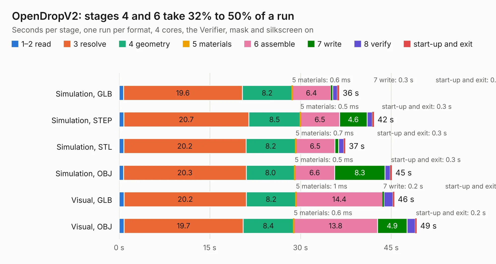

# 1005. OpenDropV2

Board 1,005 of the 3,104 of [Corpus Testing](../Corpus-Testing.md), on [Corpus Page 10](../CorpusTestingPages/Corpus-Testing-10.md#1005-opendropv2).

| Mode and format | 1–2 read | 3 resolve | 4 geometry | 5 materials | 6 assemble | 7 write | 8 verify | start-up and exit | Total |
|---|---:|---:|---:|---:|---:|---:|---:|---:|---:|
| Simulation, GLB | 0.7 | 19.6 | 8.2 | 0.6&nbsp;ms | 6.4 | 0.3 | 0.8 | 0.3 | 36.4 |
| Simulation, STEP | 0.8 | 20.7 | 8.5 | 0.5&nbsp;ms | 6.5 | 4.6 | 0.9 | 0.3 | 42.1 |
| Simulation, STL | 0.8 | 20.2 | 8.2 | 0.7&nbsp;ms | 6.5 | 0.6 | 0.9 | 0.3 | 37.4 |
| Simulation, OBJ | 0.7 | 20.3 | 8.0 | 0.5&nbsp;ms | 6.6 | 8.3 | 0.9 | 0.3 | 45.1 |
| Visual, GLB | 0.8 | 20.2 | 8.2 | 1&nbsp;ms | 14.4 | 0.2 | 1.5 | 0.2 | 45.5 |
| Visual, OBJ | 0.8 | 19.7 | 8.4 | 0.6&nbsp;ms | 13.8 | 4.9 | 1.4 | 0.2 | 49.2 |

<table align="center"><tr><td valign="top">

| Board | Repo: [GaudiLabs/OpenDrop](https://github.com/GaudiLabs/OpenDrop) Board: `OpenDropV2.kicad_pcb` |
|---|---|
| Folder | OpenDropV2 / DesignFiles |
| Complexity | 292&nbsp;/&nbsp;1000 (size&nbsp;247, features&nbsp;45) |
| KESE&nbsp;features | through vias, filled zones, curved board outline |
| Tested | 9th November 2026 |
| Copper&nbsp;layers | 2 |
| File&nbsp;format | KiCad 4 (4) |
| Parts,&nbsp;tracks,&nbsp;vias | 211, 1,878, 96 |
| Triangles,&nbsp;simulation | 1,898,760 in 203 parts |
| Verifier | PASS in all six runs |

</td><td valign="top">

<table>
<tr><th>File type</th><th>File size</th><th>Peak memory used</th></tr>
<tr><th colspan="3" align="left">Simulation</th></tr>
<tr><td>GLB</td><td align="right">68&nbsp;MB</td><td align="right">689&nbsp;MB</td></tr>
<tr><td>STEP</td><td align="right">379&nbsp;MB</td><td align="right">821&nbsp;MB</td></tr>
<tr><td>STL</td><td align="right">95&nbsp;MB</td><td align="right">696&nbsp;MB</td></tr>
<tr><td>OBJ</td><td align="right">206&nbsp;MB</td><td align="right">1.3&nbsp;GB</td></tr>
<tr><th colspan="3" align="left">Visual</th></tr>
<tr><td>GLB</td><td align="right">41&nbsp;MB</td><td align="right">868&nbsp;MB</td></tr>
<tr><td>OBJ</td><td align="right">124&nbsp;MB</td><td align="right">939&nbsp;MB</td></tr>
</table>

</td></tr></table>

| Previous | Next |
|:---|---:|
| [1004. WarpSE](b1004b_WarpSE_WarpSE.md) | [1006. PCBFrame](b1006b_OpenDrop_PCBFrame.md) |
