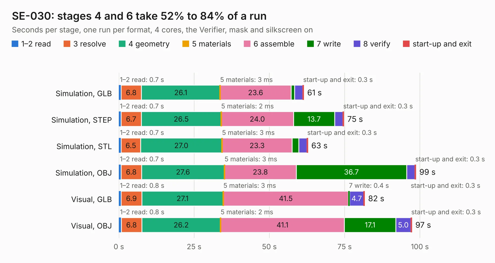

# 1005. SE-030

Board 1,005 of the 3,111 of [Corpus Testing](../Corpus-Testing.md), on [Corpus Page 10](../CorpusTestingPages/Corpus-Testing-10.md#1005-se-030).

| Mode and format | 1–2 read | 3 resolve | 4 geometry | 5 materials | 6 assemble | 7 write | 8 verify | start-up and exit | Total |
|---|---:|---:|---:|---:|---:|---:|---:|---:|---:|
| Simulation, GLB | 0.7 | 6.8 | 26.1 | 3&nbsp;ms | 23.6 | 1.2 | 2.7 | 0.3 | 61.4 |
| Simulation, STEP | 0.7 | 6.7 | 26.5 | 2&nbsp;ms | 24.0 | 13.7 | 2.7 | 0.3 | 74.7 |
| Simulation, STL | 0.7 | 6.5 | 27.0 | 3&nbsp;ms | 23.3 | 2.2 | 2.6 | 0.3 | 62.8 |
| Simulation, OBJ | 0.7 | 6.8 | 27.6 | 3&nbsp;ms | 23.8 | 36.7 | 2.7 | 0.3 | 98.7 |
| Visual, GLB | 0.8 | 6.9 | 27.1 | 3&nbsp;ms | 41.5 | 0.4 | 4.7 | 0.3 | 81.6 |
| Visual, OBJ | 0.8 | 6.8 | 26.2 | 2&nbsp;ms | 41.1 | 17.1 | 5.0 | 0.3 | 97.3 |

<table align="center"><tr><td valign="top">

| Board | Repo: [garrettsworkshop/Warp-LC](https://github.com/garrettsworkshop/Warp-LC) Board: `SE-030.kicad_pcb` |
|---|---|
| Complexity | 364&nbsp;/&nbsp;1000 (size&nbsp;289, features&nbsp;75) |
| KESE&nbsp;features | through vias, slotted holes, rounded, trapezoid or chamfered pads, curved board outline, stack-up, dielectric εr and tanδ |
| Tested | 9th November 2026 |
| Copper&nbsp;layers | 6 |
| File&nbsp;format | KiCad 7 (20221018) |
| Parts,&nbsp;tracks,&nbsp;vias | 177, 2,044, 604 |
| Triangles,&nbsp;simulation | 6,234,746 in 682 parts |
| Verifier | PASS in all six runs |

</td><td valign="top">

<table>
<tr><th>File type</th><th>File size</th><th>Peak memory used</th></tr>
<tr><th colspan="3" align="left">Simulation</th></tr>
<tr><td>GLB</td><td align="right">204&nbsp;MB</td><td align="right">1.5&nbsp;GB</td></tr>
<tr><td>STEP</td><td align="right">786&nbsp;MB</td><td align="right">2.0&nbsp;GB</td></tr>
<tr><td>STL</td><td align="right">312&nbsp;MB</td><td align="right">1.5&nbsp;GB</td></tr>
<tr><td>OBJ</td><td align="right">665&nbsp;MB</td><td align="right">4.0&nbsp;GB</td></tr>
<tr><th colspan="3" align="left">Visual</th></tr>
<tr><td>GLB</td><td align="right">100&nbsp;MB</td><td align="right">1.7&nbsp;GB</td></tr>
<tr><td>OBJ</td><td align="right">327&nbsp;MB</td><td align="right">2.2&nbsp;GB</td></tr>
</table>

</td></tr></table>

| Previous | Next |
|:---|---:|
| [1004. RAM2E](b1004b_RAM2E_Hardware-MAX_RAM2E.md) | [1006. WarpSE](b1006b_WarpSE_WarpSE.md) |
