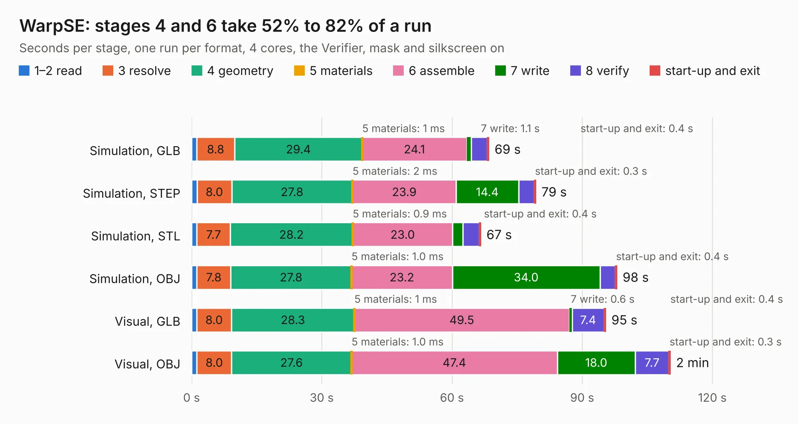

# 1006. WarpSE

Board 1,006 of the 3,110 of [Corpus Testing](../Corpus-Testing.md), on [Corpus Page 10](../CorpusTestingPages/Corpus-Testing-10.md#1006-warpse).

| Mode and format | 1–2 read | 3 resolve | 4 geometry | 5 materials | 6 assemble | 7 write | 8 verify | start-up and exit | Total |
|---|---:|---:|---:|---:|---:|---:|---:|---:|---:|
| Simulation, GLB | 1.2 | 8.8 | 29.4 | 1&nbsp;ms | 24.1 | 1.1 | 3.7 | 0.4 | 68.5 |
| Simulation, STEP | 1.3 | 8.0 | 27.8 | 2&nbsp;ms | 23.9 | 14.4 | 3.6 | 0.3 | 79.3 |
| Simulation, STL | 1.2 | 7.7 | 28.2 | 0.9&nbsp;ms | 23.0 | 2.3 | 3.8 | 0.4 | 66.6 |
| Simulation, OBJ | 1.2 | 7.8 | 27.8 | 1.0&nbsp;ms | 23.2 | 34.0 | 3.5 | 0.4 | 98.0 |
| Visual, GLB | 1.2 | 8.0 | 28.3 | 1&nbsp;ms | 49.5 | 0.6 | 7.4 | 0.4 | 95.4 |
| Visual, OBJ | 1.2 | 8.0 | 27.6 | 1.0&nbsp;ms | 47.4 | 18.0 | 7.7 | 0.3 | 110.3 |

<table align="center"><tr><td valign="top">

| Board | Repo: [garrettsworkshop/WarpSE](https://github.com/garrettsworkshop/WarpSE) Board: `WarpSE.kicad_pcb` |
|---|---|
| Complexity | 374&nbsp;/&nbsp;1000 (size&nbsp;289, features&nbsp;85) |
| KESE&nbsp;features | through vias, rounded, trapezoid or chamfered pads, filled zones, curved board outline, stack-up, dielectric εr and tanδ |
| Tested | 9th November 2026 |
| Copper&nbsp;layers | 4 |
| File&nbsp;format | KiCad 8 (20240108) |
| Parts,&nbsp;tracks,&nbsp;vias | 135, 4,359, 1,470 |
| Triangles,&nbsp;simulation | 7,022,420 in 267 parts |
| Verifier | PASS in all six runs |

</td><td valign="top">

<table>
<tr><th>File type</th><th>File size</th><th>Peak memory used</th></tr>
<tr><th colspan="3" align="left">Simulation</th></tr>
<tr><td>GLB</td><td align="right">235&nbsp;MB</td><td align="right">2.1&nbsp;GB</td></tr>
<tr><td>STEP</td><td align="right">916&nbsp;MB</td><td align="right">2.7&nbsp;GB</td></tr>
<tr><td>STL</td><td align="right">351&nbsp;MB</td><td align="right">2.0&nbsp;GB</td></tr>
<tr><td>OBJ</td><td align="right">758&nbsp;MB</td><td align="right">4.4&nbsp;GB</td></tr>
<tr><th colspan="3" align="left">Visual</th></tr>
<tr><td>GLB</td><td align="right">138&nbsp;MB</td><td align="right">2.3&nbsp;GB</td></tr>
<tr><td>OBJ</td><td align="right">452&nbsp;MB</td><td align="right">3.0&nbsp;GB</td></tr>
</table>

</td></tr></table>

| Previous | Next |
|:---|---:|
| [1005. SE-030](b1005b_Warp-LC_SE-030.md) | [1007. ecp5_mainboard](b1007b_TrellisBoard_ecp5-mainboard.md) |
