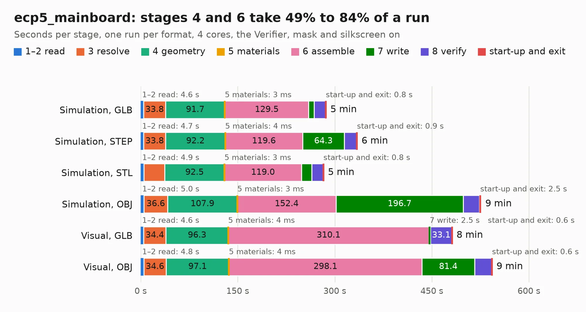

# 1008. ecp5_mainboard

Board 1,008 of the 3,112 of [Corpus Testing](../Corpus-Testing.md), on [Corpus Page 10](../CorpusTestingPages/Corpus-Testing-10.md#1008-ecp5_mainboard).

| Mode and format | 1–2 read | 3 resolve | 4 geometry | 5 materials | 6 assemble | 7 write | 8 verify | start-up and exit | Total |
|---|---:|---:|---:|---:|---:|---:|---:|---:|---:|
| Simulation, GLB | 4.6 | 33.8 | 91.7 | 3&nbsp;ms | 129.5 | 8.5 | 17.7 | 0.8 | 286.6 |
| Simulation, STEP | 4.7 | 33.8 | 92.2 | 4&nbsp;ms | 119.6 | 64.3 | 19.3 | 0.9 | 334.8 |
| Simulation, STL | 4.9 | 32.1 | 92.5 | 3&nbsp;ms | 119.0 | 16.1 | 17.5 | 0.8 | 282.9 |
| Simulation, OBJ | 5.0 | 36.6 | 107.9 | 3&nbsp;ms | 152.4 | 196.7 | 25.0 | 2.5 | 526.1 |
| Visual, GLB | 4.6 | 34.4 | 96.3 | 4&nbsp;ms | 310.1 | 2.5 | 33.1 | 0.6 | 481.6 |
| Visual, OBJ | 4.8 | 34.6 | 97.1 | 4&nbsp;ms | 298.1 | 81.4 | 26.7 | 0.6 | 543.3 |

<table align="center"><tr><td valign="top">

| Board | Repo: [gatecat/TrellisBoard](https://github.com/gatecat/TrellisBoard) Board: `ecp5_mainboard.kicad_pcb` |
|---|---|
| Folder | hardware / ecp5_mainboard |
| Complexity | 424&nbsp;/&nbsp;1000 (size&nbsp;359, features&nbsp;65) |
| KESE&nbsp;features | through vias, slotted holes, rounded, trapezoid or chamfered pads, filled zones, curved board outline |
| Tested | 9th November 2026 to 11th November 2026 |
| Copper&nbsp;layers | 8 |
| File&nbsp;format | KiCad 5 (20171130) |
| Parts,&nbsp;tracks,&nbsp;vias | 498, 44,254, 3,208 |
| Triangles,&nbsp;simulation | 26,783,694 in 768 parts |
| Verifier | PASS in all six runs |
| Run&nbsp;again | Simulation, OBJ: failed in the corpus run, run again with no memory cap and no time limit (swap added to a 16 GB machine), and passed |

</td><td valign="top">

<table>
<tr><th>File type</th><th>File size</th><th>Peak memory used</th></tr>
<tr><th colspan="3" align="left">Simulation</th></tr>
<tr><td>GLB</td><td align="right">911&nbsp;MB</td><td align="right">5.8&nbsp;GB</td></tr>
<tr><td>STEP</td><td align="right">2.8&nbsp;GB</td><td align="right">8.1&nbsp;GB</td></tr>
<tr><td>STL</td><td align="right">1.3&nbsp;GB</td><td align="right">5.6&nbsp;GB</td></tr>
<tr><td>OBJ</td><td align="right">3.0&nbsp;GB</td><td align="right">17&nbsp;GB</td></tr>
<tr><th colspan="3" align="left">Visual</th></tr>
<tr><td>GLB</td><td align="right">424&nbsp;MB</td><td align="right">6.9&nbsp;GB</td></tr>
<tr><td>OBJ</td><td align="right">1.4&nbsp;GB</td><td align="right">8.7&nbsp;GB</td></tr>
</table>

</td></tr></table>

| Previous | Next |
|:---|---:|
| [1007. WarpSE](b1007b_WarpSE_WarpSE.md) | [1009. OpenDropV2](b1009b_OpenDrop_OpenDropV2.md) |
