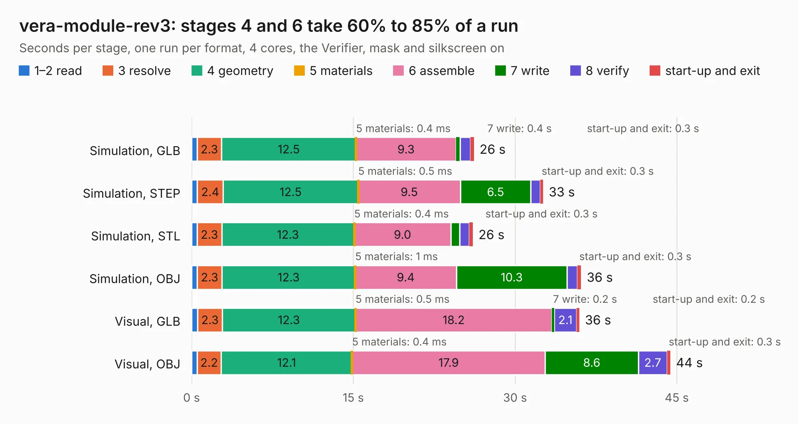

# 1008. vera-module-rev3

Board 1,008 of the 3,124 of [Corpus Testing](../Corpus-Testing.md), on [Corpus Page 10](../CorpusTestingPages/Corpus-Testing-10.md#1008-vera-module-rev3).

| Mode and format | 1–2 read | 3 resolve | 4 geometry | 5 materials | 6 assemble | 7 write | 8 verify | start-up and exit | Total |
|---|---:|---:|---:|---:|---:|---:|---:|---:|---:|
| Simulation, GLB | 0.5 | 2.3 | 12.5 | 0.4&nbsp;ms | 9.3 | 0.4 | 1.0 | 0.3 | 26.2 |
| Simulation, STEP | 0.5 | 2.4 | 12.5 | 0.5&nbsp;ms | 9.5 | 6.5 | 0.9 | 0.3 | 32.6 |
| Simulation, STL | 0.5 | 2.3 | 12.3 | 0.4&nbsp;ms | 9.0 | 0.8 | 0.9 | 0.3 | 26.1 |
| Simulation, OBJ | 0.5 | 2.3 | 12.3 | 1&nbsp;ms | 9.4 | 10.3 | 1.0 | 0.3 | 36.1 |
| Visual, GLB | 0.6 | 2.3 | 12.3 | 0.5&nbsp;ms | 18.2 | 0.2 | 2.1 | 0.2 | 36.0 |
| Visual, OBJ | 0.5 | 2.2 | 12.1 | 0.4&nbsp;ms | 17.9 | 8.6 | 2.7 | 0.3 | 44.4 |

<table align="center"><tr><td valign="top">

| Board | Repo: [fvdhoef/vera-module](https://github.com/fvdhoef/vera-module) Board: `vera-module-rev3.kicad_pcb` |
|---|---|
| Folder | pcb / rev3 |
| Complexity | 285&nbsp;/&nbsp;1000 (size&nbsp;230, features&nbsp;55) |
| KESE&nbsp;features | through vias, rounded, trapezoid or chamfered pads, filled zones, curved board outline |
| Tested | 9th November 2026 |
| Copper&nbsp;layers | 2 |
| File&nbsp;format | KiCad 5 (20171130) |
| Parts,&nbsp;tracks,&nbsp;vias | 100, 1,125, 243 |
| Triangles,&nbsp;simulation | 1,720,326 in 136 parts |
| Verifier | PASS in all six runs |

</td><td valign="top">

<table>
<tr><th>File type</th><th>File size</th><th>Peak memory used</th></tr>
<tr><th colspan="3" align="left">Simulation</th></tr>
<tr><td>GLB</td><td align="right">60&nbsp;MB</td><td align="right">753&nbsp;MB</td></tr>
<tr><td>STEP</td><td align="right">308&nbsp;MB</td><td align="right">829&nbsp;MB</td></tr>
<tr><td>STL</td><td align="right">86&nbsp;MB</td><td align="right">743&nbsp;MB</td></tr>
<tr><td>OBJ</td><td align="right">181&nbsp;MB</td><td align="right">1.2&nbsp;GB</td></tr>
<tr><th colspan="3" align="left">Visual</th></tr>
<tr><td>GLB</td><td align="right">45&nbsp;MB</td><td align="right">833&nbsp;MB</td></tr>
<tr><td>OBJ</td><td align="right">135&nbsp;MB</td><td align="right">971&nbsp;MB</td></tr>
</table>

</td></tr></table>

| Previous | Next |
|:---|---:|
| [1007. vera-module-rev2](b1007b_vera-module_vera-module-rev2.md) | [1009. vera-module-rev4](b1009b_vera-module_vera-module-rev4.md) |
