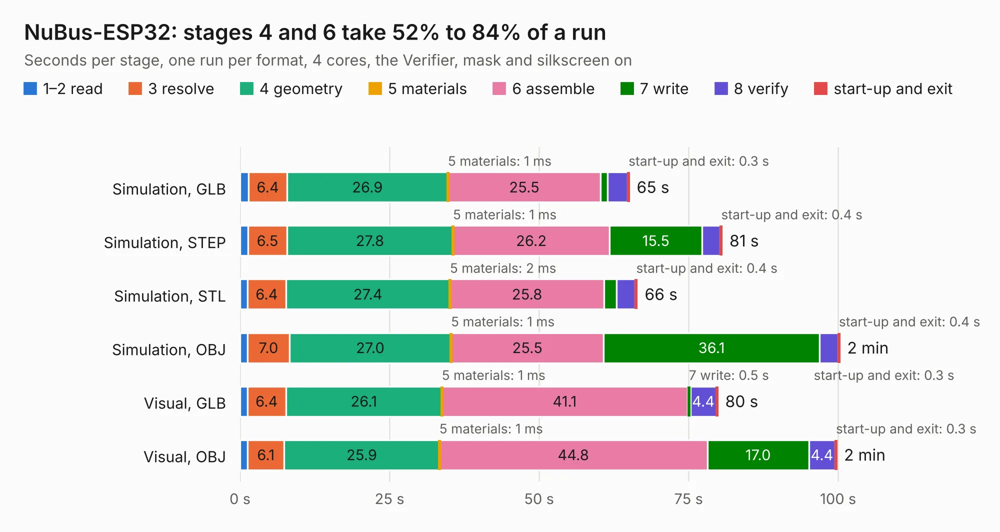

# 1009. NuBus-ESP32

Board 1,009 of the 3,119 of [Corpus Testing](../Corpus-Testing.md), on [Corpus Page 10](../CorpusTestingPages/Corpus-Testing-10.md#1009-nubus-esp32).

| Mode and format | 1–2 read | 3 resolve | 4 geometry | 5 materials | 6 assemble | 7 write | 8 verify | start-up and exit | Total |
|---|---:|---:|---:|---:|---:|---:|---:|---:|---:|
| Simulation, GLB | 1.5 | 6.4 | 26.9 | 1&nbsp;ms | 25.5 | 1.1 | 3.4 | 0.3 | 65.1 |
| Simulation, STEP | 1.3 | 6.5 | 27.8 | 1&nbsp;ms | 26.2 | 15.5 | 3.0 | 0.4 | 80.6 |
| Simulation, STL | 1.3 | 6.4 | 27.4 | 2&nbsp;ms | 25.8 | 2.0 | 3.1 | 0.4 | 66.5 |
| Simulation, OBJ | 1.2 | 7.0 | 27.0 | 1&nbsp;ms | 25.5 | 36.1 | 3.1 | 0.4 | 100.3 |
| Visual, GLB | 1.2 | 6.4 | 26.1 | 1&nbsp;ms | 41.1 | 0.5 | 4.4 | 0.3 | 79.9 |
| Visual, OBJ | 1.3 | 6.1 | 25.9 | 1&nbsp;ms | 44.8 | 17.0 | 4.4 | 0.3 | 99.8 |

<table align="center"><tr><td valign="top">

| Board | Repo: [garrettsworkshop/NuBus-ESP32](https://github.com/garrettsworkshop/NuBus-ESP32) Board: `NuBus-ESP32.kicad_pcb` |
|---|---|
| Complexity | 373&nbsp;/&nbsp;1000 (size&nbsp;288, features&nbsp;85) |
| KESE&nbsp;features | through vias, rounded, trapezoid or chamfered pads, filled zones, curved board outline, stack-up, dielectric εr and tanδ |
| Tested | 9th November 2026 |
| Copper&nbsp;layers | 6 |
| File&nbsp;format | KiCad 8 (20240108) |
| Parts,&nbsp;tracks,&nbsp;vias | 162, 2,390, 698 |
| Triangles,&nbsp;simulation | 5,988,802 in 354 parts |
| Verifier | PASS in all six runs |

</td><td valign="top">

<table>
<tr><th>File type</th><th>File size</th><th>Peak memory used</th></tr>
<tr><th colspan="3" align="left">Simulation</th></tr>
<tr><td>GLB</td><td align="right">198&nbsp;MB</td><td align="right">1.5&nbsp;GB</td></tr>
<tr><td>STEP</td><td align="right">799&nbsp;MB</td><td align="right">2.2&nbsp;GB</td></tr>
<tr><td>STL</td><td align="right">299&nbsp;MB</td><td align="right">1.6&nbsp;GB</td></tr>
<tr><td>OBJ</td><td align="right">643&nbsp;MB</td><td align="right">3.9&nbsp;GB</td></tr>
<tr><th colspan="3" align="left">Visual</th></tr>
<tr><td>GLB</td><td align="right">100&nbsp;MB</td><td align="right">1.9&nbsp;GB</td></tr>
<tr><td>OBJ</td><td align="right">322&nbsp;MB</td><td align="right">2.2&nbsp;GB</td></tr>
</table>

</td></tr></table>

| Previous | Next |
|:---|---:|
| [1008. GR8RAM](b1008b_GR8RAM_GR8RAM.md) | [1010. RAM2E](b1010b_RAM2E_Hardware-LCMXO2_RAM2E.md) |
