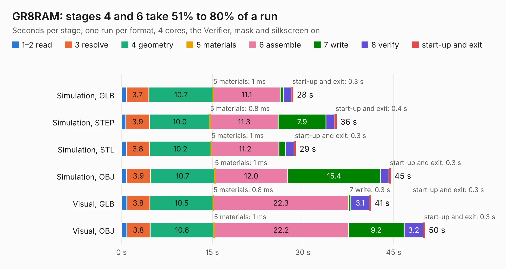

# 1010. GR8RAM

Board 1,010 of the 3,130 of [Corpus Testing](../Corpus-Testing.md), on [Corpus Page 10](../CorpusTestingPages/Corpus-Testing-10.md#1010-gr8ram).

| Mode and format | 1–2 read | 3 resolve | 4 geometry | 5 materials | 6 assemble | 7 write | 8 verify | start-up and exit | Total |
|---|---:|---:|---:|---:|---:|---:|---:|---:|---:|
| Simulation, GLB | 0.8 | 3.7 | 10.7 | 1&nbsp;ms | 11.1 | 0.5 | 1.4 | 0.3 | 28.4 |
| Simulation, STEP | 0.7 | 3.9 | 10.0 | 0.8&nbsp;ms | 11.3 | 7.9 | 1.4 | 0.4 | 35.6 |
| Simulation, STL | 0.8 | 3.8 | 10.2 | 1&nbsp;ms | 11.2 | 1.1 | 1.4 | 0.3 | 28.8 |
| Simulation, OBJ | 0.8 | 3.9 | 10.7 | 1&nbsp;ms | 12.0 | 15.4 | 1.4 | 0.3 | 44.5 |
| Visual, GLB | 0.9 | 3.8 | 10.5 | 0.8&nbsp;ms | 22.3 | 0.3 | 3.1 | 0.3 | 41.3 |
| Visual, OBJ | 0.9 | 3.8 | 10.6 | 1&nbsp;ms | 22.2 | 9.2 | 3.2 | 0.3 | 50.2 |

<table align="center"><tr><td valign="top">

| Board | Repo: [garrettsworkshop/GR8RAM](https://github.com/garrettsworkshop/GR8RAM) Board: `GR8RAM.kicad_pcb` |
|---|---|
| Complexity | 304&nbsp;/&nbsp;1000 (size&nbsp;249, features&nbsp;55) |
| KESE&nbsp;features | through vias, rounded, trapezoid or chamfered pads, filled zones, curved board outline |
| Tested | 9th November 2026 |
| Copper&nbsp;layers | 4 |
| File&nbsp;format | KiCad 6 (20211014) |
| Parts,&nbsp;tracks,&nbsp;vias | 58, 1,689, 476 |
| Triangles,&nbsp;simulation | 3,124,046 in 178 parts |
| Verifier | PASS in all six runs |

</td><td valign="top">

<table>
<tr><th>File type</th><th>File size</th><th>Peak memory used</th></tr>
<tr><th colspan="3" align="left">Simulation</th></tr>
<tr><td>GLB</td><td align="right">107&nbsp;MB</td><td align="right">1.2&nbsp;GB</td></tr>
<tr><td>STEP</td><td align="right">422&nbsp;MB</td><td align="right">1.3&nbsp;GB</td></tr>
<tr><td>STL</td><td align="right">156&nbsp;MB</td><td align="right">1.2&nbsp;GB</td></tr>
<tr><td>OBJ</td><td align="right">331&nbsp;MB</td><td align="right">2.2&nbsp;GB</td></tr>
<tr><th colspan="3" align="left">Visual</th></tr>
<tr><td>GLB</td><td align="right">64&nbsp;MB</td><td align="right">1.2&nbsp;GB</td></tr>
<tr><td>OBJ</td><td align="right">202&nbsp;MB</td><td align="right">1.4&nbsp;GB</td></tr>
</table>

</td></tr></table>

| Previous | Next |
|:---|---:|
| [1009. vera-module-rev4](b1009b_vera-module_vera-module-rev4.md) | [1011. NuBus-ESP32](b1011b_NuBus-ESP32_NuBus-ESP32.md) |
