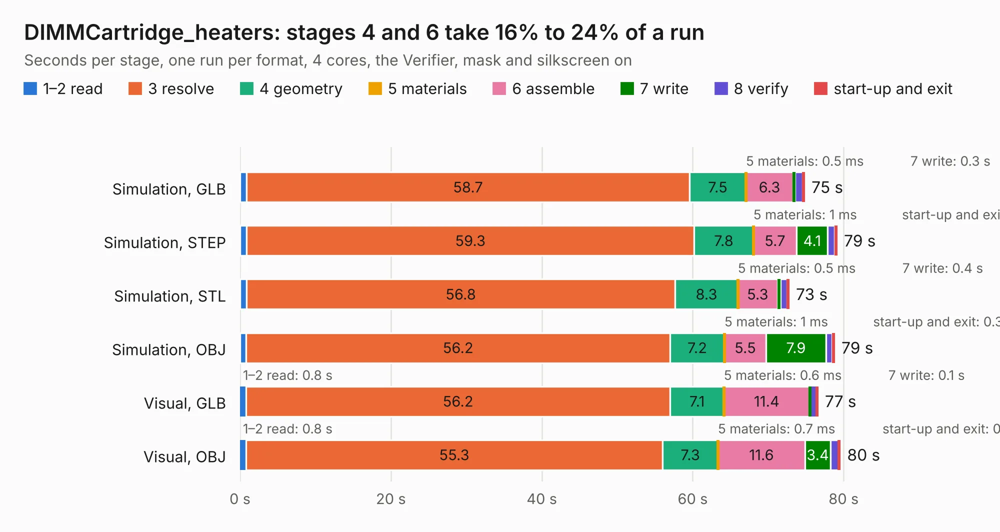

# 1010. DIMMCartridge_heaters

Board 1,010 of the 3,103 of [Corpus Testing](../Corpus-Testing.md), on [Corpus Page 10](../CorpusTestingPages/Corpus-Testing-10.md#1010-dimmcartridge_heaters).

| Mode and format | 1–2 read | 3 resolve | 4 geometry | 5 materials | 6 assemble | 7 write | 8 verify | start-up and exit | Total |
|---|---:|---:|---:|---:|---:|---:|---:|---:|---:|
| Simulation, GLB | 0.8 | 58.7 | 7.5 | 0.5&nbsp;ms | 6.3 | 0.3 | 1.0 | 0.2 | 74.8 |
| Simulation, STEP | 0.9 | 59.3 | 7.8 | 1&nbsp;ms | 5.7 | 4.1 | 0.9 | 0.3 | 79.1 |
| Simulation, STL | 0.8 | 56.8 | 8.3 | 0.5&nbsp;ms | 5.3 | 0.4 | 0.9 | 0.3 | 72.7 |
| Simulation, OBJ | 0.8 | 56.2 | 7.2 | 1&nbsp;ms | 5.5 | 7.9 | 0.8 | 0.3 | 78.8 |
| Visual, GLB | 0.8 | 56.2 | 7.1 | 0.6&nbsp;ms | 11.4 | 0.1 | 0.8 | 0.2 | 76.6 |
| Visual, OBJ | 0.8 | 55.3 | 7.3 | 0.7&nbsp;ms | 11.6 | 3.4 | 1.1 | 0.2 | 79.5 |

<table align="center"><tr><td valign="top">

| Board | Repo: [GaudiLabs/OpenDrop](https://github.com/GaudiLabs/OpenDrop) Board: `DIMMCartridge_heaters.kicad_pcb` |
|---|---|
| Folder | OpenDropV4 / Electronics / DIMMCartridge_heaters |
| Complexity | 296&nbsp;/&nbsp;1000 (size&nbsp;231, features&nbsp;65) |
| KESE&nbsp;features | through vias, rounded, trapezoid or chamfered pads, curved board outline, stack-up, dielectric εr and tanδ |
| Tested | 9th November 2026 |
| Copper&nbsp;layers | 2 |
| File&nbsp;format | KiCad 6 (20211014) |
| Parts,&nbsp;tracks,&nbsp;vias | 142, 1,400, 41 |
| Triangles,&nbsp;simulation | 1,375,622 in 248 parts |
| Verifier | PASS in all six runs |

</td><td valign="top">

<table>
<tr><th>File type</th><th>File size</th><th>Peak memory used</th></tr>
<tr><th colspan="3" align="left">Simulation</th></tr>
<tr><td>GLB</td><td align="right">49&nbsp;MB</td><td align="right">538&nbsp;MB</td></tr>
<tr><td>STEP</td><td align="right">272&nbsp;MB</td><td align="right">699&nbsp;MB</td></tr>
<tr><td>STL</td><td align="right">69&nbsp;MB</td><td align="right">530&nbsp;MB</td></tr>
<tr><td>OBJ</td><td align="right">149&nbsp;MB</td><td align="right">1.0&nbsp;GB</td></tr>
<tr><th colspan="3" align="left">Visual</th></tr>
<tr><td>GLB</td><td align="right">23&nbsp;MB</td><td align="right">619&nbsp;MB</td></tr>
<tr><td>OBJ</td><td align="right">68&nbsp;MB</td><td align="right">608&nbsp;MB</td></tr>
</table>

</td></tr></table>

| Previous | Next |
|:---|---:|
| [1009. DIMMTop](b1009b_OpenDrop_DIMMTop.md) | [1011. ModulAdapterBasic](b1011b_OpenDrop_ModulAdapterBasic.md) |
