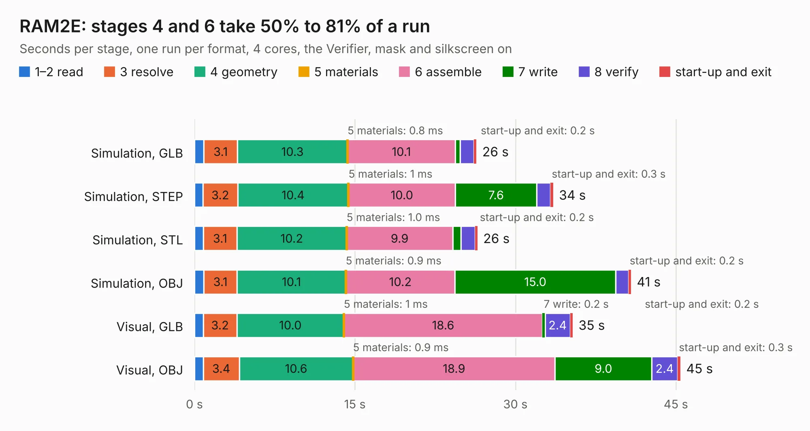

# 1012. RAM2E

Board 1,012 of the 3,128 of [Corpus Testing](../Corpus-Testing.md), on [Corpus Page 10](../CorpusTestingPages/Corpus-Testing-10.md#1012-ram2e).

| Mode and format | 1–2 read | 3 resolve | 4 geometry | 5 materials | 6 assemble | 7 write | 8 verify | start-up and exit | Total |
|---|---:|---:|---:|---:|---:|---:|---:|---:|---:|
| Simulation, GLB | 0.9 | 3.1 | 10.3 | 0.8&nbsp;ms | 10.1 | 0.5 | 1.3 | 0.2 | 26.4 |
| Simulation, STEP | 0.8 | 3.2 | 10.4 | 1&nbsp;ms | 10.0 | 7.6 | 1.3 | 0.3 | 33.5 |
| Simulation, STL | 0.8 | 3.1 | 10.2 | 1.0&nbsp;ms | 9.9 | 0.8 | 1.3 | 0.2 | 26.5 |
| Simulation, OBJ | 0.9 | 3.1 | 10.1 | 0.9&nbsp;ms | 10.2 | 15.0 | 1.2 | 0.2 | 40.8 |
| Visual, GLB | 0.8 | 3.2 | 10.0 | 1&nbsp;ms | 18.6 | 0.2 | 2.4 | 0.2 | 35.4 |
| Visual, OBJ | 0.8 | 3.4 | 10.6 | 0.9&nbsp;ms | 18.9 | 9.0 | 2.4 | 0.3 | 45.4 |

<table align="center"><tr><td valign="top">

| Board | Repo: [garrettsworkshop/RAM2E](https://github.com/garrettsworkshop/RAM2E) Board: `RAM2E.kicad_pcb` |
|---|---|
| Folder | Hardware / LCMXO2 |
| Complexity | 338&nbsp;/&nbsp;1000 (size&nbsp;253, features&nbsp;85) |
| KESE&nbsp;features | through vias, rounded, trapezoid or chamfered pads, filled zones, curved board outline, stack-up, dielectric εr and tanδ |
| Tested | 9th November 2026 |
| Copper&nbsp;layers | 4 |
| File&nbsp;format | KiCad 8 (20240108) |
| Parts,&nbsp;tracks,&nbsp;vias | 69, 1,905, 527 |
| Triangles,&nbsp;simulation | 2,836,766 in 177 parts |
| Verifier | PASS in all six runs |

</td><td valign="top">

<table>
<tr><th>File type</th><th>File size</th><th>Peak memory used</th></tr>
<tr><th colspan="3" align="left">Simulation</th></tr>
<tr><td>GLB</td><td align="right">97&nbsp;MB</td><td align="right">1.1&nbsp;GB</td></tr>
<tr><td>STEP</td><td align="right">425&nbsp;MB</td><td align="right">1.2&nbsp;GB</td></tr>
<tr><td>STL</td><td align="right">142&nbsp;MB</td><td align="right">1.1&nbsp;GB</td></tr>
<tr><td>OBJ</td><td align="right">305&nbsp;MB</td><td align="right">1.9&nbsp;GB</td></tr>
<tr><th colspan="3" align="left">Visual</th></tr>
<tr><td>GLB</td><td align="right">58&nbsp;MB</td><td align="right">1.1&nbsp;GB</td></tr>
<tr><td>OBJ</td><td align="right">186&nbsp;MB</td><td align="right">1.3&nbsp;GB</td></tr>
</table>

</td></tr></table>

| Previous | Next |
|:---|---:|
| [1011. NuBus-ESP32](b1011b_NuBus-ESP32_NuBus-ESP32.md) | [1013. RAM2E](b1013b_RAM2E_Hardware-MAX_RAM2E.md) |
