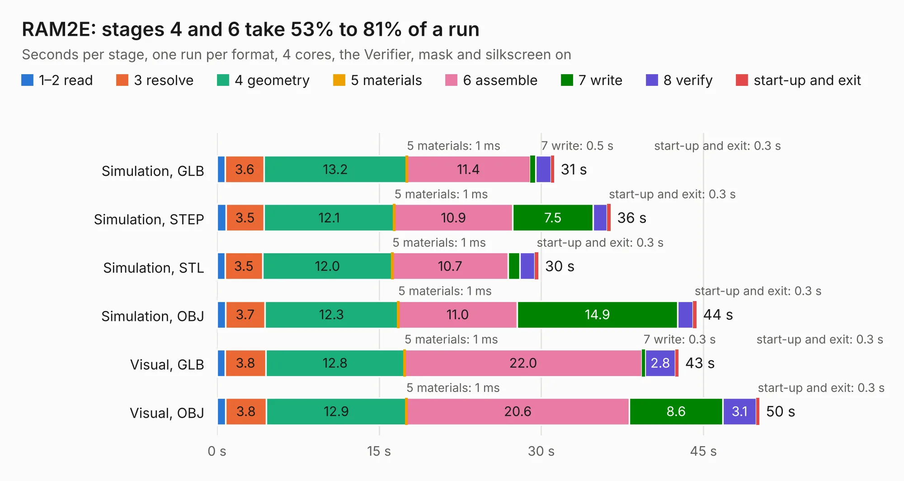

# 1013. RAM2E

Board 1,013 of the 3,127 of [Corpus Testing](../Corpus-Testing.md), on [Corpus Page 10](../CorpusTestingPages/Corpus-Testing-10.md#1013-ram2e).

| Mode and format | 1–2 read | 3 resolve | 4 geometry | 5 materials | 6 assemble | 7 write | 8 verify | start-up and exit | Total |
|---|---:|---:|---:|---:|---:|---:|---:|---:|---:|
| Simulation, GLB | 0.8 | 3.6 | 13.2 | 1&nbsp;ms | 11.4 | 0.5 | 1.4 | 0.3 | 31.2 |
| Simulation, STEP | 0.8 | 3.5 | 12.1 | 1&nbsp;ms | 10.9 | 7.5 | 1.3 | 0.3 | 36.4 |
| Simulation, STL | 0.7 | 3.5 | 12.0 | 1&nbsp;ms | 10.7 | 1.1 | 1.4 | 0.3 | 29.7 |
| Simulation, OBJ | 0.8 | 3.7 | 12.3 | 1&nbsp;ms | 11.0 | 14.9 | 1.4 | 0.3 | 44.4 |
| Visual, GLB | 0.8 | 3.8 | 12.8 | 1&nbsp;ms | 22.0 | 0.3 | 2.8 | 0.3 | 42.7 |
| Visual, OBJ | 0.8 | 3.8 | 12.9 | 1&nbsp;ms | 20.6 | 8.6 | 3.1 | 0.3 | 50.2 |

<table align="center"><tr><td valign="top">

| Board | Repo: [garrettsworkshop/RAM2E](https://github.com/garrettsworkshop/RAM2E) Board: `RAM2E.kicad_pcb` |
|---|---|
| Folder | Hardware / MAX |
| Complexity | 338&nbsp;/&nbsp;1000 (size&nbsp;253, features&nbsp;85) |
| KESE&nbsp;features | through vias, rounded, trapezoid or chamfered pads, filled zones, curved board outline, stack-up, dielectric εr and tanδ |
| Tested | 9th November 2026 |
| Copper&nbsp;layers | 4 |
| File&nbsp;format | KiCad 8 (20240108) |
| Parts,&nbsp;tracks,&nbsp;vias | 66, 1,883, 548 |
| Triangles,&nbsp;simulation | 2,861,040 in 179 parts |
| Verifier | PASS in all six runs |

</td><td valign="top">

<table>
<tr><th>File type</th><th>File size</th><th>Peak memory used</th></tr>
<tr><th colspan="3" align="left">Simulation</th></tr>
<tr><td>GLB</td><td align="right">97&nbsp;MB</td><td align="right">1.1&nbsp;GB</td></tr>
<tr><td>STEP</td><td align="right">418&nbsp;MB</td><td align="right">1.3&nbsp;GB</td></tr>
<tr><td>STL</td><td align="right">143&nbsp;MB</td><td align="right">1.1&nbsp;GB</td></tr>
<tr><td>OBJ</td><td align="right">308&nbsp;MB</td><td align="right">1.9&nbsp;GB</td></tr>
<tr><th colspan="3" align="left">Visual</th></tr>
<tr><td>GLB</td><td align="right">58&nbsp;MB</td><td align="right">1.1&nbsp;GB</td></tr>
<tr><td>OBJ</td><td align="right">185&nbsp;MB</td><td align="right">1.3&nbsp;GB</td></tr>
</table>

</td></tr></table>

| Previous | Next |
|:---|---:|
| [1012. RAM2E](b1012b_RAM2E_Hardware-LCMXO2_RAM2E.md) | [1014. SE-030](b1014b_Warp-LC_SE-030.md) |
