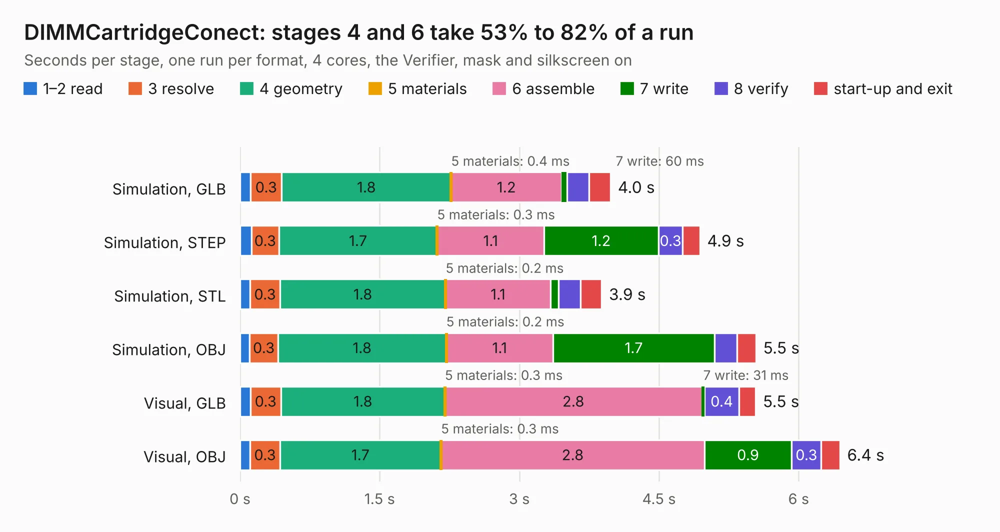

# 1015. DIMMCartridgeConect

Board 1,015 of the 3,116 of [Corpus Testing](../Corpus-Testing.md), on [Corpus Page 10](../CorpusTestingPages/Corpus-Testing-10.md#1015-dimmcartridgeconect).

| Mode and format | 1–2 read | 3 resolve | 4 geometry | 5 materials | 6 assemble | 7 write | 8 verify | start-up and exit | Total |
|---|---:|---:|---:|---:|---:|---:|---:|---:|---:|
| Simulation, GLB | 0.1 | 0.3 | 1.8 | 0.4&nbsp;ms | 1.2 | 60&nbsp;ms | 0.2 | 0.2 | 4.0 |
| Simulation, STEP | 0.1 | 0.3 | 1.7 | 0.3&nbsp;ms | 1.1 | 1.2 | 0.3 | 0.2 | 4.9 |
| Simulation, STL | 0.1 | 0.3 | 1.8 | 0.2&nbsp;ms | 1.1 | 88&nbsp;ms | 0.2 | 0.2 | 3.9 |
| Simulation, OBJ | 0.1 | 0.3 | 1.8 | 0.2&nbsp;ms | 1.1 | 1.7 | 0.2 | 0.2 | 5.5 |
| Visual, GLB | 0.1 | 0.3 | 1.8 | 0.3&nbsp;ms | 2.8 | 31&nbsp;ms | 0.4 | 0.2 | 5.5 |
| Visual, OBJ | 0.1 | 0.3 | 1.7 | 0.3&nbsp;ms | 2.8 | 0.9 | 0.3 | 0.2 | 6.4 |

<table align="center"><tr><td valign="top">

| Board | Repo: [GaudiLabs/OpenDrop](https://github.com/GaudiLabs/OpenDrop) Board: `DIMMCartridgeConect.kicad_pcb` |
|---|---|
| Folder | OpenDropV4 / Electronics / Cartridge_Connector / DIMMCartridge_connector |
| Complexity | 194&nbsp;/&nbsp;1000 (size&nbsp;169, features&nbsp;25) |
| KESE&nbsp;features | through vias, curved board outline |
| Tested | 9th November 2026 |
| Copper&nbsp;layers | 2 |
| File&nbsp;format | KiCad 5 (20171130) |
| Parts,&nbsp;tracks,&nbsp;vias | 3, 364, 2 |
| Triangles,&nbsp;simulation | 419,974 in 48 parts |
| Verifier | PASS in all six runs |

</td><td valign="top">

<table>
<tr><th>File type</th><th>File size</th><th>Peak memory used</th></tr>
<tr><th colspan="3" align="left">Simulation</th></tr>
<tr><td>GLB</td><td align="right">15&nbsp;MB</td><td align="right">287&nbsp;MB</td></tr>
<tr><td>STEP</td><td align="right">69&nbsp;MB</td><td align="right">302&nbsp;MB</td></tr>
<tr><td>STL</td><td align="right">21&nbsp;MB</td><td align="right">287&nbsp;MB</td></tr>
<tr><td>OBJ</td><td align="right">43&nbsp;MB</td><td align="right">330&nbsp;MB</td></tr>
<tr><th colspan="3" align="left">Visual</th></tr>
<tr><td>GLB</td><td align="right">8.1&nbsp;MB</td><td align="right">290&nbsp;MB</td></tr>
<tr><td>OBJ</td><td align="right">24&nbsp;MB</td><td align="right">295&nbsp;MB</td></tr>
</table>

</td></tr></table>

| Previous | Next |
|:---|---:|
| [1014. OpenDropV3](b1014b_OpenDrop_OpenDropV3.md) | [1016. DIMMCartridgeV4](b1016b_OpenDrop_DIMMCartridgeV4.md) |
