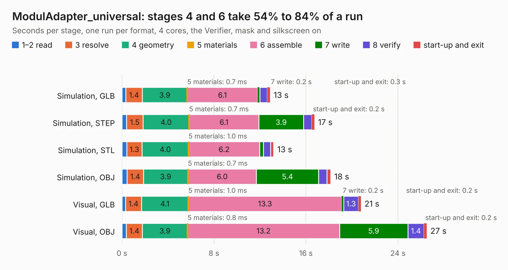

# 1017. ModulAdapter_universal

Board 1,017 of the 3,110 of [Corpus Testing](../Corpus-Testing.md), on [Corpus Page 10](../CorpusTestingPages/Corpus-Testing-10.md#1017-moduladapter_universal).

| Mode and format | 1–2 read | 3 resolve | 4 geometry | 5 materials | 6 assemble | 7 write | 8 verify | start-up and exit | Total |
|---|---:|---:|---:|---:|---:|---:|---:|---:|---:|
| Simulation, GLB | 0.3 | 1.4 | 3.9 | 0.7&nbsp;ms | 6.1 | 0.2 | 0.6 | 0.3 | 12.9 |
| Simulation, STEP | 0.4 | 1.5 | 4.0 | 0.7&nbsp;ms | 6.1 | 3.9 | 0.7 | 0.2 | 16.7 |
| Simulation, STL | 0.4 | 1.3 | 4.0 | 1.0&nbsp;ms | 6.2 | 0.3 | 0.6 | 0.3 | 13.2 |
| Simulation, OBJ | 0.4 | 1.4 | 3.9 | 0.7&nbsp;ms | 6.0 | 5.4 | 0.7 | 0.3 | 18.1 |
| Visual, GLB | 0.3 | 1.4 | 4.1 | 1.0&nbsp;ms | 13.3 | 0.2 | 1.3 | 0.2 | 20.8 |
| Visual, OBJ | 0.4 | 1.4 | 3.9 | 0.8&nbsp;ms | 13.2 | 5.9 | 1.4 | 0.2 | 26.5 |

<table align="center"><tr><td valign="top">

| Board | Repo: [GaudiLabs/OpenDrop](https://github.com/GaudiLabs/OpenDrop) Board: `ModulAdapter_universal.kicad_pcb` |
|---|---|
| Folder | OpenDropV4 / Electronics / ModulAdapter_universal / PCB |
| Complexity | 299&nbsp;/&nbsp;1000 (size&nbsp;244, features&nbsp;55) |
| KESE&nbsp;features | through vias, rounded, trapezoid or chamfered pads, filled zones, curved board outline |
| Tested | 9th November 2026 |
| Copper&nbsp;layers | 2 |
| File&nbsp;format | KiCad 5 (20171130) |
| Parts,&nbsp;tracks,&nbsp;vias | 43, 2,459, 269 |
| Triangles,&nbsp;simulation | 1,149,118 in 188 parts |
| Verifier | PASS in all six runs |

</td><td valign="top">

<table>
<tr><th>File type</th><th>File size</th><th>Peak memory used</th></tr>
<tr><th colspan="3" align="left">Simulation</th></tr>
<tr><td>GLB</td><td align="right">40&nbsp;MB</td><td align="right">655&nbsp;MB</td></tr>
<tr><td>STEP</td><td align="right">200&nbsp;MB</td><td align="right">656&nbsp;MB</td></tr>
<tr><td>STL</td><td align="right">57&nbsp;MB</td><td align="right">648&nbsp;MB</td></tr>
<tr><td>OBJ</td><td align="right">118&nbsp;MB</td><td align="right">811&nbsp;MB</td></tr>
<tr><th colspan="3" align="left">Visual</th></tr>
<tr><td>GLB</td><td align="right">37&nbsp;MB</td><td align="right">939&nbsp;MB</td></tr>
<tr><td>OBJ</td><td align="right">114&nbsp;MB</td><td align="right">844&nbsp;MB</td></tr>
</table>

</td></tr></table>

| Previous | Next |
|:---|---:|
| [1016. ModulAdapterMagnet](b1016b_OpenDrop_ModulAdapterMagnet.md) | [1018. OpenDropV4](b1018b_OpenDrop_OpenDropV4.md) |
