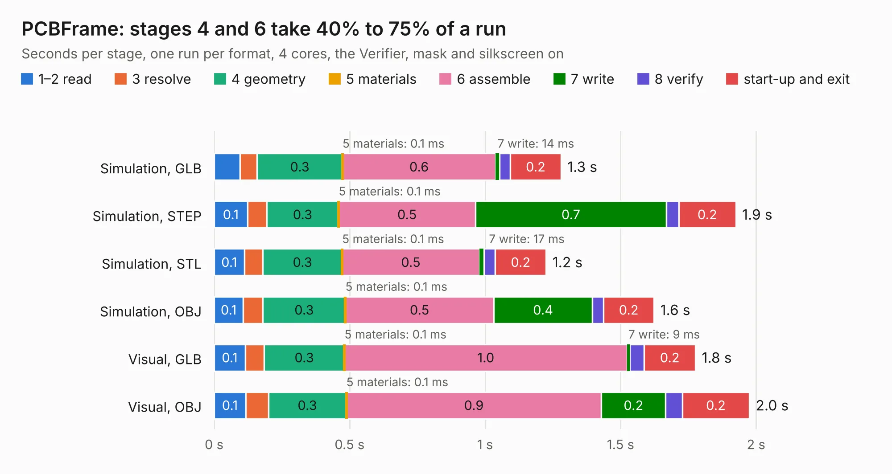

# 1018. PCBFrame

Board 1,018 of the 3,128 of [Corpus Testing](../Corpus-Testing.md), on [Corpus Page 10](../CorpusTestingPages/Corpus-Testing-10.md#1018-pcbframe).

| Mode and format | 1–2 read | 3 resolve | 4 geometry | 5 materials | 6 assemble | 7 write | 8 verify | start-up and exit | Total |
|---|---:|---:|---:|---:|---:|---:|---:|---:|---:|
| Simulation, GLB | 96&nbsp;ms | 63&nbsp;ms | 0.3 | 0.1&nbsp;ms | 0.6 | 14&nbsp;ms | 40&nbsp;ms | 0.2 | 1.3 |
| Simulation, STEP | 0.1 | 70&nbsp;ms | 0.3 | 0.1&nbsp;ms | 0.5 | 0.7 | 46&nbsp;ms | 0.2 | 1.9 |
| Simulation, STL | 0.1 | 68&nbsp;ms | 0.3 | 0.1&nbsp;ms | 0.5 | 17&nbsp;ms | 41&nbsp;ms | 0.2 | 1.2 |
| Simulation, OBJ | 0.1 | 73&nbsp;ms | 0.3 | 0.1&nbsp;ms | 0.5 | 0.4 | 41&nbsp;ms | 0.2 | 1.6 |
| Visual, GLB | 0.1 | 69&nbsp;ms | 0.3 | 0.1&nbsp;ms | 1.0 | 9&nbsp;ms | 54&nbsp;ms | 0.2 | 1.8 |
| Visual, OBJ | 0.1 | 84&nbsp;ms | 0.3 | 0.1&nbsp;ms | 0.9 | 0.2 | 62&nbsp;ms | 0.2 | 2.0 |

<table align="center"><tr><td valign="top">

| Board | Repo: [GaudiLabs/OpenDrop](https://github.com/GaudiLabs/OpenDrop) Board: `PCBFrame.kicad_pcb` |
|---|---|
| Folder | OpenDropV3 / Carrier / PCBFrame |
| Complexity | 69&nbsp;/&nbsp;1000 (size&nbsp;39, features&nbsp;30) |
| KESE&nbsp;features | filled zones, curved board outline |
| Tested | 9th November 2026 |
| Copper&nbsp;layers | 2 |
| File&nbsp;format | KiCad 4 (4) |
| Parts,&nbsp;tracks,&nbsp;vias | 0, 3, 0 |
| Triangles,&nbsp;simulation | 69,738 in 12 parts |
| Note | no components |
| Verifier | PASS in all six runs |

</td><td valign="top">

<table>
<tr><th>File type</th><th>File size</th><th>Peak memory used</th></tr>
<tr><th colspan="3" align="left">Simulation</th></tr>
<tr><td>GLB</td><td align="right">2.5&nbsp;MB</td><td align="right">173&nbsp;MB</td></tr>
<tr><td>STEP</td><td align="right">16&nbsp;MB</td><td align="right">179&nbsp;MB</td></tr>
<tr><td>STL</td><td align="right">3.5&nbsp;MB</td><td align="right">175&nbsp;MB</td></tr>
<tr><td>OBJ</td><td align="right">6.8&nbsp;MB</td><td align="right">173&nbsp;MB</td></tr>
<tr><th colspan="3" align="left">Visual</th></tr>
<tr><td>GLB</td><td align="right">1.6&nbsp;MB</td><td align="right">156&nbsp;MB</td></tr>
<tr><td>OBJ</td><td align="right">4.3&nbsp;MB</td><td align="right">156&nbsp;MB</td></tr>
</table>

</td></tr></table>

| Previous | Next |
|:---|---:|
| [1017. OpenDropV2](b1017b_OpenDrop_OpenDropV2.md) | [1019. OpenDropV3](b1019b_OpenDrop_OpenDropV3.md) |
