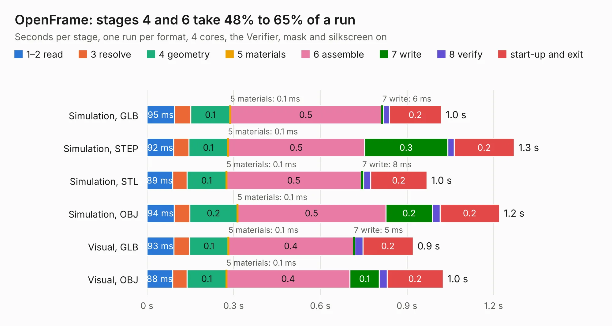

# 1019. OpenFrame

Board 1,019 of the 3,111 of [Corpus Testing](../Corpus-Testing.md), on [Corpus Page 10](../CorpusTestingPages/Corpus-Testing-10.md#1019-openframe).

| Mode and format | 1–2 read | 3 resolve | 4 geometry | 5 materials | 6 assemble | 7 write | 8 verify | start-up and exit | Total |
|---|---:|---:|---:|---:|---:|---:|---:|---:|---:|
| Simulation, GLB | 95&nbsp;ms | 56&nbsp;ms | 0.1 | 0.1&nbsp;ms | 0.5 | 6&nbsp;ms | 21&nbsp;ms | 0.2 | 1.0 |
| Simulation, STEP | 92&nbsp;ms | 53&nbsp;ms | 0.1 | 0.1&nbsp;ms | 0.5 | 0.3 | 23&nbsp;ms | 0.2 | 1.3 |
| Simulation, STL | 89&nbsp;ms | 50&nbsp;ms | 0.1 | 0.1&nbsp;ms | 0.5 | 8&nbsp;ms | 24&nbsp;ms | 0.2 | 1.0 |
| Simulation, OBJ | 94&nbsp;ms | 54&nbsp;ms | 0.2 | 0.1&nbsp;ms | 0.5 | 0.2 | 26&nbsp;ms | 0.2 | 1.2 |
| Visual, GLB | 93&nbsp;ms | 54&nbsp;ms | 0.1 | 0.1&nbsp;ms | 0.4 | 5&nbsp;ms | 28&nbsp;ms | 0.2 | 0.9 |
| Visual, OBJ | 88&nbsp;ms | 51&nbsp;ms | 0.1 | 0.1&nbsp;ms | 0.4 | 0.1 | 27&nbsp;ms | 0.2 | 1.0 |

<table align="center"><tr><td valign="top">

| Board | Repo: [GaudiLabs/OpenDrop](https://github.com/GaudiLabs/OpenDrop) Board: `OpenFrame.kicad_pcb` |
|---|---|
| Folder | OpenDropV4 / Electronics / OpenFrame |
| Complexity | 84&nbsp;/&nbsp;1000 (size&nbsp;49, features&nbsp;35) |
| KESE&nbsp;features | through vias, filled zones |
| Tested | 9th November 2026 |
| Copper&nbsp;layers | 2 |
| File&nbsp;format | KiCad 5 (20171130) |
| Parts,&nbsp;tracks,&nbsp;vias | 0, 3, 1 |
| Triangles,&nbsp;simulation | 32,040 in 12 parts |
| Note | no components |
| Verifier | PASS in all six runs |

</td><td valign="top">

<table>
<tr><th>File type</th><th>File size</th><th>Peak memory used</th></tr>
<tr><th colspan="3" align="left">Simulation</th></tr>
<tr><td>GLB</td><td align="right">1.1&nbsp;MB</td><td align="right">66&nbsp;MB</td></tr>
<tr><td>STEP</td><td align="right">8.8&nbsp;MB</td><td align="right">71&nbsp;MB</td></tr>
<tr><td>STL</td><td align="right">1.6&nbsp;MB</td><td align="right">67&nbsp;MB</td></tr>
<tr><td>OBJ</td><td align="right">3.1&nbsp;MB</td><td align="right">73&nbsp;MB</td></tr>
<tr><th colspan="3" align="left">Visual</th></tr>
<tr><td>GLB</td><td align="right">721&nbsp;kB</td><td align="right">87&nbsp;MB</td></tr>
<tr><td>OBJ</td><td align="right">1.9&nbsp;MB</td><td align="right">76&nbsp;MB</td></tr>
</table>

</td></tr></table>

| Previous | Next |
|:---|---:|
| [1018. OpenDropV4](b1018b_OpenDrop_OpenDropV4.md) | [1020. gd rp2040 keyboard proto pcb](b1020b_Golden-Delicious_gd-rp2040-keyboard-proto-pcb.md) |
