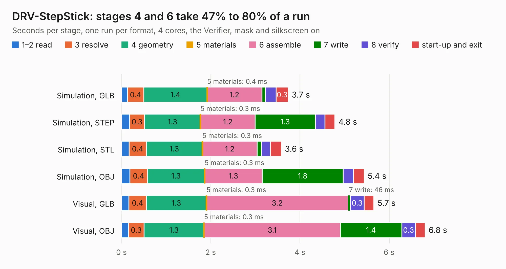

# 1020. DRV-StepStick

Board 1,020 of the 3,107 of [Corpus Testing](../Corpus-Testing.md), on [Corpus Page 10](../CorpusTestingPages/Corpus-Testing-10.md#1020-drv-stepstick).

| Mode and format | 1–2 read | 3 resolve | 4 geometry | 5 materials | 6 assemble | 7 write | 8 verify | start-up and exit | Total |
|---|---:|---:|---:|---:|---:|---:|---:|---:|---:|
| Simulation, GLB | 0.1 | 0.4 | 1.4 | 0.4&nbsp;ms | 1.2 | 82&nbsp;ms | 0.2 | 0.3 | 3.7 |
| Simulation, STEP | 0.2 | 0.3 | 1.3 | 0.3&nbsp;ms | 1.2 | 1.3 | 0.2 | 0.2 | 4.8 |
| Simulation, STL | 0.2 | 0.4 | 1.3 | 0.3&nbsp;ms | 1.2 | 97&nbsp;ms | 0.2 | 0.2 | 3.6 |
| Simulation, OBJ | 0.2 | 0.4 | 1.3 | 0.3&nbsp;ms | 1.3 | 1.8 | 0.2 | 0.2 | 5.4 |
| Visual, GLB | 0.2 | 0.4 | 1.3 | 0.3&nbsp;ms | 3.2 | 46&nbsp;ms | 0.3 | 0.2 | 5.7 |
| Visual, OBJ | 0.2 | 0.3 | 1.3 | 0.3&nbsp;ms | 3.1 | 1.4 | 0.3 | 0.2 | 6.8 |

<table align="center"><tr><td valign="top">

| Board | Repo: [ghent360/prntrboardv2](https://github.com/ghent360/prntrboardv2) Board: `DRV-StepStick.kicad_pcb` |
|---|---|
| Folder | hardware |
| Complexity | 237&nbsp;/&nbsp;1000 (size&nbsp;147, features&nbsp;90) |
| KESE&nbsp;features | through vias, rounded, trapezoid or chamfered pads, filled zones, curved board outline, stack-up, dielectric εr and tanδ, mask and silkscreen colours |
| Tested | 9th November 2026 |
| Copper&nbsp;layers | 2 |
| File&nbsp;format | KiCad 6 (20210108) |
| Parts,&nbsp;tracks,&nbsp;vias | 18, 238, 55 |
| Triangles,&nbsp;simulation | 388,600 in 36 parts |
| Verifier | PASS in all six runs |

</td><td valign="top">

<table>
<tr><th>File type</th><th>File size</th><th>Peak memory used</th></tr>
<tr><th colspan="3" align="left">Simulation</th></tr>
<tr><td>GLB</td><td align="right">13&nbsp;MB</td><td align="right">289&nbsp;MB</td></tr>
<tr><td>STEP</td><td align="right">59&nbsp;MB</td><td align="right">300&nbsp;MB</td></tr>
<tr><td>STL</td><td align="right">19&nbsp;MB</td><td align="right">272&nbsp;MB</td></tr>
<tr><td>OBJ</td><td align="right">39&nbsp;MB</td><td align="right">304&nbsp;MB</td></tr>
<tr><th colspan="3" align="left">Visual</th></tr>
<tr><td>GLB</td><td align="right">9.9&nbsp;MB</td><td align="right">308&nbsp;MB</td></tr>
<tr><td>OBJ</td><td align="right">29&nbsp;MB</td><td align="right">300&nbsp;MB</td></tr>
</table>

</td></tr></table>

| Previous | Next |
|:---|---:|
| [1019. gd rp2040 keyboard proto pcb](b1019b_Golden-Delicious_gd-rp2040-keyboard-proto-pcb.md) | [1021. LcdFlip](b1021b_prntrboardv2_LcdFlip.md) |
