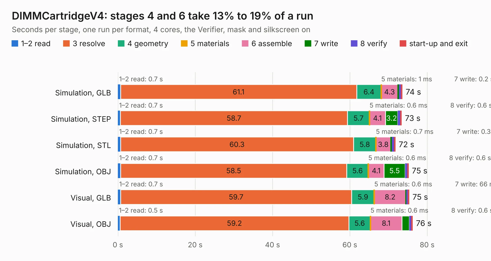

# 1021. DIMMCartridgeV4

Board 1,021 of the 3,129 of [Corpus Testing](../Corpus-Testing.md), on [Corpus Page 10](../CorpusTestingPages/Corpus-Testing-10.md#1021-dimmcartridgev4).

| Mode and format | 1–2 read | 3 resolve | 4 geometry | 5 materials | 6 assemble | 7 write | 8 verify | start-up and exit | Total |
|---|---:|---:|---:|---:|---:|---:|---:|---:|---:|
| Simulation, GLB | 0.7 | 61.1 | 6.4 | 1&nbsp;ms | 4.3 | 0.2 | 0.7 | 0.2 | 73.5 |
| Simulation, STEP | 0.7 | 58.7 | 5.7 | 0.6&nbsp;ms | 4.1 | 3.2 | 0.6 | 0.3 | 73.3 |
| Simulation, STL | 0.7 | 60.3 | 5.8 | 0.7&nbsp;ms | 3.8 | 0.3 | 0.6 | 0.3 | 71.7 |
| Simulation, OBJ | 0.7 | 58.5 | 5.6 | 0.6&nbsp;ms | 4.1 | 5.5 | 0.6 | 0.2 | 75.1 |
| Visual, GLB | 0.7 | 59.7 | 5.9 | 0.6&nbsp;ms | 8.2 | 66&nbsp;ms | 0.5 | 0.2 | 75.3 |
| Visual, OBJ | 0.5 | 59.2 | 5.6 | 0.6&nbsp;ms | 8.1 | 1.9 | 0.6 | 0.2 | 76.2 |

<table align="center"><tr><td valign="top">

| Board | Repo: [GaudiLabs/OpenDrop](https://github.com/GaudiLabs/OpenDrop) Board: `DIMMCartridgeV4.kicad_pcb` |
|---|---|
| Folder | OpenDropV4 / Electronics / CartridgeV4 / DIMMCartridgeV4 |
| Complexity | 244&nbsp;/&nbsp;1000 (size&nbsp;219, features&nbsp;25) |
| KESE&nbsp;features | through vias, curved board outline |
| Tested | 9th November 2026 |
| Copper&nbsp;layers | 2 |
| File&nbsp;format | KiCad 5 (20171130) |
| Parts,&nbsp;tracks,&nbsp;vias | 133, 781, 6 |
| Triangles,&nbsp;simulation | 1,208,380 in 142 parts |
| Verifier | PASS in all six runs |

</td><td valign="top">

<table>
<tr><th>File type</th><th>File size</th><th>Peak memory used</th></tr>
<tr><th colspan="3" align="left">Simulation</th></tr>
<tr><td>GLB</td><td align="right">43&nbsp;MB</td><td align="right">525&nbsp;MB</td></tr>
<tr><td>STEP</td><td align="right">242&nbsp;MB</td><td align="right">659&nbsp;MB</td></tr>
<tr><td>STL</td><td align="right">60&nbsp;MB</td><td align="right">531&nbsp;MB</td></tr>
<tr><td>OBJ</td><td align="right">131&nbsp;MB</td><td align="right">872&nbsp;MB</td></tr>
<tr><th colspan="3" align="left">Visual</th></tr>
<tr><td>GLB</td><td align="right">17&nbsp;MB</td><td align="right">548&nbsp;MB</td></tr>
<tr><td>OBJ</td><td align="right">50&nbsp;MB</td><td align="right">523&nbsp;MB</td></tr>
</table>

</td></tr></table>

| Previous | Next |
|:---|---:|
| [1020. DIMMCartridgeConect](b1020b_OpenDrop_DIMMCartridgeConect.md) | [1022. DIMMTop](b1022b_OpenDrop_DIMMTop.md) |
