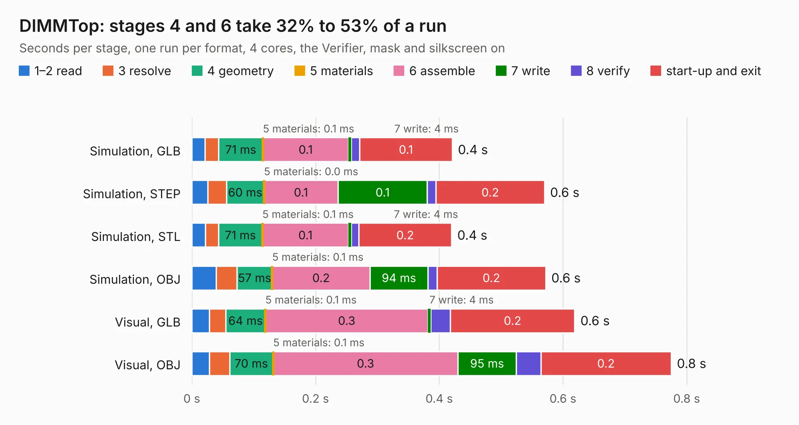

# 1022. DIMMTop

Board 1,022 of the 3,128 of [Corpus Testing](../Corpus-Testing.md), on [Corpus Page 10](../CorpusTestingPages/Corpus-Testing-10.md#1022-dimmtop).

| Mode and format | 1–2 read | 3 resolve | 4 geometry | 5 materials | 6 assemble | 7 write | 8 verify | start-up and exit | Total |
|---|---:|---:|---:|---:|---:|---:|---:|---:|---:|
| Simulation, GLB | 21&nbsp;ms | 22&nbsp;ms | 71&nbsp;ms | 0.1&nbsp;ms | 0.1 | 4&nbsp;ms | 14&nbsp;ms | 0.1 | 0.4 |
| Simulation, STEP | 26&nbsp;ms | 30&nbsp;ms | 60&nbsp;ms | 0.0&nbsp;ms | 0.1 | 0.1 | 14&nbsp;ms | 0.2 | 0.6 |
| Simulation, STL | 22&nbsp;ms | 21&nbsp;ms | 71&nbsp;ms | 0.1&nbsp;ms | 0.1 | 4&nbsp;ms | 12&nbsp;ms | 0.2 | 0.4 |
| Simulation, OBJ | 39&nbsp;ms | 34&nbsp;ms | 57&nbsp;ms | 0.1&nbsp;ms | 0.2 | 94&nbsp;ms | 15&nbsp;ms | 0.2 | 0.6 |
| Visual, GLB | 28&nbsp;ms | 27&nbsp;ms | 64&nbsp;ms | 0.1&nbsp;ms | 0.3 | 4&nbsp;ms | 32&nbsp;ms | 0.2 | 0.6 |
| Visual, OBJ | 28&nbsp;ms | 33&nbsp;ms | 70&nbsp;ms | 0.1&nbsp;ms | 0.3 | 95&nbsp;ms | 40&nbsp;ms | 0.2 | 0.8 |

<table align="center"><tr><td valign="top">

| Board | Repo: [GaudiLabs/OpenDrop](https://github.com/GaudiLabs/OpenDrop) Board: `DIMMTop.kicad_pcb` |
|---|---|
| Folder | OpenDropV4 / Electronics / CartridgeV4 / DIMMTop |
| Complexity | 17&nbsp;/&nbsp;1000 (size&nbsp;17, features&nbsp;0) |
| Tested | 9th November 2026 |
| Copper&nbsp;layers | 2 |
| File&nbsp;format | KiCad 5 (20171130) |
| Parts,&nbsp;tracks,&nbsp;vias | 0, 0, 0 |
| Triangles,&nbsp;simulation | 19,290 in 7 parts |
| Note | no components |
| Verifier | PASS in all six runs |

</td><td valign="top">

<table>
<tr><th>File type</th><th>File size</th><th>Peak memory used</th></tr>
<tr><th colspan="3" align="left">Simulation</th></tr>
<tr><td>GLB</td><td align="right">705&nbsp;kB</td><td align="right">43&nbsp;MB</td></tr>
<tr><td>STEP</td><td align="right">5.3&nbsp;MB</td><td align="right">46&nbsp;MB</td></tr>
<tr><td>STL</td><td align="right">965&nbsp;kB</td><td align="right">43&nbsp;MB</td></tr>
<tr><td>OBJ</td><td align="right">1.9&nbsp;MB</td><td align="right">46&nbsp;MB</td></tr>
<tr><th colspan="3" align="left">Visual</th></tr>
<tr><td>GLB</td><td align="right">615&nbsp;kB</td><td align="right">54&nbsp;MB</td></tr>
<tr><td>OBJ</td><td align="right">1.6&nbsp;MB</td><td align="right">58&nbsp;MB</td></tr>
</table>

</td></tr></table>

| Previous | Next |
|:---|---:|
| [1021. DIMMCartridgeV4](b1021b_OpenDrop_DIMMCartridgeV4.md) | [1023. DIMMCartridge_heaters](b1023b_OpenDrop_DIMMCartridge-heaters.md) |
