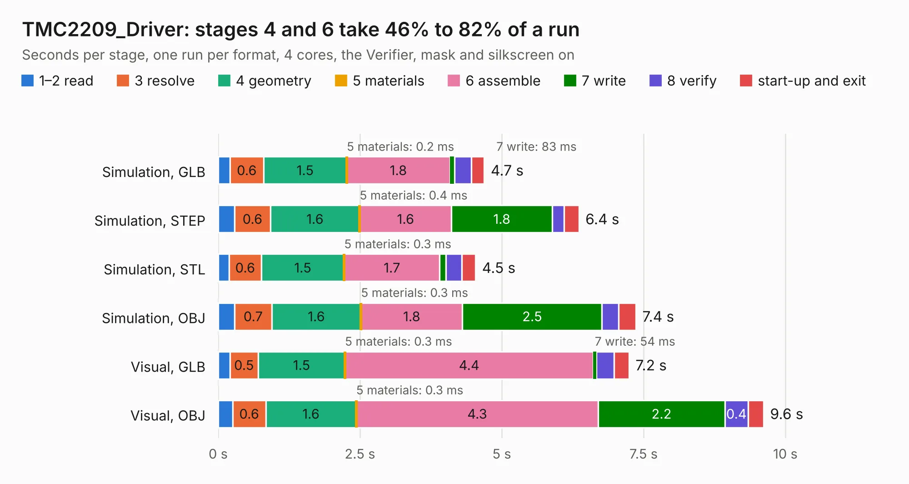

# 1022. TMC2209_Driver

Board 1,022 of the 3,102 of [Corpus Testing](../Corpus-Testing.md), on [Corpus Page 10](../CorpusTestingPages/Corpus-Testing-10.md#1022-tmc2209_driver).

| Mode and format | 1–2 read | 3 resolve | 4 geometry | 5 materials | 6 assemble | 7 write | 8 verify | start-up and exit | Total |
|---|---:|---:|---:|---:|---:|---:|---:|---:|---:|
| Simulation, GLB | 0.2 | 0.6 | 1.5 | 0.2&nbsp;ms | 1.8 | 83&nbsp;ms | 0.3 | 0.2 | 4.7 |
| Simulation, STEP | 0.3 | 0.6 | 1.6 | 0.4&nbsp;ms | 1.6 | 1.8 | 0.2 | 0.3 | 6.4 |
| Simulation, STL | 0.2 | 0.6 | 1.5 | 0.3&nbsp;ms | 1.7 | 0.1 | 0.3 | 0.2 | 4.5 |
| Simulation, OBJ | 0.3 | 0.7 | 1.6 | 0.3&nbsp;ms | 1.8 | 2.5 | 0.3 | 0.3 | 7.4 |
| Visual, GLB | 0.2 | 0.5 | 1.5 | 0.3&nbsp;ms | 4.4 | 54&nbsp;ms | 0.3 | 0.3 | 7.2 |
| Visual, OBJ | 0.3 | 0.6 | 1.6 | 0.3&nbsp;ms | 4.3 | 2.2 | 0.4 | 0.3 | 9.6 |

<table align="center"><tr><td valign="top">

| Board | Repo: [ghent360/prntrboardv2](https://github.com/ghent360/prntrboardv2) Board: `TMC2209_Driver.kicad_pcb` |
|---|---|
| Folder | hardware |
| Complexity | 249&nbsp;/&nbsp;1000 (size&nbsp;159, features&nbsp;90) |
| KESE&nbsp;features | through vias, rounded, trapezoid or chamfered pads, filled zones, curved board outline, stack-up, dielectric εr and tanδ, mask and silkscreen colours |
| Tested | 9th November 2026 |
| Copper&nbsp;layers | 2 |
| File&nbsp;format | KiCad 6 (20210925) |
| Parts,&nbsp;tracks,&nbsp;vias | 28, 349, 101 |
| Triangles,&nbsp;simulation | 341,348 in 56 parts |
| Verifier | PASS in all six runs |

</td><td valign="top">

<table>
<tr><th>File type</th><th>File size</th><th>Peak memory used</th></tr>
<tr><th colspan="3" align="left">Simulation</th></tr>
<tr><td>GLB</td><td align="right">12&nbsp;MB</td><td align="right">259&nbsp;MB</td></tr>
<tr><td>STEP</td><td align="right">54&nbsp;MB</td><td align="right">292&nbsp;MB</td></tr>
<tr><td>STL</td><td align="right">17&nbsp;MB</td><td align="right">261&nbsp;MB</td></tr>
<tr><td>OBJ</td><td align="right">34&nbsp;MB</td><td align="right">291&nbsp;MB</td></tr>
<tr><th colspan="3" align="left">Visual</th></tr>
<tr><td>GLB</td><td align="right">9.5&nbsp;MB</td><td align="right">299&nbsp;MB</td></tr>
<tr><td>OBJ</td><td align="right">28&nbsp;MB</td><td align="right">295&nbsp;MB</td></tr>
</table>

</td></tr></table>

| Previous | Next |
|:---|---:|
| [1021. TMC2130_Driver](b1021b_prntrboardv2_TMC2130-Driver.md) | [1023. TMC2660_Driver](b1023b_prntrboardv2_TMC2660-Driver.md) |
