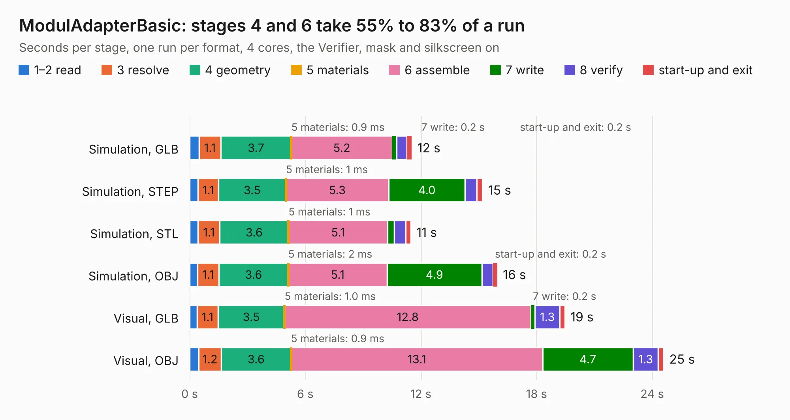

# 1024. ModulAdapterBasic

Board 1,024 of the 3,124 of [Corpus Testing](../Corpus-Testing.md), on [Corpus Page 10](../CorpusTestingPages/Corpus-Testing-10.md#1024-moduladapterbasic).

| Mode and format | 1–2 read | 3 resolve | 4 geometry | 5 materials | 6 assemble | 7 write | 8 verify | start-up and exit | Total |
|---|---:|---:|---:|---:|---:|---:|---:|---:|---:|
| Simulation, GLB | 0.5 | 1.1 | 3.7 | 0.9&nbsp;ms | 5.2 | 0.2 | 0.5 | 0.2 | 11.5 |
| Simulation, STEP | 0.4 | 1.1 | 3.5 | 1&nbsp;ms | 5.3 | 4.0 | 0.6 | 0.3 | 15.2 |
| Simulation, STL | 0.4 | 1.1 | 3.6 | 1&nbsp;ms | 5.1 | 0.3 | 0.6 | 0.3 | 11.5 |
| Simulation, OBJ | 0.4 | 1.1 | 3.6 | 2&nbsp;ms | 5.1 | 4.9 | 0.6 | 0.2 | 16.0 |
| Visual, GLB | 0.4 | 1.1 | 3.5 | 1.0&nbsp;ms | 12.8 | 0.2 | 1.3 | 0.3 | 19.5 |
| Visual, OBJ | 0.5 | 1.2 | 3.6 | 0.9&nbsp;ms | 13.1 | 4.7 | 1.3 | 0.3 | 24.6 |

<table align="center"><tr><td valign="top">

| Board | Repo: [GaudiLabs/OpenDrop](https://github.com/GaudiLabs/OpenDrop) Board: `ModulAdapterBasic.kicad_pcb` |
|---|---|
| Folder | OpenDropV4 / Electronics / ModulAdapter_basic / PCB |
| Complexity | 333&nbsp;/&nbsp;1000 (size&nbsp;248, features&nbsp;85) |
| KESE&nbsp;features | through vias, rounded, trapezoid or chamfered pads, filled zones, curved board outline, stack-up, dielectric εr and tanδ |
| Tested | 9th November 2026 |
| Copper&nbsp;layers | 2 |
| File&nbsp;format | KiCad 6 (20211014) |
| Parts,&nbsp;tracks,&nbsp;vias | 138, 1,749, 195 |
| Triangles,&nbsp;simulation | 1,100,508 in 404 parts |
| Verifier | PASS in all six runs |

</td><td valign="top">

<table>
<tr><th>File type</th><th>File size</th><th>Peak memory used</th></tr>
<tr><th colspan="3" align="left">Simulation</th></tr>
<tr><td>GLB</td><td align="right">37&nbsp;MB</td><td align="right">576&nbsp;MB</td></tr>
<tr><td>STEP</td><td align="right">195&nbsp;MB</td><td align="right">652&nbsp;MB</td></tr>
<tr><td>STL</td><td align="right">55&nbsp;MB</td><td align="right">546&nbsp;MB</td></tr>
<tr><td>OBJ</td><td align="right">112&nbsp;MB</td><td align="right">765&nbsp;MB</td></tr>
<tr><th colspan="3" align="left">Visual</th></tr>
<tr><td>GLB</td><td align="right">34&nbsp;MB</td><td align="right">707&nbsp;MB</td></tr>
<tr><td>OBJ</td><td align="right">104&nbsp;MB</td><td align="right">876&nbsp;MB</td></tr>
</table>

</td></tr></table>

| Previous | Next |
|:---|---:|
| [1023. DIMMCartridge_heaters](b1023b_OpenDrop_DIMMCartridge-heaters.md) | [1025. ModulAdapterMagnet](b1025b_OpenDrop_ModulAdapterMagnet.md) |
