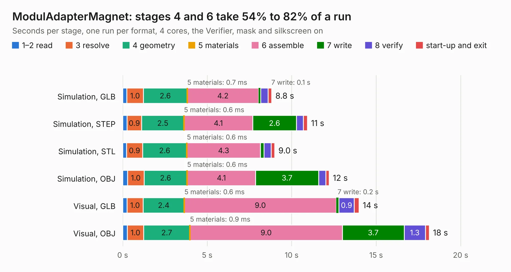

# 1024. ModulAdapterMagnet

Board 1,024 of the 3,120 of [Corpus Testing](../Corpus-Testing.md), on [Corpus Page 10](../CorpusTestingPages/Corpus-Testing-10.md#1024-moduladaptermagnet).

| Mode and format | 1–2 read | 3 resolve | 4 geometry | 5 materials | 6 assemble | 7 write | 8 verify | start-up and exit | Total |
|---|---:|---:|---:|---:|---:|---:|---:|---:|---:|
| Simulation, GLB | 0.2 | 1.0 | 2.6 | 0.7&nbsp;ms | 4.2 | 0.1 | 0.4 | 0.2 | 8.8 |
| Simulation, STEP | 0.3 | 0.9 | 2.5 | 0.6&nbsp;ms | 4.1 | 2.6 | 0.4 | 0.2 | 10.9 |
| Simulation, STL | 0.2 | 0.9 | 2.6 | 0.6&nbsp;ms | 4.3 | 0.2 | 0.4 | 0.2 | 9.0 |
| Simulation, OBJ | 0.3 | 1.0 | 2.6 | 0.6&nbsp;ms | 4.1 | 3.7 | 0.4 | 0.2 | 12.2 |
| Visual, GLB | 0.3 | 1.0 | 2.4 | 0.6&nbsp;ms | 9.0 | 0.2 | 0.9 | 0.3 | 14.0 |
| Visual, OBJ | 0.3 | 1.0 | 2.7 | 0.9&nbsp;ms | 9.0 | 3.7 | 1.3 | 0.2 | 18.1 |

<table align="center"><tr><td valign="top">

| Board | Repo: [GaudiLabs/OpenDrop](https://github.com/GaudiLabs/OpenDrop) Board: `ModulAdapterMagnet.kicad_pcb` |
|---|---|
| Folder | OpenDropV4 / Electronics / ModulAdapter_Magnet / PCB |
| Complexity | 285&nbsp;/&nbsp;1000 (size&nbsp;230, features&nbsp;55) |
| KESE&nbsp;features | through vias, rounded, trapezoid or chamfered pads, filled zones, curved board outline |
| Tested | 9th November 2026 |
| Copper&nbsp;layers | 2 |
| File&nbsp;format | KiCad 5 (20171130) |
| Parts,&nbsp;tracks,&nbsp;vias | 25, 1,746, 207 |
| Triangles,&nbsp;simulation | 876,500 in 175 parts |
| Verifier | PASS in all six runs |

</td><td valign="top">

<table>
<tr><th>File type</th><th>File size</th><th>Peak memory used</th></tr>
<tr><th colspan="3" align="left">Simulation</th></tr>
<tr><td>GLB</td><td align="right">30&nbsp;MB</td><td align="right">481&nbsp;MB</td></tr>
<tr><td>STEP</td><td align="right">152&nbsp;MB</td><td align="right">542&nbsp;MB</td></tr>
<tr><td>STL</td><td align="right">44&nbsp;MB</td><td align="right">477&nbsp;MB</td></tr>
<tr><td>OBJ</td><td align="right">90&nbsp;MB</td><td align="right">634&nbsp;MB</td></tr>
<tr><th colspan="3" align="left">Visual</th></tr>
<tr><td>GLB</td><td align="right">28&nbsp;MB</td><td align="right">715&nbsp;MB</td></tr>
<tr><td>OBJ</td><td align="right">87&nbsp;MB</td><td align="right">724&nbsp;MB</td></tr>
</table>

</td></tr></table>

| Previous | Next |
|:---|---:|
| [1023. ModulAdapterBasic](b1023b_OpenDrop_ModulAdapterBasic.md) | [1025. ModulAdapter_universal](b1025b_OpenDrop_ModulAdapter-universal.md) |
