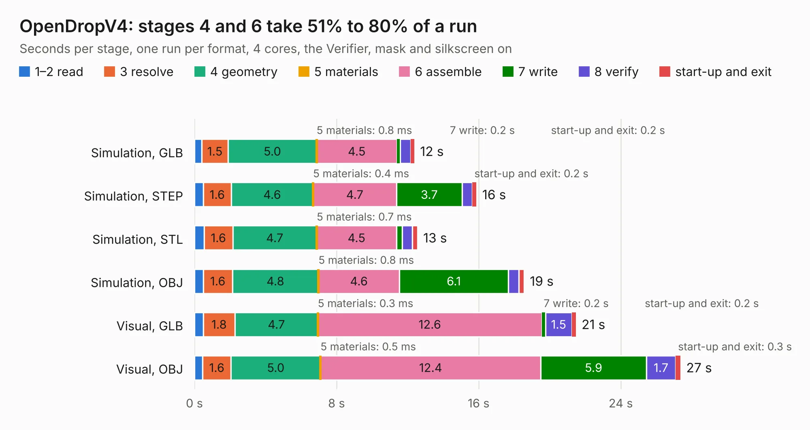

# 1027. OpenDropV4

Board 1,027 of the 3,125 of [Corpus Testing](../Corpus-Testing.md), on [Corpus Page 10](../CorpusTestingPages/Corpus-Testing-10.md#1027-opendropv4).

| Mode and format | 1–2 read | 3 resolve | 4 geometry | 5 materials | 6 assemble | 7 write | 8 verify | start-up and exit | Total |
|---|---:|---:|---:|---:|---:|---:|---:|---:|---:|
| Simulation, GLB | 0.4 | 1.5 | 5.0 | 0.8&nbsp;ms | 4.5 | 0.2 | 0.6 | 0.2 | 12.4 |
| Simulation, STEP | 0.5 | 1.6 | 4.6 | 0.4&nbsp;ms | 4.7 | 3.7 | 0.6 | 0.2 | 15.9 |
| Simulation, STL | 0.5 | 1.6 | 4.7 | 0.7&nbsp;ms | 4.5 | 0.3 | 0.6 | 0.3 | 12.6 |
| Simulation, OBJ | 0.5 | 1.6 | 4.8 | 0.8&nbsp;ms | 4.6 | 6.1 | 0.6 | 0.3 | 18.6 |
| Visual, GLB | 0.5 | 1.8 | 4.7 | 0.3&nbsp;ms | 12.6 | 0.2 | 1.5 | 0.2 | 21.5 |
| Visual, OBJ | 0.5 | 1.6 | 5.0 | 0.5&nbsp;ms | 12.4 | 5.9 | 1.7 | 0.3 | 27.4 |

<table align="center"><tr><td valign="top">

| Board | Repo: [GaudiLabs/OpenDrop](https://github.com/GaudiLabs/OpenDrop) Board: `OpenDropV4.kicad_pcb` |
|---|---|
| Folder | OpenDropV4 / Electronics / OpenDropV4_MainBoard / PCB |
| Complexity | 303&nbsp;/&nbsp;1000 (size&nbsp;238, features&nbsp;65) |
| KESE&nbsp;features | through vias, slotted holes, rounded, trapezoid or chamfered pads, filled zones, curved board outline |
| Tested | 9th November 2026 |
| Copper&nbsp;layers | 2 |
| File&nbsp;format | KiCad 5 (20171130) |
| Parts,&nbsp;tracks,&nbsp;vias | 114, 2,175, 197 |
| Triangles,&nbsp;simulation | 1,200,262 in 117 parts |
| Verifier | PASS in all six runs |

</td><td valign="top">

<table>
<tr><th>File type</th><th>File size</th><th>Peak memory used</th></tr>
<tr><th colspan="3" align="left">Simulation</th></tr>
<tr><td>GLB</td><td align="right">42&nbsp;MB</td><td align="right">645&nbsp;MB</td></tr>
<tr><td>STEP</td><td align="right">222&nbsp;MB</td><td align="right">670&nbsp;MB</td></tr>
<tr><td>STL</td><td align="right">60&nbsp;MB</td><td align="right">665&nbsp;MB</td></tr>
<tr><td>OBJ</td><td align="right">125&nbsp;MB</td><td align="right">838&nbsp;MB</td></tr>
<tr><th colspan="3" align="left">Visual</th></tr>
<tr><td>GLB</td><td align="right">39&nbsp;MB</td><td align="right">798&nbsp;MB</td></tr>
<tr><td>OBJ</td><td align="right">117&nbsp;MB</td><td align="right">858&nbsp;MB</td></tr>
</table>

</td></tr></table>

| Previous | Next |
|:---|---:|
| [1026. ModulAdapter_universal](b1026b_OpenDrop_ModulAdapter-universal.md) | [1028. OpenFrame](b1028b_OpenDrop_OpenFrame.md) |
