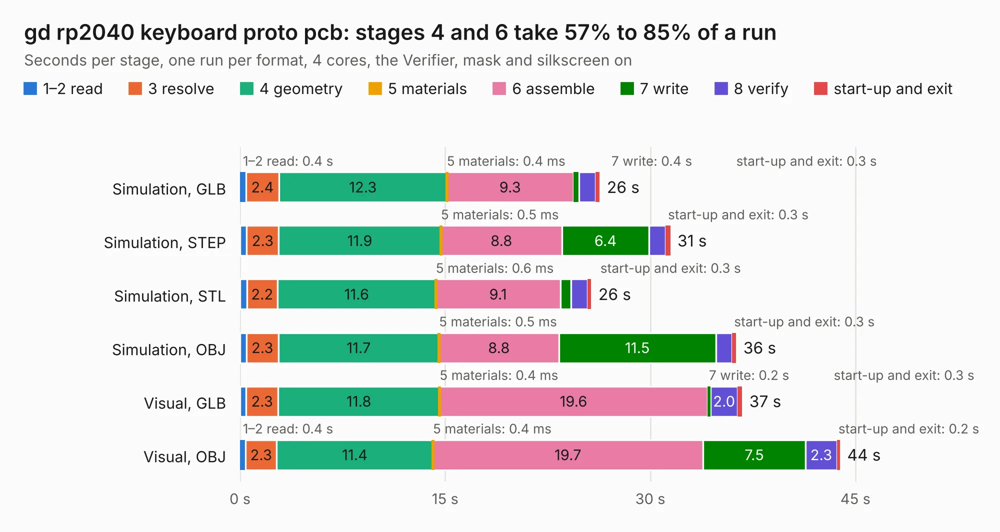

# 1028. gd rp2040 keyboard proto pcb

Board 1,028 of the 3,122 of [Corpus Testing](../Corpus-Testing.md), on [Corpus Page 10](../CorpusTestingPages/Corpus-Testing-10.md#1028-gd-rp2040-keyboard-proto-pcb).

| Mode and format | 1–2 read | 3 resolve | 4 geometry | 5 materials | 6 assemble | 7 write | 8 verify | start-up and exit | Total |
|---|---:|---:|---:|---:|---:|---:|---:|---:|---:|
| Simulation, GLB | 0.4 | 2.4 | 12.3 | 0.4&nbsp;ms | 9.3 | 0.4 | 1.2 | 0.3 | 26.3 |
| Simulation, STEP | 0.5 | 2.3 | 11.9 | 0.5&nbsp;ms | 8.8 | 6.4 | 1.2 | 0.3 | 31.5 |
| Simulation, STL | 0.5 | 2.2 | 11.6 | 0.6&nbsp;ms | 9.1 | 0.8 | 1.2 | 0.3 | 25.7 |
| Simulation, OBJ | 0.5 | 2.3 | 11.7 | 0.5&nbsp;ms | 8.8 | 11.5 | 1.2 | 0.3 | 36.3 |
| Visual, GLB | 0.5 | 2.3 | 11.8 | 0.4&nbsp;ms | 19.6 | 0.2 | 2.0 | 0.3 | 36.7 |
| Visual, OBJ | 0.4 | 2.3 | 11.4 | 0.4&nbsp;ms | 19.7 | 7.5 | 2.3 | 0.2 | 43.9 |

<table align="center"><tr><td valign="top">

| Board | Repo: [geekbozu/Golden-Delicious](https://github.com/geekbozu/Golden-Delicious) Board: `gd rp2040 keyboard proto pcb.kicad_pcb` |
|---|---|
| Folder | kicad files / gd rp2040 keyboard proto pcb / kicad |
| Complexity | 278&nbsp;/&nbsp;1000 (size&nbsp;213, features&nbsp;65) |
| KESE&nbsp;features | through vias, slotted holes, rounded, trapezoid or chamfered pads, filled zones, curved board outline |
| Tested | 9th November 2026 |
| Copper&nbsp;layers | 2 |
| File&nbsp;format | KiCad 5 (20171130) |
| Parts,&nbsp;tracks,&nbsp;vias | 60, 645, 97 |
| Triangles,&nbsp;simulation | 2,321,572 in 111 parts |
| Verifier | PASS in all six runs |

</td><td valign="top">

<table>
<tr><th>File type</th><th>File size</th><th>Peak memory used</th></tr>
<tr><th colspan="3" align="left">Simulation</th></tr>
<tr><td>GLB</td><td align="right">80&nbsp;MB</td><td align="right">854&nbsp;MB</td></tr>
<tr><td>STEP</td><td align="right">405&nbsp;MB</td><td align="right">984&nbsp;MB</td></tr>
<tr><td>STL</td><td align="right">116&nbsp;MB</td><td align="right">805&nbsp;MB</td></tr>
<tr><td>OBJ</td><td align="right">246&nbsp;MB</td><td align="right">1.6&nbsp;GB</td></tr>
<tr><th colspan="3" align="left">Visual</th></tr>
<tr><td>GLB</td><td align="right">52&nbsp;MB</td><td align="right">1.0&nbsp;GB</td></tr>
<tr><td>OBJ</td><td align="right">159&nbsp;MB</td><td align="right">1.1&nbsp;GB</td></tr>
</table>

</td></tr></table>

| Previous | Next |
|:---|---:|
| [1027. OpenFrame](b1027b_OpenDrop_OpenFrame.md) | [1029. DRV-StepStick](b1029b_prntrboardv2_DRV-StepStick.md) |
