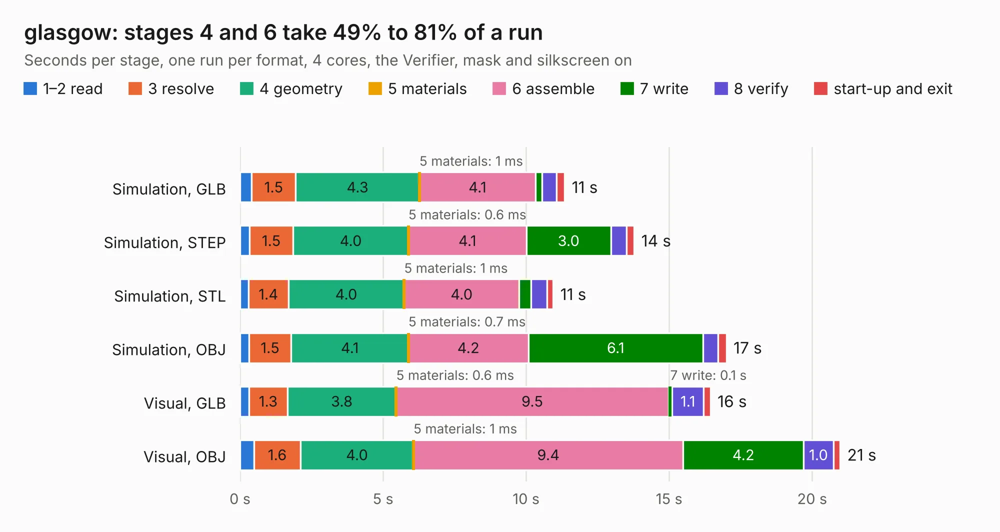

# 1029. glasgow

Board 1,029 of the 3,103 of [Corpus Testing](../Corpus-Testing.md), on [Corpus Page 10](../CorpusTestingPages/Corpus-Testing-10.md#1029-glasgow).

| Mode and format | 1–2 read | 3 resolve | 4 geometry | 5 materials | 6 assemble | 7 write | 8 verify | start-up and exit | Total |
|---|---:|---:|---:|---:|---:|---:|---:|---:|---:|
| Simulation, GLB | 0.4 | 1.5 | 4.3 | 1&nbsp;ms | 4.1 | 0.2 | 0.5 | 0.3 | 11.3 |
| Simulation, STEP | 0.3 | 1.5 | 4.0 | 0.6&nbsp;ms | 4.1 | 3.0 | 0.5 | 0.3 | 13.8 |
| Simulation, STL | 0.3 | 1.4 | 4.0 | 1&nbsp;ms | 4.0 | 0.4 | 0.6 | 0.2 | 10.9 |
| Simulation, OBJ | 0.3 | 1.5 | 4.1 | 0.7&nbsp;ms | 4.2 | 6.1 | 0.5 | 0.3 | 17.0 |
| Visual, GLB | 0.3 | 1.3 | 3.8 | 0.6&nbsp;ms | 9.5 | 0.1 | 1.1 | 0.2 | 16.4 |
| Visual, OBJ | 0.5 | 1.6 | 4.0 | 1&nbsp;ms | 9.4 | 4.2 | 1.0 | 0.2 | 21.0 |

<table align="center"><tr><td valign="top">

| Board | Repo: [GlasgowEmbedded/glasgow](https://github.com/GlasgowEmbedded/glasgow) Board: `glasgow.kicad_pcb` |
|---|---|
| Folder | hardware / boards / glasgow / revB |
| Complexity | 298&nbsp;/&nbsp;1000 (size&nbsp;253, features&nbsp;45) |
| KESE&nbsp;features | through vias, filled zones, curved board outline |
| Tested | 9th November 2026 |
| Copper&nbsp;layers | 4 |
| File&nbsp;format | KiCad 5 (20171130) |
| Parts,&nbsp;tracks,&nbsp;vias | 106, 1,300, 163 |
| Triangles,&nbsp;simulation | 1,302,156 in 156 parts |
| Verifier | PASS in all six runs |

</td><td valign="top">

<table>
<tr><th>File type</th><th>File size</th><th>Peak memory used</th></tr>
<tr><th colspan="3" align="left">Simulation</th></tr>
<tr><td>GLB</td><td align="right">45&nbsp;MB</td><td align="right">502&nbsp;MB</td></tr>
<tr><td>STEP</td><td align="right">166&nbsp;MB</td><td align="right">627&nbsp;MB</td></tr>
<tr><td>STL</td><td align="right">65&nbsp;MB</td><td align="right">497&nbsp;MB</td></tr>
<tr><td>OBJ</td><td align="right">134&nbsp;MB</td><td align="right">917&nbsp;MB</td></tr>
<tr><th colspan="3" align="left">Visual</th></tr>
<tr><td>GLB</td><td align="right">30&nbsp;MB</td><td align="right">663&nbsp;MB</td></tr>
<tr><td>OBJ</td><td align="right">90&nbsp;MB</td><td align="right">683&nbsp;MB</td></tr>
</table>

</td></tr></table>

| Previous | Next |
|:---|---:|
| [1028. glasgow](b1028b_glasgow_hardware-boards-glasgow-revA_glasgow.md) | [1030. glasgow](b1030b_glasgow_hardware-boards-glasgow-revC0_glasgow.md) |
