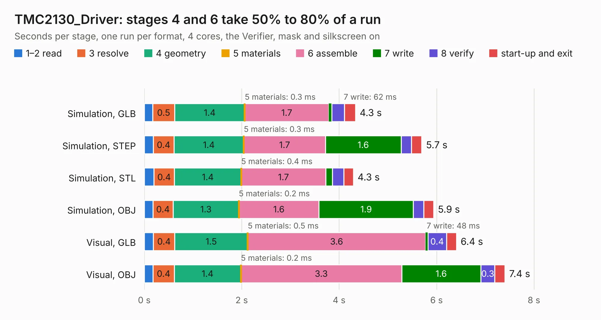

# 1030. TMC2130_Driver

Board 1,030 of the 3,116 of [Corpus Testing](../Corpus-Testing.md), on [Corpus Page 10](../CorpusTestingPages/Corpus-Testing-10.md#1030-tmc2130_driver).

| Mode and format | 1–2 read | 3 resolve | 4 geometry | 5 materials | 6 assemble | 7 write | 8 verify | start-up and exit | Total |
|---|---:|---:|---:|---:|---:|---:|---:|---:|---:|
| Simulation, GLB | 0.2 | 0.5 | 1.4 | 0.3&nbsp;ms | 1.7 | 62&nbsp;ms | 0.3 | 0.2 | 4.3 |
| Simulation, STEP | 0.2 | 0.4 | 1.4 | 0.3&nbsp;ms | 1.7 | 1.6 | 0.2 | 0.2 | 5.7 |
| Simulation, STL | 0.2 | 0.4 | 1.4 | 0.4&nbsp;ms | 1.7 | 0.1 | 0.2 | 0.2 | 4.3 |
| Simulation, OBJ | 0.2 | 0.4 | 1.3 | 0.2&nbsp;ms | 1.6 | 1.9 | 0.2 | 0.2 | 5.9 |
| Visual, GLB | 0.2 | 0.4 | 1.5 | 0.5&nbsp;ms | 3.6 | 48&nbsp;ms | 0.4 | 0.2 | 6.4 |
| Visual, OBJ | 0.2 | 0.4 | 1.4 | 0.2&nbsp;ms | 3.3 | 1.6 | 0.3 | 0.2 | 7.4 |

<table align="center"><tr><td valign="top">

| Board | Repo: [ghent360/prntrboardv2](https://github.com/ghent360/prntrboardv2) Board: `TMC2130_Driver.kicad_pcb` |
|---|---|
| Folder | hardware |
| Complexity | 253&nbsp;/&nbsp;1000 (size&nbsp;163, features&nbsp;90) |
| KESE&nbsp;features | through vias, rounded, trapezoid or chamfered pads, filled zones, curved board outline, stack-up, dielectric εr and tanδ, mask and silkscreen colours |
| Tested | 9th November 2026 |
| Copper&nbsp;layers | 2 |
| File&nbsp;format | KiCad 6 (20210925) |
| Parts,&nbsp;tracks,&nbsp;vias | 28, 429, 121 |
| Triangles,&nbsp;simulation | 384,240 in 59 parts |
| Verifier | PASS in all six runs |

</td><td valign="top">

<table>
<tr><th>File type</th><th>File size</th><th>Peak memory used</th></tr>
<tr><th colspan="3" align="left">Simulation</th></tr>
<tr><td>GLB</td><td align="right">13&nbsp;MB</td><td align="right">275&nbsp;MB</td></tr>
<tr><td>STEP</td><td align="right">60&nbsp;MB</td><td align="right">320&nbsp;MB</td></tr>
<tr><td>STL</td><td align="right">19&nbsp;MB</td><td align="right">271&nbsp;MB</td></tr>
<tr><td>OBJ</td><td align="right">39&nbsp;MB</td><td align="right">319&nbsp;MB</td></tr>
<tr><th colspan="3" align="left">Visual</th></tr>
<tr><td>GLB</td><td align="right">11&nbsp;MB</td><td align="right">324&nbsp;MB</td></tr>
<tr><td>OBJ</td><td align="right">32&nbsp;MB</td><td align="right">321&nbsp;MB</td></tr>
</table>

</td></tr></table>

| Previous | Next |
|:---|---:|
| [1029. T12_Control](b1029b_prntrboardv2_T12-Control.md) | [1031. TMC2209_Driver](b1031b_prntrboardv2_TMC2209-Driver.md) |
